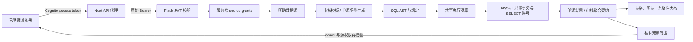

# P0 实施记录：可信入口、身份授权、SQL 防线与多库聚合

> 日期：2026-11-25。对应方案：[自动本体升级评估](../research/2026-11-25-auto-ontology-production-upgrade-assessment.md)。
> 状态：P0 核心工程改造与本地验证已完成；未部署到生产。真实身份服务、业务资产及业务 gold 集的验收仍须在目标环境完成。本文记录最终行为、复现方式和放量条件，不将替身测试等同于业务验收。

## 1. 范围与结论

本次将现有 ChatBI 查询链路接入统一执行防线，保留自然语言问答、SQL 模板、表格/图表、会话历史、SQL 展示、结果下载、离线 Prompt 生成及本体旁路。没有切换为 NVIDIA auto-ontology，也没有让自动生成的本体定义直接支配生产查询；这些属于后续阶段。

主要决策：

1. 复用项目已有的 Cognito 登录；Flask 自行验证 access JWT，Next.js 只转发凭证。客户端 `userId`、`X-User-Id` 均不能建立身份。
2. 先确定授权源，再初始化模型和生成查询；问题不明确时拒绝扩大范围。
3. 所有在线 SQL，包括模型修复后的 SQL，都经过 AST 校验、参数绑定、数据库只读事务、超时及容量限制。
4. 多库采用审核模板中的显式代数契约；拒绝无契约聚合，拒绝将部分失败或截断结果展示为完整总计。
5. 下载改为短期、受身份和源权限保护的接口；Docker 后端不再复制 `.env`，查询日志不输出问题、SQL、结果或凭证。

### 1.1 与原方案 P0 的映射

| 原缺口 | 本次落地 | 验证 | 状态 |
|---|---|---|---|
| 未定义 HelloWorld 导致入口失败 | `create_app()`、WSGI `app`、健康/就绪路由；导入不触发模型调用 | Flask 完整路由测试、无环境导入测试 | 已完成 |
| 客户端身份可伪造 | RS256/JWKS/issuer/client_id/token_use/时间声明校验；服务端源授权 | 合成 RSA 签名、错误签名/声明/过期/伪造身份测试 | 工程完成，真实 Cognito 待联调 |
| 模板值字符串格式化 | `{0}` 迁移为驱动绑定；参数顺序由审核定义控制 | 注入字符串、IN 列表、百分号、实库执行 | 已完成 |
| 查询无独立执行防线 | SQLGlot、只读事务、只读账号部署约束、预算/行数/字节上限 | 单测与真实 MySQL | 已完成；生产账号权限待核验 |
| 未匹配时查询所有库 | 授权后选源；多可选源歧义返回 422 | 越权、歧义、单授权源回归 | 已完成 |
| 所有度量一律相加 | sum/min/max/weighted_avg/ratio 契约 | 数学反例、粒度/表达式校验、实库加权平均 | 已完成受限联邦能力 |
| 源失败丢失 | 每源显式状态；失败/截断不可合并 | 连接失败、部分失败、截断、禁止首库重试 | 已完成 |
| `.env` 入镜像、日志与下载暴露 | Docker 忽略敏感文件、运行时注入、私有导出 | 代码核验、下载 owner/撤权/过期测试 | 已完成代码改造；镜像部署待验证 |
| 资产盘点、gold 与基线 | 仓库样例盘点、109 项通过的测试基线 | 见第 8 节 | 工程基线完成；200 条真实业务题尚未建立 |

## 2. 改动位置与调用边界



| 文件 | 职责 |
|---|---|
| `main.py` | 入口、认证先行、输入上限、健康检查、错误脱敏、下载接口 |
| `server/auth.py` | Cognito access JWT 验证、源授权、管理员身份 |
| `server/conf.py` | 数据源配置校验、授权范围路由、审核模板加载 |
| `server/query_policy.py` | SQL AST 策略和模板绑定 |
| `server/execution.py` | 单源/多源统一执行、预算和失败状态 |
| `server/db/mysql.py` | 只读事务、服务端执行超时、流式读取及连接关闭 |
| `server/federation.py` | 契约校验、局部 SQL 形状校验、确定性合并 |
| `server/api.py` | 保持现有返回字段，接入安全路径和受控修复 |
| `server/exports.py` | owner/source/TTL/容量约束的 CSV 导出 |
| `mainproxy.py`、`server/llm.py` | 可选模型代理的服务认证、模型输出与时间限制 |
| `utils/server/backend.ts`、`pages/api/*` | Bearer 转发、状态保留、管理员路由门禁 |
| `utils/app/authFetch.ts`、Chat 相关组件 | 获取登录凭证、保护下载、完整 JSON 读取 |
| `requirements.lock`、`DockerfileServer` | Python 3.12 哈希锁定依赖、去除构建期凭证复制 |

`server/db/mysql.py` 的历史 `fetch_one/get_binlog_info` 和 `utils/server/index.ts` 的旧执行辅助函数仍供历史/离线代码引用，未暴露为本次在线查询入口。新增线上执行路径必须调用统一网关，不得重新接通这些旧函数。全局 Prompt 读取辅助函数中的内容日志已移除；离线工具仍需在受控作业环境运行。

## 3. 身份、入口与权限

### 3.1 请求与响应契约

- 浏览器调用 `/api/chat`：POST，JSON `{ "messages": [...], "sourceIds": ["east"] }`；`sourceIds` 可省略。
- Next 转发到 `/queryllm`：`{ "messages": [...], "source_ids": ["east"] }`。
- 两层均使用 `Authorization: Bearer <Cognito access token>`；不能用 ID token 代替。
- Flask 兼容旧消息数组请求，但同样要求有效 Bearer。
- 消息最多 40 条，单条内容 1～16,384 字符，请求体最多 1 MiB；角色只允许 user/assistant，最后一条为 user。
- 请求内额外身份、SQL 等字段不会进入查询服务。
- 成功保留 `content/mdData/chartData/sql/chartType/extra`，新增 `status/truncated/sources`。
- 失败使用 `error.code/error.message`，保留 HTTP 状态；Next 不再把后端失败包装为 200。
- Flask 返回 `X-Trace-Id`、`Cache-Control: no-store`、`X-Content-Type-Options: nosniff`。

| HTTP | 典型错误码 | 处理 |
|---|---|---|
| 401 | AUTH_REQUIRED / INVALID_TOKEN | 重新登录，不使用客户端 userId 补救 |
| 403 | FORBIDDEN_SCOPE | 修改服务端授权或选择已有权限的源 |
| 422 | AMBIGUOUS_SOURCE | 明确源；UI 可用问题中的源描述，API 可传 sourceIds |
| 422 | SQL_REJECTED / MERGE_CONTRACT_REQUIRED / INCOMPLETE_RESULT | 修正审核模板、查询范围或口径，禁止绕过网关 |
| 429 | BUDGET_EXCEEDED | 缩小查询、减少源数量；不是无限重试提示 |
| 502 | SOURCE_QUERY_FAILED / PARTIAL_RESULT | 核对源状态，不展示残缺总计 |
| 503 | AUTH_CONFIGURATION / SOURCE_CONFIGURATION / TEMPLATE_CONFIGURATION | 部署配置不完整，修复后重启 |
| 501 | UPLOAD_NOT_IMPLEMENTED | 原文件导入没有实际处理实现，现明确拒绝虚假成功 |

多库执行中的预算错误保留在内部源状态中，汇总入口可能将其映射为 PARTIAL_RESULT；错误响应不包含原始驱动文本。

### 3.2 Cognito 与授权配置

以下是配置形状示例，值均须替换，不是可直接用于生产的账号：

```dotenv
BACK_USER_POOL_REGION=us-east-1
BACK_USER_POOL_ID=us-east-1_REPLACE
BACK_USER_CLIENT_ID=REPLACE
AUTH_SOURCE_GRANTS={"group:bi-readers":["east"],"sub:replace-with-cognito-sub":["east","west"]}
AUTH_ADMIN_GROUPS=bi-admins
SOURCE_SCENARIOS={"east":["订单"],"west":["订单"]}
```

- `MYSQL_KEY` 就是授权使用的 source_id。`sub:` 指 Cognito 的稳定 sub，不是用户名。
- 不接受 `*` 源授权；没有授权即不可查询。管理员并不自动获得全部数据源。
- JWKS 只取自配置中的 Cognito issuer，不能由 token 的 URL 声明决定；缓存签名 key set 300 秒，取 key 超时 5 秒。
- 检查 RS256 签名、issuer、client_id、token_use=access、exp/iat/sub 等必需声明。access token 使用 client_id 校验；这里没有把 ID token 的 aud 规则误用于 access token。
- Next 的 `/api/getDefaultPrompt` 和 `/api/updateFaissIndex` 需要后端验证过的管理员身份；旧硬编码索引 key 已删除。
- `/api/getConfig` 保持公开，因为登录前需要用户池公开配置；不返回密钥。
- `/auth/session` 需要有效身份，返回 subject、admin、source_ids。
- JWT 本地验证不能实现 Cognito 令牌的即时撤销。登出/组移除后的旧 token 可能在到期前仍有效；应配置合理 access token 寿命，紧急撤权同时更新服务端 grants 并滚动重启。没有实现全局 denylist。
- grants 在每次认证（包括下载）重新读取进程环境；更改部署配置仍须重启所有进程。模板与场景发布同样以滚动重启生效，本次不支持在线热发布。

### 3.3 数据与元数据范围

先取“配置源 ∩ 身份授权源”，再处理显式源或问题中的源描述。只有一个授权源可默认选中；有多个授权源且问题没有明确目标，返回 422。单次最多 8 源。

多源部署的生成式单源查询必须配置 `SOURCE_SCENARIOS`；其选场景上下文仅保留该源的场景。`Examples/ChartPrompt/HardPrompt/DefaultPrompt` 属于全局共享指令，部署方须确认不含其他租户的数据样例。P0 实现数据源级授权，不宣称已实现完整行级、列级、指标级 ABAC；数据库账号必须仅能 SELECT 被批准的数据/视图。带 DEFINER 权限的视图也需审核，不能借视图把其他敏感库映射进来。

## 4. SQL 执行防线

### 4.1 SQL 策略

允许单条 SELECT/UNION，单源可使用合法 CTE、子查询、窗口及白名单分析函数；支持 MySQL 方言。拒绝 DDL/DML、多个语句、INTO/OUTFILE、锁、事务或 session 指令、外部库/catalog、动态表及未知/有副作用函数。

保守地拒绝 SQL 文本中的 `/*`、`--`、`#`，即使出现在 SQL 字面量中也会拒绝。正常业务文本应通过参数绑定传入，绑定值中的这些字符不改变 SQL 结构。未列入白名单的函数需代码评审后扩展，不能让模型自行放行。

模板中的完整值槽支持 `'{0}'` 与 `{0}`；IN 的完整值列表支持 1～100 个标量。拒绝字符串内部插槽、动态表名、动态排序/分页位置、格式转换器及数量不匹配。多参数模板必须显式指定 `condition_keys`，避免模型 JSON 字段顺序变化导致参数错位。

### 4.2 数据库保护与资源预算

执行顺序：解析并校验 → 预算扣减 → 建连 → 设置 `MAX_EXECUTION_TIME` → `START TRANSACTION READ ONLY` → 执行 → 有界流式读取 → 关闭连接。建立只读或超时保护失败就停止，禁止降级成普通事务。线上不执行 commit，不保留到连接池。

| 配置 | 默认 | 允许范围 | 作用 |
|---|---:|---:|---|
| QUERY_DEADLINE_SECONDS | 60 秒 | 1～600 | 请求级共享截止时间 |
| QUERY_MAX_SQL_CALLS | 16 | 1～32 | 所有源与重试共享 SQL 调用数 |
| SQL_TIMEOUT_SECONDS | 15 秒 | 1～120 | 每源 SQL 时间上限，取剩余预算更小者 |
| SQL_MAX_RESULT_ROWS | 10,000 | 1～100,000 | 每源返回行数 |
| SQL_MAX_RESULT_BYTES | 8 MiB | 1 KiB～32 MiB | 每源累计单元格字符串字节数 |
| MAX_ROW_COUNT_RETURN | 50 | 1～10,000 | UI 展示行数；仓库 env 模板设为 10 |

最多 4 个源并发。参数、SQL、结果在日志中均不输出。预算不是分布式并发限流：入口还需按用户/租户设置吞吐与成本限额。

读取附加一行探测截断；截断的单源结果明确标识且不提供“完整导出”，截断的多源结果拒绝汇总。字节数上限统计的是数据单元格编码体积，不是严格的 Python 进程峰值内存上限；单个超大 MySQL 数据包仍可能先占用驱动内存。应配合列选择、数据库包限制及容器内存限制。

请求截止时间是协作式检查。数据库有服务端 SELECT 超时与 socket 超时；Bedrock 客户端连接/读取分别为 5/30 秒，无 SDK 自动重试，流事件之间检查截止时间。因此某个阻塞 I/O 可使总耗时略超请求预算，不承诺精确 60 秒硬取消。浏览器取消也不等于 MySQL 已立即终止，后端预算仍负责清理。

### 4.3 MySQL 部署要求

本次实测 MySQL 8.0；不宣称已验证 MariaDB 或旧版 MySQL。保护语句不支持时拒绝查询。

由 DBA 按数据源创建独立 SELECT 账号，以下只表达最小授权意图：

```sql
CREATE USER 'bi_east_reader'@'<backend-network>' IDENTIFIED BY '<managed-secret>';
GRANT SELECT ON approved_east.* TO 'bi_east_reader'@'<backend-network>';
```

生产可进一步只授予审核视图。不得授予 FILE、写入、DDL、存储例程执行和无关数据库权限。核验 `SHOW GRANTS`、业务账号实际可见表和 DEFINER 视图，不能因为代码设置了 READ ONLY 就跳过账号隔离。目标网络上的 MySQL TLS 连接策略尚未在本次临时本地数据库测试中验证。

### 4.4 修复策略

只有单源、非绑定模板生成的 SQL，在 MySQL 1054/1064/1146 类错误下允许一次模型修复。修复使用同一预算、同一授权源，并重新进入完整网关。其他数据库失败不盲目重试。绑定模板不让修复模型重新解释参数；多源不允许“某源失败后只重跑第一库”。

## 5. 多库契约与可运行配置形状

P0 将联邦范围收窄为**同构、互斥分区、单表局部聚合**。合同中的 `disjoint_partitions=true` 是审核责任声明，程序不能仅凭布尔值证明两个业务库没有重叠数据。

支持：sum、min、max、weighted_avg、ratio。禁止直接相加 AVG、跨源 COUNT DISTINCT、分位数；不支持跨源 JOIN、源内 JOIN 的自动 fanout 推断、全局 TOP K、HAVING、窗口、CTE/子查询及局部 LIMIT/OFFSET 的多源合并。单源合法分析 SQL 不受这些联邦专用限制。

### 5.1 示例

将下面两个文件放到**独立、已审核、只读挂载**的 `SQL_TEMPLATE_PATH` 目录。示例假设两个源均存在 `orders(city, amount, order_date)`；不得直接指向未经核实的真实业务库。

`summary.json`：

```json
[
  {
    "question": "统计 2026-01-01 起各城市的订单平均金额",
    "params": ["2026-01-01"],
    "condition_keys": ["日期>="],
    "source_ids": ["east", "west"],
    "sql": "city-average.sql",
    "merge": {
      "version": 1,
      "sources": ["east", "west"],
      "disjoint_partitions": true,
      "dimensions": ["city"],
      "measures": {
        "average_amount": {
          "op": "weighted_avg",
          "numerator": "amount_sum",
          "denominator": "amount_count"
        }
      }
    }
  }
]
```

`city-average.sql`：

```sql
SELECT city, SUM(amount) AS amount_sum, COUNT(amount) AS amount_count
FROM orders
WHERE order_date >= '{0}'
GROUP BY city
```

模板元信息仍由既有 LLM 匹配流程提取。`condition_keys` 中的业务条件名称必须和批准的匹配元信息一致；若模型给出不同条件键，明确拒绝，不猜测映射。P1 应进一步把模板意图/槽位元信息纳入审核资产，以减少启动时推断的不确定性。

每个源的 SQL 输出名、数量、聚合函数及 GROUP BY 粒度必须和契约精确对应。每源每维度只允许一行，重复维度行拒绝合并。weighted_avg 使用 `SUM(numerator)/SUM(denominator)`；ratio 同样先合并分子分母；分母为 0 返回 NULL。NULL/非有限度量不偷偷转为零。使用 Decimal 运算，JSON 对 Decimal 可序列化为字符串；既有图表转换为数值，CSV 保留精度。

示例中 east 是 100/1，west 是 0/9，正确总平均为 10，不能相加得到 100 或把两个平均再取平均得到 50。该反例已在真实数据库验证。

### 5.2 审核与完整性要求

- 分区互斥、相同币种/单位/时区/指标口径、兼容列类型，由业务 owner 审核。
- `SUM(amount)` 必须配 `COUNT(amount)`，不能误配 `COUNT(other_column)`；AST 能确认 SUM/COUNT 形式，但不能证明业务意义相同。
- 任一源不可用、字段不匹配或结果截断：整体失败，不返回完整总计。
- 两个独立只读事务不构成跨库一致性快照。对同一时点有要求的指标，须用统一截止时间/已结账分区/离线快照，不能拿在线不同时间读数做强一致对账。
- 本次支持相同 SQL 运行于不同源；没有按源自动映射不同表/列名。异构映射留给后续批准语义层。
- 原模板若未指定 source_ids，只在单配置源部署中自动兼容；多源部署必须补充审核源范围。单参数旧模板兼容，多参数必须补 condition_keys。
- 仓库原 `1.sql` 缺少 GROUP BY，不能据其存在认定已通过 MySQL strict mode 或口径审阅。生产模板目录应由业务负责人替换/审核；本次未擅自推断其数据源和业务口径。

## 6. 下载、兼容性与运行边界

结果超过展示上限但未截断时，生成 CSV（UTF-8 BOM），`extra` 返回 `/api/downloads/<opaque-id>`。浏览器携带当前 access token 下载，Flask 重新验证 owner 与全部源权限。不同用户、源权限被移除、ID 非法或超过 10 分钟均不可读。CSV 字符串以 `= + - @` 开始时做公式转义。

导出目录 `QUERY_EXPORT_PATH` 默认 `var/exports`；SQLite 文件权限 0600、新目录 0700，每项最多 16 MiB，累计有效数据最多 128 MiB、1,000 项。有效期结束即不能下载；物理清理在下一次访问时触发，设置 secure_delete，但不等于 SSD/备份级不可恢复删除。

生产当前以单实例/同机多进程共享本地目录为边界。多节点不能依赖各自本地文件命中下载，应先接入共享、授权的导出存储或保持会话路由；网络文件系统上的 SQLite 不是本次验证范围。卷备份和磁盘加密由部署环境承担。

保留：

- 原 response 字段、单源模板/生成式问答、表格、BarChartPic/LineChartPic/PieChartPic 标识与 CSV 下载。
- 离线 Prompt CLI、本体抽取/审核/版本/影子对照；原有 44 项回归通过。
- 模型代理功能，新增两端相同的至少 32 字符随机 `LLM_PROXY_TOKEN`；代理应部署在私网并使用 TLS/受保护隧道。

明确变化：

- 未登录、无权限、歧义多源不再继续查询。
- 旧公共下载链接不再由新 UI 使用；历史会话需重新查询生成受保护链接。
- 文件导入原来是空实现，现返回 501；没有谎称恢复不存在的数据治理功能。
- `updateFaissIndex()` 原逻辑仍返回空数组，本次只封堵未授权入口，没有实现在线索引发布。
- 对单份 JSON 响应完整读取后再更新会话，修复旧客户端按传输分片解析 JSON 的问题；请求中止及异常均清理轮询状态。

## 7. 启动、迁移与回退

### 7.1 依赖与启动

```bash
python3.12 -m venv .venv
.venv/bin/pip install --require-hashes -r requirements.lock
npm ci
```

`requirement.txt` 是直接依赖输入，`requirements.lock` 是 Python 3.12 的全量带哈希锁；后端 Docker 使用后者。更新依赖时执行 `uv pip compile requirement.txt --python-version 3.12 --universal --generate-hashes -o requirements.lock`，并重新跑安全与数据库回归。

本地开发若确需读取环境文件：

```bash
APP_ENV_FILE=.env .venv/bin/python main.py
```

本地文件加载只补充尚未设置的变量，不覆盖运行时注入。WSGI 导入 `main:app` 不自动加载该文件；生产使用容器/平台的 secret 注入。禁止把真实环境文件加进构建上下文；本次 `.dockerignore` 排除了 `.env`、`.env.*`、`.git` 和运行数据。

后端镜像使用方式（本次未完成镜像构建与生产部署验收）：

```bash
docker build -f DockerfileServer -t chatbi-server:p0 .
docker run --env-file /secure/runtime.env \
  -p 127.0.0.1:5018:80 \
  -v /secure/reviewed-sql:/app/reviewed-sql:ro \
  -v /secure/query-exports:/app/var/exports \
  -e SQL_TEMPLATE_PATH=/app/reviewed-sql \
  chatbi-server:p0
```

前端在可信网络访问后端 `SERVER_HOST`，公网只开放受控入口。后端自身鉴权不替代网络隔离。前端历史 Dockerfile 仍使用旧 Node 基础镜像/安装流程，未在本次升级运行时；本次前端生产构建是在 Node 20.20.2 本地环境完成。正式镜像发布需要同步核验受支持的 Node/Next 版本、锁文件安装与基础镜像漏洞，不能把本地构建通过当作镜像安全认证。

### 7.2 健康与配置

- `GET /healthz`（以及 `/`）：仅 liveness，不初始化模型，不代表数据库可用。
- `GET /readyz`：校验 Cognito 配置格式、非空有效源授权、数据库配置和本地审核模板。模板使用只校验模式，不热替换在线缓存。响应 `model_probe: not_run`。
- 就绪检查不连接真实 Cognito/MySQL/Bedrock，不测账号权限，也未证明 SOURCE_SCENARIOS 引用的 S3 场景有效。部署后需补真实登录与受控查询探针。
- `MYSQL_HOST/PORT/DATABASE/USER/PWD/KEY/KEY_STR` 逗号数组须等长、非空，KEY 唯一，端口有效。现有格式不支持密码内的逗号；此类凭证应先迁移配置格式，不能直接截断使用。
- 模板加载目录必须本地且经过审核，禁止路径逃逸和重复问题；S3 模板分支原来未实现，本次明确报配置错误。模板定义建议只读挂载、随版本发布。

### 7.3 上线顺序

1. 盘点真实源与账号、视图、数据等级；填写 source_id、owner、场景及授权矩阵。
2. 建立 SELECT 专用账号，确认 MySQL 保护语句和 TLS/网络边界；把秘钥交给部署平台注入。
3. 为多源部署补审核模板 source_ids、condition_keys、merge；配置 SOURCE_SCENARIOS。
4. 同步发布后端鉴权与前端 Bearer 透传，避免旧前端对新后端持续 401；管理员全局资源权限单独分配。
5. 在隔离环境用真实 Cognito 测试登录/过期/越权、正常查询、恶意查询、下载与权限变更。
6. 执行下面的自动化测试、业务 gold 验收和目标并发压测；收集 401/403/422/429/5xx、源失败率、截断率、SQL 次数、P95 耗时与导出容量。
7. 从单业务域、单源开始灰度；有审核契约和真实对账证据后再启用多源。

异常先停用有问题的 source grant/多源模板并滚动重启，保留安全网关。可回退 Prompt/模板/场景资产到上一批准版本；不得通过恢复旧“默认查所有库/无 JWT/任意 SQL”入口来回退。紧急撤销下载应移除授权，并处置导出卷中的有效文件；业务审计需要的证据另行保留。

## 8. 验证记录与复现

### 8.1 环境和结果

本次没有读取项目真实 `.env`，没有连接用户真实业务数据库，没有调用真实 Cognito 或 Bedrock。数据库测试使用自行创建、仅绑定 loopback 的一次性 MySQL 容器，账号和数据均为合成测试数据。

| 检查 | 结果 |
|---|---|
| 既有 Python 回归（本体/影子/CLI） | 44 项通过 |
| 新增 P0 单元/入口/兼容性/代理测试 | 46 项通过 |
| 默认 `unittest discover` | 共 97 项，90 通过，7 项实库测试按条件跳过 |
| 显式开启真实 MySQL 集成 | 7/7 通过；不计作默认跳过的成功 |
| 前端 Vitest | 12/12 通过 |
| TypeScript | `tsc --noEmit --incremental false` 通过 |
| Next 生产构建 | 在排除 `.env*` 的临时副本中通过；保留既有 Hook/Browserslist/webpack 提示 |
| Python 哈希锁安装 | `uv pip sync --require-hashes requirements.lock` 成功 |
| Git 补丁空白检查 | `git diff --check` 通过 |

总计 **109 项唯一自动测试通过**：44 既有 + 46 P0 + 7 MySQL + 12 前端；没有把同一用例重复运行计算为新增覆盖。Python 3.12.13、Node 20.20.2、Vitest 0.34.6；SQLGlot 30.35.0、PyMySQL 1.2.4、PyJWT 2.15.1、Flask 3.1.3。精确传递依赖见锁文件。

前端首次构建因沙箱无法下载 Google 字体失败，允许公共字体联网后重跑成功；没有为规避构建验证删除字体功能。实库流式游标曾在关闭 socket 后触发驱动析构告警，已针对锁定 PyMySQL 版本关闭未读结果的析构排空状态；再次实库测试无该告警。未来升级驱动必须重跑截断与超时测试。

### 8.2 命令

```bash
.venv/bin/python -m unittest discover -s tests -v
npx vitest run tests/web/p0.test.ts --threads false
npx tsc --noEmit --incremental false
NEXT_TELEMETRY_DISABLED=1 npm run build
```

Next 会自动加载工作目录中的 `.env*`。复现构建应使用不含真实凭证的临时副本或受控 CI 环境；本次未在真实 `.env` 所在目录执行生产构建。

真实 MySQL 测试只对**一次性实例**执行。它会创建随机前缀数据库/用户并在结束时删除，绝不能指向业务实例。可复现方式：

```bash
docker run --rm -d --name chatbi-p0-mysql-fixture \
  -e MYSQL_ROOT_PASSWORD=disposable-p0-test-root \
  -p 127.0.0.1:33306:3306 mysql:8.0
# 等待 mysqladmin ping 确认已就绪后运行：
P0_MYSQL_TEST_PORT=33306 P0_MYSQL_TEST_ALLOW_CREATE=1 \
P0_MYSQL_TEST_PASSWORD=disposable-p0-test-root \
.venv/bin/python -m unittest tests.test_p0_mysql -v
docker stop chatbi-p0-mysql-fixture
```

上述密码仅是一次性测试数据。集成测试覆盖绑定注入字符串与 DATE_FORMAT 百分号、CTE/行数截断、账号写入/跨库拒绝、独立于账号权限的只读事务、昂贵 SELECT 超时、加权平均、错误密码导致部分失败拒绝汇总。

### 8.3 仓库资产基线

不读取真实数据库，使用现有抽取器盘点：

| 资产 | 场景 | 表 | 列 | 指标 | 关系 | SQL 模板 |
|---|---:|---:|---:|---:|---:|---:|
| `assets/orders_default.xlsx` | 1 | 3 | 14 | 3 | 0 | 0 |
| `server/prompt_sqls` | 0 | 0 | 0 | 0 | 0 | 1 |

工作簿表名：`business.order_detail`、`business.user`、`business.goods`。关系数为 0 不等于业务没有关系，仅表示当前资产没有被抽取出的批准关系。没有把示例环境文件中的两个库认定为当前真实线上资产。

## 9. 自检、未完成项与 P1 输入

本次没有把“解析器允许执行”解释为“业务指标正确”，也没有把“工程测试通过”解释为“生产全面验收”。

| 尚待验证/建设 | 当前处理 | 后续准入条件 |
|---|---|---|
| 真实用户池/JWKS 轮换、网络故障 | 已用真实 RSA 签名与替身 JWKS 测控制流 | 目标 Cognito 登录与轮换演练 |
| 业务角色与行列范围 | 数据源级 grants + 专用账号 | 业务授权矩阵；后续行/列/指标策略 |
| 200 条人工审阅 gold 问题 | 无真实业务材料，未伪造 gold | owner 提供口径、快照、预期结果/拒绝条件并签字 |
| SQL 合法但业务逻辑错误 | 单源现有生成能力保留，多源限制形状 | gold 执行等价/数值误差、歧义拒绝率评估 |
| 跨源分区是否互斥/口径是否一致 | 审核契约声明 | 实际主键重叠检查、币种/时区/结账日对齐 |
| 并发峰值、模型成本、硬取消 | 有界单请求，尚无全局限流 | 网关限流、目标并发压测、成本监测 |
| 多节点导出与严格擦除 | 本地 SQLite + TTL 授权 | 共享私有存储、加密与生命周期设计 |
| 生产容器/供应链运行时 | Python 依赖哈希锁；前端本地构建 | 实际镜像构建、SBOM/扫描、受支持运行时、部署探针 |
| 自动本体影响查询与治理动作 | 本体保持旁路，默认关闭 | P1 registry/审批/版本钉住/评测门禁后逐步接入 |

业务 gold 的最小记录应含：case_id、owner、意图、source_ids、角色、数据快照、批准指标/关系、gold SQL 或预期拒绝码、预期结果、误差阈值、审核状态。未补齐这部分之前，可以合入已验证的 P0 防线，但不得据本文宣告原方案中全部业务试点退出条件已经满足。

## 10. 依据

- [AWS：验证 Cognito JWT](https://docs.aws.amazon.com/cognito/latest/developerguide/amazon-cognito-user-pools-using-tokens-verifying-a-jwt.html)：issuer、签名、有效期以及 access token 的 client_id/token_use 检查。
- [PyJWT API](https://pyjwt.readthedocs.io/en/stable/api.html)：固定算法、必需声明、JWT/JWKS 客户端行为。
- [MySQL 8.0 系统变量](https://dev.mysql.com/doc/refman/8.0/en/server-system-variables.html)：MAX_EXECUTION_TIME 的 SELECT 限制；本次仍叠加 socket 与请求预算保护。
- 本仓库 `tests/test_p0.py`、`tests/test_p0_mysql.py`、`tests/web/p0.test.ts` 与既有回归测试是上述工程结论的可执行依据。
