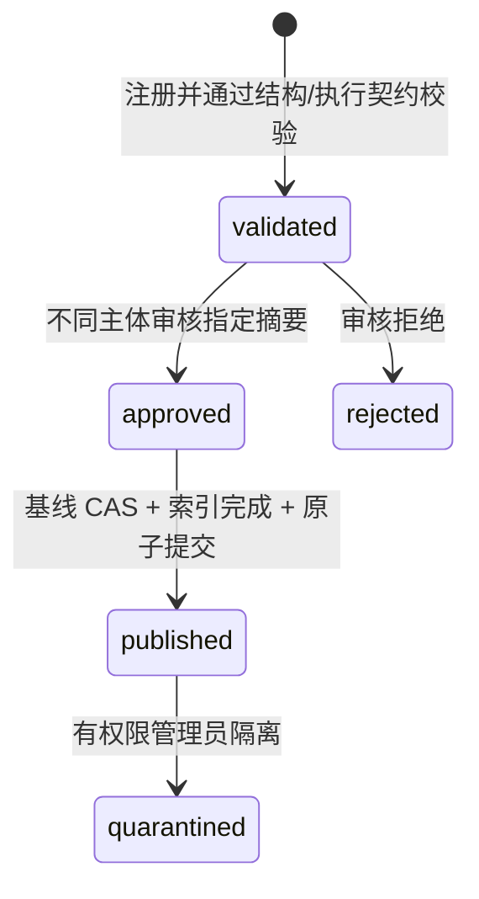

# P1 实施记录：Registry v2、本体审核发布与受控查询接入

> 日期：2026-11-25。依据：[升级方案](../research/2026-11-25-auto-ontology-production-upgrade-assessment.md)、[P0 实施记录](2026-11-25-p0-security-and-federation.md)。
> 结论：P1 注册、迁移、审核、不可变发布、版本回退、Knowledge API 与批准模板查询接入已落地并通过本地测试。默认不切换现有查询；未部署生产、未替业务 owner 批准真实口径。

## 1. 本次范围与决策

原方案的 P1 是 Registry v2；完整指标编译、自动关系发现、复杂查询规划和多智能体 DAG 属于后续阶段。本次按需求提前接入一条可验证的查询路径：**仅使用明确批准并发布的单表 SQL 模板**。这条路径依赖 P0 的源授权、AST 网关、参数绑定、只读事务、预算与多源合并契约。

继续保留 v1 FileOntologyStore、Excel/SQL 模板抽取、离线 Prompt CLI、S3 上传和本体影子比较。v2 仓库独立存放，不会读取 v1 `approved.json` 后直接视为已发布，也不会修改 v1 文件的含义。原先业务查询默认仍走 P0。

| 交付项 | 最终行为 | 对应代码 |
|---|---|---|
| Registry v2 契约 | 严格字段、稳定 ID、依赖闭包、复合键、执行资格 | `ontology/v2.py` |
| v1 兼容迁移 | 全量原始快照/实体归档、显式源映射、阻断报告 | `ontology/v2.py`、`ontology/registry_cli.py` |
| ChangeSet / Review | 不可变内容、摘要审批、作者与审核者分离 | `ontology/registry.py` |
| Release | 内容和检索索引同事务落库；完成后切 active | `ontology/registry.py` |
| 版本与恢复 | 实体版本高水位、活动指针 generation、CAS 回滚、隔离 | `ontology/registry.py` |
| Knowledge API | 先按源授权过滤，再检索；固定 release，草稿不可见 | `ontology/runtime.py`、`server/ontology_api.py` |
| 查询接入 | 按源灰度、明确模板/参数、版本固定、继续使用 P0 网关 | `server/api.py`、`main.py` |
| 下载与证据 | 响应/会话保存版本证据；隔离后的历史导出不可下载 | `server/exports.py`、Chat 组件 |
| 前端代理 | 管理接口需可信管理员；知识读取需 Bearer；路径白名单 | `utils/server/ontologyProxy.ts`、`pages/api/{ontology,knowledge}` |

## 2. v2 元模型与迁移约束

### 2.1 文档与实体

文档固定字段：`schema_version=2`、`namespace`、`entities`、`migration`。未知顶层或实体字段拒绝，文档最多 8 MiB、10,000 个实体，依赖深度最多 256。HTTP 注册入口同样上限 8 MiB；普通查询仍保留 P0 的 1 MiB 上限。

实体公共字段：

- `id/kind/version/name/description/owner`：稳定身份、类型、版本及责任人。
- `source_ids`：适用的数据源，不是数据库密码或用户自报权限。
- `synonyms/dependencies`：检索别名和完整引用清单。
- `availability`：`candidate`、`reference` 或 `executable`。
- `attributes`：各实体类型严格限定的属性。
- `legacy`：迁移实体的完整 v1 原文，仅管理面可见，Knowledge API 不返回。

| 类型 | P1 属性与用途 |
|---|---|
| DataSource | mysql 引擎、database、`credential_ref=source:<source_id>`；只引用 P0 配置，不嵌入凭证 |
| BusinessConcept | 业务定义；原 Scenario 映射于此 |
| Dataset | physical_name、完整 primary_key 字段 ID 数组 |
| Field | dataset_id、physical_name、dtype、primary_key 标记 |
| Relation | 两端 dataset、完整且等长的 left_keys/right_keys、join_type、cardinality |
| Metric | expression、field_ids、aggregation、grain、unit、time_definition、filters |
| Mapping | concept_id、target_ids、expression |
| QualityRule / Policy | target_ids、definition；本阶段是注册对象，不直接执行治理或覆盖 P0 授权 |
| Evidence | target_ids、method、observed_at、summary |
| QueryTemplate | sql、类型化参数及示例、输出列、列分类、问题骨架、P0 merge 契约 |

P1 只有 QueryTemplate 可标记 `executable`。Metric 的 expression 暂存定义，不是完整的类型化指标编译器；Relation 的注册不等于 JOIN 基数经过数据验证；Policy 的注册不等于授权策略已安装。不能凭这些对象进入 registry 就宣称治理闭环完成。

所有引用必须存在、类型匹配且不越过对象声明的源范围；服务实体不能依赖 candidate。Field 必须属于声明的 Dataset，关系键必须属于对应端点，复合键保持一个有序键组。依赖图拒绝循环。Dataset 的主键成员关系不重复建成反向依赖，避免制造 Dataset ↔ Field 假循环。

### 2.2 无损迁移与阻断

迁移要求明确 `v1 namespace → P0 source_id`，不推断命名空间就是数据库名。ID 保持不变；`migration.source_snapshot` 保留整个原快照，包括 warnings、revision、version_counters；每个实体 `legacy` 保留原所有字段。v1 的 query_rule、join_rule、slot synonyms 等没有完整映射到 v2 可执行属性的字段，也在归档中保留，不能声称已自动编译执行这些规则。

- 已批准场景/表/列可成为 reference；未批准祖先会阻断其后代的服务资格。
- Relation 一律作为 candidate，缺少 cardinality/证据时不自动批准。
- Metric 一律作为 candidate，缺少粒度、单位、时间及业务审阅时不自动生成可执行口径。
- QueryTemplate 一律作为 candidate，需补齐物理依赖、输出语义、源绑定与 SQL 审阅后再转 executable。
- v1 单键关系迁为长度 1 的键数组；v1 本身没有的复合键不会被猜测重建。v2 可以直接注册并保留复合键。
- v1 版本在原文中完整保留；v2 实体版本由新 registry 分配，是独立发布生命周期，不冒充旧 v1 的版本序列。

仓库真实样例 `assets/orders_default.xlsx`：21 个实体全部迁移；3 个指标保留 candidate。迁移摘要见 [样例迁移报告](../examples/p1/sample-migration-report.json)。这是仓库样例验证，不是生产资产盘点。

离线操作，不访问模型、数据库、AWS：

```bash
# 先按已有 v1 流程生成/确认一个快照，下面使用其文件路径。
python -m ontology.registry_cli migrate-v1 \
  --input /secure/v1/approved.json \
  --source-map '{"demo":"demo"}' \
  --owner business-owner --namespace default \
  --output /secure/proposals/ontology-v2.json

python -m ontology.registry_cli validate --input /secure/proposals/ontology-v2.json

# 导出的是迁移时原始 v1 归档，不是对当前 v2 内容做反向编译。
python -m ontology.registry_cli export-v1-archive \
  --input /secure/proposals/ontology-v2.json \
  --output /secure/proposals/original-v1-archive.json
```

输出文件必须不存在，避免覆盖人工审核结果。CLI 只生成候选，不提供可冒充任意审核人的本地发布命令。所有在线审批/发布使用 P0 已验证身份。

## 3. 注册、审批、发布与版本

### 3.1 事务仓库

配置：

```dotenv
ONTOLOGY_REGISTRY_PATH=/app/var/registry/registry.sqlite3
ONTOLOGY_REGISTRY_NAMESPACE=default
ONTOLOGY_QUERY_SOURCES=[]
```

SQLite 文件/新目录默认 0600/0700；事务使用 `BEGIN IMMEDIATE` 和 `synchronous=FULL`。仓库保存 changesets、reviews、releases、active、counters、quarantine、audit。当前只支持单主机本地磁盘，可由同机多进程访问；不宣称可用于多节点共享网络盘。

发布内容和确定性词法索引都在同一 SQLite 事务中，因此本阶段没有外部索引 ready 与 active 指针之间的提交间隙，不需要伪造异步 outbox。之后接入独立向量库/图库或同步发布旧 Prompt/S3 时，必须增加真正的幂等 outbox 与 ready 状态；当前没有把旧 S3 流程包装成跨系统事务。

### 3.2 生命周期



文档内 `availability` 和 ChangeSet 审核状态是两个维度。批准包含 candidate 的快照，不会把 candidate 自动变为 reference/executable，也不会让其出现在 Knowledge API。

完整流程：

1. 读取 active 的 `release_id/generation`。
2. 提交完整目标文档及 expected_active/expected_generation。校验依赖与可执行模板，生成不可变 ChangeSet，计算 digest、changed/removed/impacted。
3. 审核者读取完整变更、diff 和具体 digest。审核者必须与提交者不同，且都具有管理员身份和整个受影响源范围的权限。
4. 审核决定和理由绑定 digest。内容不能原地修改；修改须新建变更，旧审批不能复用。
5. 发布再次验证摘要、审批、源配置、SQL 绑定及活动基线，构建全部索引，然后原子写入 release、active、状态和审计。
6. 重试发布同一 ChangeSet 返回原 release 回执，不重新激活已经过时的发布。

删除也需授权：提交完整文档时检查“新文档源 ∪ 原发布源”，避免权限较小的管理员通过省略不可见资产删除其他源。

同一 ID 的内容发生变化才分配新实体版本；版本高水位跨删除/回滚保留。被拒绝或并发冲突的提案可能消耗版本号，允许空号，不允许重用。回滚只切换 release 指针，历史内容和实体版本不重写。

`generation` 防止 ABA：即便 active 从 R1 → R2 → R1，旧提案也不能拿“还是 R1”复用审批。版本基线已变化时返回 `REVISION_CONFLICT`，必须重新提出并审核。

### 3.3 回滚与隔离

`activate` 要求 target release、expected_active、expected_generation 和 reason。HTTP 入口重新核验目标的物理源绑定；查询执行时还会再次校验。回滚不恢复业务库数据，也不能保证数据库 schema 已回到旧状态。

隔离不删除历史发布，active 指针可仍指向隔离版本以明确显示异常；知识读取、指定旧版本读取、查询执行前后、历史导出下载都会拒绝该 release。隔离不可直接解除；通过修订后的新审批/发布恢复，或激活其他可用版本。

校验摘要失败、索引损坏或 registry 不可读均明确失败，不静默切回旧 Prompt。摘要用于完整性检测，不是密码学签名；能任意修改 SQLite 的运维主体仍处于信任边界内。

## 4. API 与操作手册

所有接口要求 P0 Cognito access JWT；管理接口还要求 `admin=true`。管理员来源仍为服务端 `AUTH_ADMIN_GROUPS`，不是 body/header 中的自报角色；管理员也不能越过自己的 source grants。

| Flask 接口 | 用途 |
|---|---|
| POST `/v1/ontology/migrate-v1` | snapshot + source_map → v2 文档预览，不发布 |
| GET/POST `/v1/ontology/changesets` | 最近变更列表 / 提交新变更 |
| GET `/v1/ontology/changesets/{id}` | 文档、摘要、差异、审核记录 |
| POST `/v1/ontology/changesets/{id}/review` | expected_digest、decision、reason |
| GET/POST `/v1/ontology/releases` | 历史/active / 发布 changeset_id + expected_digest |
| POST `/v1/ontology/activate` | CAS 切回指定可用 release |
| POST `/v1/ontology/releases/{id}/quarantine` | 隔离并记录理由 |
| GET `/v1/ontology/audit` | 最近审计事件；需覆盖历史全部提案源范围 |
| POST `/v1/knowledge/search` | 授权后的发布资产检索 |
| GET `/v1/knowledge/entities/{id}?release_id=...` | 固定版本的单实体详情 |

浏览器对应 `/api/ontology/...`、`/api/knowledge/...`。Next 代理使用路径/方法白名单，Bearer 透传且禁止重定向；不提供任意后端 URL 代理。管理接口先验证管理员，Flask 继续独立验证。

提案和发布列表当前返回最新 100 条，审计接口最新 100 条；完整历史保留在 SQLite，按已知 ID 仍可读取变更。大规模分页、审核台 UI、多人会签工作流属于后续扩展。

### 4.1 一个完整发布流程

可参考 [registry-demo.json](../examples/p1/registry-demo.json)：源 ID `a`、数据库 `db_a`、orders 表、city/amount 字段。它是测试契约形状，不是真实业务的默认批准定义。先按真实只读库和审核口径修改。

首次提交请求形状：

```json
{
  "document": "此处放 registry-demo.json 的完整 JSON 对象，不是文件路径字符串",
  "expected_active": null,
  "expected_generation": 0
}
```

后续从 GET releases 读取 active 填入基线。响应返回 `id/digest/document/diff/status`。审核者使用自己的登录凭证：

```json
{
  "expected_digest": "从变更详情读取的完整 digest",
  "decision": "approved",
  "reason": "已核对源绑定、列、过滤、指标含义与结果样例"
}
```

发布请求：

```json
{
  "changeset_id": "变更集 ID",
  "expected_digest": "本次获批的 digest"
}
```

可以由提交者或其他覆盖全范围的管理员发布；审核者必须与提交者不同，但不强制第三名发布者。拒绝后的修订必须新建 ChangeSet。

### 4.2 检索与版本固定

```json
{
  "question": "城市销售额",
  "kinds": ["QueryTemplate", "Metric"],
  "source_ids": ["a"],
  "limit": 10
}
```

返回 release_id 与候选 ID/version/名称/资格/源/score。score 是确定性词法匹配比例，不是业务置信度。权限过滤在评分之前；草稿、candidate、缺失可见依赖的对象不参与召回。未授权实体详情统一 404，不返回名称或存在性提示。

拿到 release_id 后，后续读取可显式携带它；发布新版本不会改变旧 release 的内容。隔离状态和当前源权限仍实时检查，不因版本固定而固定旧权限。

## 5. 查询接入与 P0 兼容

### 5.1 按源开启

默认 `ONTOLOGY_QUERY_SOURCES=[]`：本次接入不打开 registry、不增加原 P0 查询的本体证据字段，原模板/模型查询和影子比较继续运行。

完成发布及验证后，只对指定源配置：

```dotenv
ONTOLOGY_QUERY_SOURCES=["a"]
```

更新配置后重启进程。一次请求不能混合开启和未开启本体路由的源；不能通过请求参数开启未灰度的源。选源仍先执行 P0 的当前授权判断。

灰度源的查询必须命中已发布 executable 模板，未命中、冲突、绑定变化、发布损坏/隔离都明确失败，禁止悄悄转旧 LLM SQL 路由。

### 5.2 自然语言与显式模板

普通 Chat 问题可精确匹配审核的 `question_pattern`，例如 `{0}销售额` 匹配“上海销售额”。参数保留原始大小写与空格，不把“New York”改成“newyork”。匹配设长度和状态预算；多个模板或多种槽位切分同时匹配时返回 `AMBIGUOUS_DEFINITION`，不让相似度擅自裁决。

明确模板调用 `/api/chat`：

```json
{
  "messages": [{"role":"user","content":"查询上海销售额"}],
  "sourceIds": ["a"],
  "ontology": {
    "release_id": "已发布 release_id，可省略以固定当前 active",
    "template_id": "template:sales",
    "parameters": ["上海"]
  }
}
```

直连 Flask 使用 `source_ids`。参数必须与发布定义中的类型、数量一致；参数是值，不能修改 SQL 或身份。当前 Chat UI 展示发布版本并保存证据，但未增加模板选择器；多源或复杂显式参数可使用 API。

### 5.3 可执行模板的严格范围

P1 为每个 executable 模板验证：

- 明确依赖且只依赖一个物理 Dataset；使用的字段都在批准依赖中。
- 明确 DataSource 依赖，source_id、数据库名、credential_ref 与 P0 配置一致。
- 单表 SELECT；不允许 JOIN、CTE、子查询或 SELECT *。聚合 COUNT(*) 可用。
- 输出别名、数量及顺序与模板列定义精确对应；实际游标列再次检查。
- 多源时使用同构表和相同 SQL，完整遵守 P0 merge 契约；AVG/ratio 等仍先合并中间态。
- 模板实例化后经过 P0 AST/绑定网关、只读事务和共享预算；不能用 registry 绕开这些防线。

复杂 JOIN/CTE 等原 P0 单源能力继续保留在未灰度源上；本次没有把它们自动升级为已审核的本体查询。以源为单位的严格切换会减少该源暂时可回答的问题，必须先评估模板覆盖率；需要更细的按指标灰度时另行扩展，不用不受控 fallback 掩盖覆盖不足。

DataSource 检查的是已声明数据库绑定，不是生产 schema 实时画像。仅改 hostname 但 database 名相同、物理列类型变化、数据质量变化，本阶段没有全面自动探测。P2 应接入 schema 指纹/水位/画像证据与漂移隔离。

### 5.4 查询证据与导出

成功响应新增 `ontology`：release_id、template_id、template_version、dependency_versions、sql_sha256，以及 retrieved/selected/executed 三个阶段标记。SQL hash 是实际受控 SQL 字符串（保留参数占位符）的 UTF-8 SHA-256，不包含参数原值。UI 显示版本，历史会话保存完整证据字段。

只在 SQL 实际完成后返回 executed；失败不伪造成功证据。结果完整性继续通过 `sources/truncated/status` 判断。此处是响应级证据，不是已实现完整 QueryExecution 持久化审计库；注册/审核/发布审计已持久化，完整查询事件仓库留给后续阶段。

P1 导出复用 P0 的 SQLite 格式，在 sources JSON 内增加发布关联；读取兼容旧 P0 列表格式，无破坏性迁移。每次下载仍验证 owner、源权限、TTL，并检查对应 release 未被隔离。隔离正在执行的查询时，在结果返回前的检查会拒绝输出；这是协作式有效性检查，不是精确瞬时取消所有正在执行的数据库语句。

## 6. 测试、演练与结果

### 6.1 自动化验证

| 检查 | 结果 |
|---|---|
| 既有 Python 非实库回归 | 90 项通过 |
| 新增 P1 Registry/迁移/HTTP/查询/恢复测试 | 33 项通过 |
| 默认 unittest discover | 131 项：123 通过，8 项实库测试按条件跳过 |
| 真实临时 MySQL | 8/8 通过：7 项 P0 安全回归 + 1 项 P1 发布到跨库查询 |
| 前端 Vitest | 20/20 通过：12 项 P0 + 8 项 P1 |
| TypeScript | `tsc --noEmit --incremental false` 通过 |
| Next 生产构建 | 无 `.env*` 的临时副本构建通过 |
| 迁移样例 | 21 → 21 实体，无丢失；3 个不完整指标保持 candidate |
| 备份恢复 | SQLite 一致性 backup 后重新打开，可读取同 release 与审计 |
| 补丁检查 | `git diff --check` 通过 |

总计 **151 项唯一自动测试通过**。默认跳过的实库用例另行显式执行后才计入总数，没有重复计数。

重点用例：

- 自审拒绝、摘要错误、未审批发布、拒绝状态不可复用、审核身份不可伪造。
- 两个基于同一版本的并发发布只有一个成功；ABA 回滚不能复用旧审核。
- 索引构建失败，以及指针更新后审计写入失败，都不留下半发布状态。
- 重启、回滚、不可变旧版本、版本高水位、幂等发布回执。
- 权限不足管理员不能删除隐藏源；检索/读取不泄露草稿或跨源定义。
- 损坏索引拒绝服务，隔离阻断历史读取、在途结果及已生成导出。
- v1 原文逐实体相等、CLI 迁移/归档往返、复合键不拆散、候选不升级为可执行。
- 本体路径不调用 AWS/LLM；关闭灰度保持 P0 返回；失败不走旧路由。
- 真实数据库验证：先发布审核模板，再通过 P0 执行跨库 `(100+0)/(1+9)=10`。
- 新前端代理覆盖管理员门禁、Bearer 透传、冲突状态、路径逃逸拒绝、固定发布读取。

命令：

```bash
.venv/bin/python -m unittest discover -s tests -v
npx vitest run tests/web --threads false
npx tsc --noEmit --incremental false
NEXT_TELEMETRY_DISABLED=1 npm run build
```

真实数据库仍使用 [P0 实施记录](2026-11-25-p0-security-and-federation.md) 中的一次性实例流程与 `P0_MYSQL_TEST_*` 开关，执行 `tests.test_p0_mysql`，现含 P1 端到端用例。测试创建并清理随机前缀对象，不能指向业务实例。

本次 Python 3.12.13、Node 20.20.2、MySQL 8.0；没有新增第三方依赖。未读取真实 `.env`、未访问真实业务库/Cognito/Bedrock、未修改生产授权。本次临时数据库测试结束后停止并删除。

### 6.2 当前可重复的恢复路径

1. 保留源配置、Registry SQLite 一致性备份及本体版本记录；不要把活动 SQLite 文件简单边写边复制。
2. 可用 Python `sqlite3.Connection.backup()` 或等效在线备份工具生成一致性备份；恢复测试已经覆盖该路径。
3. 停止目标实例写入，将备份恢复到新的受控目录，保留权限。
4. 用只读 Knowledge API 验证 release、授权过滤和审计，再核对当前数据库绑定。
5. 灰度环境跑批准模板的结果比对后，恢复服务。

单机 SQLite、磁盘/备份权限和容量监控是当前部署约束。变更/发布不会自动清理，列表上限不等于存储保留策略；大规模长期运行需治理保留期并升级注册存储后端。

## 7. 上线与回退

1. 不改 P0 查询配置，先部署 v2 管理与知识接口，挂载独立 `var/registry` 私有卷。
2. 将 v1 资产导入为提案，检查迁移报告、原始归档和候选阻断项。
3. 补充 DataSource/Dataset/Field 物理绑定、模板输出和参数；逐项完成业务口径核验。
4. 使用两个不同 Cognito 主体完成提交/审核；确认双方具备管理员资格和完整源授权。
5. 发布后执行显式 release 的查询对账、权限反例、隔离和回滚演练。
6. 只将已达到覆盖率及正确率要求的源加入 ONTOLOGY_QUERY_SOURCES；普通用户默认不新增管理权限。
7. 观测 409 冲突、422 无匹配/歧义/绑定失效、503 仓库故障、SQL 成功率及 P95。

优先通过 activate 回到兼容旧发布；错误定义可立即 quarantine。若整体暂停 v2 查询，移除灰度源并重启，回到仍有 P0 授权/SQL 防线的旧路由。这是显式运维切换，不是在单次查询失败时自动绕过已隔离的定义。

## 8. 尚未完成的目标能力与后续输入

- 真实 Cognito 管理角色/双人审核演练、真实业务 gold 集与灰度正确率验收尚未完成。
- 仍采用 P0 数据源级授权；没有新增完整租户隔离模型、行/列/指标级策略编译。共享部署按源授权与 namespace 配置隔离，不能把 namespace 单独称为租户权限。
- v2 指标/规则定义尚不直接编译执行，没有自动 FK/数据质量验证、schema 漂移检测、上游 auto-ontology 编译器接入。
- 单表模板严格接入并不等于完整知识驱动 SQL 规划。复杂关系、typed metric AST、粒度/单位自动推导和多智能体工具循环属于后续阶段。
- 本次未建设管理台 UI；审核工作流已可经鉴权 HTTP API 完成，P2 再建设证据与差异审核界面。
- 注册内容与本地词法索引原子发布；外部向量服务、Prompt/S3 outbox、混合召回和索引重建任务队列未实施。
- 注册事件持久审计已实现；查询结果持久证据库、跨源一致性快照、全局预算/限流及业务库硬取消沿用 P0 的已记录边界。

上述边界不通过自动放宽审核、把候选放入查询、或者失败时调用无约束旧路径来掩盖。后续 P2 可以在本次 ChangeSet/Review/Release 约束上接入自动候选编译；自动化产物默认只能创建候选。
