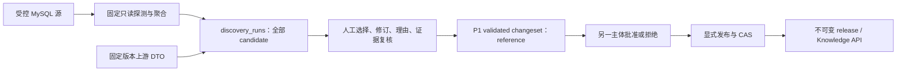

# P2 实施记录：自动候选编译、MySQL 采集与最小审核流程

日期：2026-11-27（Asia/Shanghai）
基线：P0/P1 提交 `2b3061946db7d44c0809cf475568f96f610cbdc1`
对应方案：[自动本体升级评估](../research/2026-11-25-auto-ontology-production-upgrade-assessment.md)，P2、AO-07、AO-08。

## 1. 交付结论与验收边界

P2 工程链路已实现：配置允许的单个 MySQL 源 → 元数据与聚合画像 → 关系证据 → 机器候选 → 人工修订和移交 → P1 双人审核 → 显式发布参考知识。原有聊天、Prompt/v1 旁路、P0 SQL 安全与跨源聚合、P1 模板执行及版本机制继续保留。

**自动产物始终保存在候选区。采集器不会创建 changeset、release、查询索引或可执行模板。** 人工移交会创建独立的新变更，原采集文档仍全部为 `candidate`。只有人工挑选和核验的闭包转为 `reference`，且还需要另一主体审核和显式发布。

默认 `ONTOLOGY_DISCOVERY_ENABLED=false`，本次没有连接真实业务库、读取实际 `.env`、改动生产身份授权或替真实业务负责人批准口径。合成数据中已跑通概念、指标和关系的审核约束；方案所述“已批准核心概念和指标”的**真实业务验收**需要业务负责人在目标环境完成，不能以测试账号审批替代。

上游接入范围是固定版本 DTO 的隔离兼容实验及有界候选桥接器。没有启动上游全套 PostgreSQL/Neo4j/Qdrant 服务，没有运行真实 LLM、公开基准或语义质量对比；不把 DTO 兼容宣称为整套上游生产验证。

## 2. 变更位置

| 文件 | 作用 |
|---|---|
| `ontology/discovery/policy.py` | 服务端源/表/列允许列表、采样限额、敏感列排除、标识符约束 |
| `ontology/discovery/mysql.py` | 固定 MySQL 元数据 SQL、聚合画像、复合关系证据和前后结构指纹 |
| `ontology/discovery/compiler.py` | 稳定 ID、v2 候选实体和证据编译；所有输出强制 candidate |
| `ontology/discovery/upstream.py` | 固定 NVIDIA SHA 的 DTO 桥接；无数据库、网络、模型、工具调用 |
| `ontology/discovery/workflow.py` | 持久作业、幂等、并发租约、证据有效性、人工移交 |
| `ontology/registry.py` | 增量建表、P2 审核关联和发布前校验；保留 P1 事务与 CAS |
| `server/ontology_api.py` | Flask 管理端点；身份来自验证后的 JWT，不接受调用方声明身份 |
| `utils/server/ontologyProxy.ts` | Next 代理显式允许 P2 路径，仍需经过服务端管理员验证 |
| `pages/ontology-review.tsx`、`components/Ontology/ReviewDesk.tsx` | Cognito 登录、候选/证据查看、人工修订、独立审核、显式发布 |
| `tests/test_discovery_p2.py`、`tests/test_p2_mysql.py`、`tests/web/p2-*.test.*` | 契约、拒绝路径、真实 MySQL、代理与页面交互回归 |
| `scripts/check_auto_ontology_bridge.py` | 固定上游真实 DTO 的断网实验断言 |

未增加应用运行时依赖。上游实验的 Pydantic 仅存在于一次性实验镜像，未加入后端依赖锁。

## 3. 状态与信任边界



机器作业状态为 `running → complete / partial / failed`。`complete` 表示本轮允许范围的采集步骤完成，**不表示业务正确、关系成立或已经批准**。`partial` 表示某个画像/关系步骤异常或前后结构变化；不允许移交。元数据不可见、超时后无法完成最终结构验证、上游 DTO 不合法等情况会失败。未知驱动异常只保存脱敏错误码，不保存异常中的 SQL、连接串或数据行。

新表 `discovery_runs` 与 P1 的 `changesets/releases` 隔离；`discovery_review_links` 将移交变更绑定到作业摘要与有效期。运行开始、完成、租约中断及 P1 后续操作进入审计。审计读取同时要求覆盖历史变更和采集作业的源权限，避免管理员跨源读取采集记录。

调用条件同时满足：有效 JWT、管理员身份、该 `source_id` 的授权、已配置 MySQL 源、服务端采集允许列表。管理 UI 不承担安全边界；Flask 和 Next 代理都保留相应验证。管理员也不能通过 P2 API 指定连接串、任意 SQL、采集后的目标 availability 或发布行为。

## 4. MySQL 采集契约

### 4.1 元数据

读取固定的 `information_schema.TABLES / COLUMNS / STATISTICS / KEY_COLUMN_USAGE`，用绑定参数限定当前数据库和明确列出的表。只支持基础表，不支持视图和系统库。当前允许标识符为 ASCII 字母/下划线开头、其后字母数字下划线，最长 64 字符；特殊字符或中文物理名称暂不支持，拒绝执行而非猜测转义。

复用 P0 的 AST 检查、绑定参数、服务器执行超时、只读事务、流式结果限额和连接关闭逻辑。仅内部固定目录探测使用 `information_schema` 连接上下文，**没有放宽在线 SQL 跨库规则**。沿用配置中的只读源账号，不要求 ROOT、写权限、全局元数据权限或业务库以外的授权。

编译内容包括表/列名称、类型、可空性、排序规则、注释、完整主键/唯一键及同库复合外键。未完整纳入白名单的复合键不降级成单列键。前后对允许范围的结构求规范化摘要；有变化则不能移交。跨库外键不会纳入当前单源候选。

### 4.2 画像

- 仅对 `profile_columns` 中非敏感列计算 `sampled_rows`、NULL 数量/比例、非空 distinct 数量/比例。
- 有完整主键时按主键排序截取前 N 行，否则使用无序前缀。产物明确标注 `ordered_prefix / unordered_prefix`、`not_random=true`、上限和观测时间。
- 不返回原始行、取值列表、最常见值、示例值、min/max；不调用 LLM，不向模型外发数据库值。
- 空样本和全空列的无意义比例为 `null`，不伪造 0% 或 100%。
- `sensitive_columns` 和名称启发式（password/token/email/phone 等）共同排除画像和关系探测。启发式不是完整敏感识别；运维必须显式标注非典型敏感列。
- 敏感列的名称、类型等允许范围内元数据仍可进入管理员候选；注释也会保留（每项最多 2000 字符）。若注释可能含敏感内容，需先治理注释或将列移出允许列表。没有承诺任意源的元数据天然无敏感信息。

### 4.3 关系证据

来源有 `declared`（数据库声明的完整外键）和 `operator_candidate`（运维策略中明确提出的完整键组）。不会仅因两个字段同名就自动判定有关系。P2 不做无边界全表对组合搜索，也不接受上游 LLM 的单列 FK 推测直接作为批准关系。

每条关系验证列类型和排序规则完全相同，再执行：

1. 目标端非空复合键的全量分组重复检测，给出 `duplicate_groups` 和 `exact_non_null_scan`。
2. 左侧前缀样本与目标端键组匹配，给出非空键数、孤儿数/比例、包含率和匹配行数。
3. `fanout_ratio = matched_rows / (nonnull_count - orphan_count)`，明确使用匹配的左侧行作为分母；NULL 键不计入孤儿分母。

`sampled_pass` 要求非空样本非零、目标端无重复、样本无孤儿且匹配行数等于非空样本数。空样本为 `unknown`，类型不匹配为 `type_mismatch`，敏感键为 `restricted`，失败为 `sampled_fail`。这些状态都是证据而不是审批。

自动编译的 `Relation.join_type/cardinality` 一律为 `unknown`。人工移交目前只允许证据通过的 `many-to-one`，并显式确认连接方向；不支持据目标唯一性批准 `one-to-one`，因为尚未验证左侧唯一性。复合键按顺序保留，角色名/业务有效期仍需人工定义。

探测语句各自使用只读事务，**并非跨所有探测的一致性快照**。数据并发变化可能影响证据，额外匹配行数校验只能捕获部分变化。前后结构指纹也不能证明数据在采集后未变化。当前仅发布参考契约，不让这些证据直接授权动态连接执行。

### 4.4 固定预算

| 约束 | 当前值 |
|---|---|
| 每作业数据源 | 1 |
| 每源允许表数 / 每表允许列数 | 最多 8 / 64 |
| 每表前缀样本数 | 1–1000，默认 200 |
| 关系数 | 最多 16 |
| 单条 SQL 时间 | 最多 5 秒，并受剩余预算与现有 SQL 配置限制 |
| 作业 SQL 预算 | 45 秒、最多 64 次；不含不可控的系统调度延迟 |
| 单探测返回 | 最多 2048 行、2 MiB；被截断即拒绝 |
| 作业持久化产物 | 最多 6 MiB |
| 并发 | 同源最多 1，当前注册库全局最多 4 |
| 执行租约 / 证据有效期 | 90 秒 / 从启动时刻起 24 小时 |

LIMIT 限制样本和结果，并不保证数据库扫描便宜。目标唯一性和成员验证可能扫描目标全表；大表应在只读副本或受控时段运行，超时则缩小范围或准备索引，不自动放宽超时。同步作业占用一个服务进程，本阶段没有分布式队列、异步取消或自动重试守护进程。

幂等键由调用方提交，绑定 `namespace + actor + idempotency_key`，摘要包含规范化策略、物理连接绑定和可选上游输入。同键同请求返回原作业；同键不同范围返回 `IDEMPOTENCY_CONFLICT`。进程中断的租约在下一次访问时标记失败并审计；迟到工作不能覆盖该失败。重新采集需要新键，不能把旧审核偷偷指向新证据。UI 每次“开始采集”创建新键；网络超时后应先刷新作业列表或用 API 原键查询，不连续点击制造新任务。

## 5. 候选编译与上游桥接

### 5.1 确定性编译

稳定 ID 由 namespace、source、database、实体类型与物理键构成。每表生成 DataSource/Dataset/Field、待核验 BusinessConcept、Mapping、行数 Metric；再加入 Relation 和 Evidence。完整主键转为 Field ID 列表，字段/表/关系依赖交给 v2 DAG 校验。

行数指标只是建议：自动生成 `COUNT(*)`、主键粒度（若有），单位与时间口径留空。概念描述优先来自表注释，仍标记业务复核事项。`legacy` 保存编译器版本、run_id、schema fingerprint 和待核验事项，`migration` 标明自动来源与观测摘要。没有自动生成 QueryTemplate。

### 5.2 NVIDIA DTO 兼容边界

固定上游提交：[`a12fec75226a54ffc91752cca9538f1f01f760eb`](https://github.com/NVIDIA/auto-ontology/tree/a12fec75226a54ffc91752cca9538f1f01f760eb)。本次通过 GitHub 连接器读取并校验 [`auto_ontology/semantic/models.py`](https://github.com/NVIDIA/auto-ontology/blob/a12fec75226a54ffc91752cca9538f1f01f760eb/auto_ontology/semantic/models.py)，Git blob SHA 为 `2e5f44141434e15d09f4b0bbeb73437f2b4a9e38`。

输入桥接协议示例（指纹必须替换为实际采集的 catalog fingerprint）：

```json
{
  "protocol": "nvidia-term-proposals/v1",
  "upstream_sha": "a12fec75226a54ffc91752cca9538f1f01f760eb",
  "catalog_fingerprint": "<实际元数据摘要>",
  "tables": [{
    "table": "orders",
    "terms": [{
      "name": "订单",
      "description": "待业务负责人核验的订单定义",
      "synonyms": ["销售订单"],
      "attributes": [{"source_column": "id", "display_name": "订单编号"}]
    }]
  }]
}
```

可先读取一次候选作业的结构指纹，再将隔离环境生成的 DTO 通过新作业的 `upstream` 字段导入；本次采集会重新检查结构。DTO 大小最多 128 KiB、8 表、每表 16 概念、每概念 64 字段。拒绝未知字段、SQL、原始样本、未列入目录的字段、版本或指纹不匹配。上游只补充 BusinessConcept/Mapping 候选，不导入其图数据库状态、权限或发布状态。

SHA 字段是协议兼容检查，不是生成来源签名。调用方可以伪造该字段，因此生成内容始终视为不可信候选；服务端仍做独立范围校验与人工审批。

### 5.3 隔离实验记录与复现

实验只复制固定 `models.py`、本地桥接器和 `scripts/check_auto_ontology_bridge.py` 到临时构建目录，不复制 `.env`、注册库、生产连接配置。导入前计算 Git blob SHA，使用真实 `RawTableTermsResult` 和 `TableTermsResult` 处理合成订单 DTO，再进入桥接器。

实验镜像基础：`python:3.12-slim@sha256:191083cdf6c7bda8c76158983163ead5d5cf7b77cf3033e805bb0f5296f51b4b`；Pydantic `2.13.5`，pydantic-core `2.46.5`，annotated-types `0.8.0`，typing-extensions `4.16.0`，typing-inspection `0.4.5`。这些是实验记录，不替代应用锁文件。

构建时只安装上述实验依赖；执行时断网、只读文件系统、无 Linux capabilities、非 root 用户、128 MiB 内存、64 进程上限：

```bash
docker run --rm --network none --read-only --cap-drop ALL \
  --security-opt no-new-privileges --memory 128m --pids-limit 64 \
  bi-p2-upstream-dto
```

实验目录 Dockerfile：

```dockerfile
FROM python:3.12-slim@sha256:191083cdf6c7bda8c76158983163ead5d5cf7b77cf3033e805bb0f5296f51b4b
RUN pip install --no-cache-dir pydantic==2.13.5 pydantic-core==2.46.5 \
    annotated-types==0.8.0 typing-extensions==4.16.0 typing-inspection==0.4.5
WORKDIR /experiment
COPY models.py upstream.py check.py ./
ENV PYTHONDONTWRITEBYTECODE=1
USER 65534:65534
CMD ["python", "-I", "/experiment/check.py"]
```

其中 `upstream.py` 来自本仓库 `ontology/discovery/upstream.py`，`check.py` 来自实验脚本。`models.py` 必须来自上述固定 URL，并保留其许可证头；脚本会拒绝字节级摘要变化（包括多余换行）。本次 8 个断言通过：源码完整性、真实 raw DTO、真实 sanitized DTO、有界转换、未知列拒绝、额外 SQL 拒绝、版本不符拒绝、原始行拒绝，输出 `published:false`。

## 6. 人工审核与发布

访问 `/ontology-review`，使用现有 Cognito 用户池登录；不新增默认管理员，不重置现有会话。前端使用 access token 调用同源 `/api/ontology/*`，后端继续核验 JWT 和源权限。没有生产可用的测试登录或身份绕过入口。

1. 选择配置允许的源，开始采集，或查看历史作业。
2. 查看 `complete/partial/failed`、证据范围、比例定义、敏感列排除和完整候选定义。
3. 明确勾选实体。服务端补齐依赖及主键字段，并附加相关证据；未选中的既有批准资产不会因为本次采集缺失而被删除。
4. 在 JSON 修订区填写 `实体 ID → 修改字段`，以及人工核验理由。允许名称、描述、owner、synonyms，以及概念/指标/关系的完整 attributes 对象。物理绑定和 Evidence 内容不能通过该入口改写。
5. 指标必须补齐非空表达式、粒度、单位、时间口径与支持的聚合方式。概念须有定义。关系须有通过的证据，并显式确认 many-to-one 和连接类型；关系键组不可修改。无主键表的行数候选不能因默认空粒度直接通过，需人工选择有效的粒度字段并保证依赖闭包完整。
6. “移交”提交作业摘要、显式选择/修订、活动 release 和 generation。服务端复核证据 TTL、策略摘要、连接绑定摘要和实时目录指纹，再创建 P1 validated changeset；不是发布。
7. 另一位覆盖该变更全部源的管理员查看 diff、完整文档、摘要和理由后批准或拒绝。拒绝后需新建变更，不能复活旧批准记录。
8. “发布已批准变更”单独执行。服务端再次复核关联证据与实时结构，再在 SQLite 事务内检查摘要、审批、CAS、构建索引并切换活动版本。失败整体回滚。重复发布只返回原收据，不重新激活旧版本。

人工修订是完整新版本的一部分。未显式勾选的现有批准依赖优先保留，防止机器默认名称/描述覆盖人工内容；显式勾选同一稳定 ID 则属于人工有意更新。当前最小 UI 使用 JSON 修订，适合数据治理管理员，尚不是面向普通业务用户的可视化指标设计器。

证据过期、策略或物理源绑定变化、结构漂移会阻止新移交/批准/发布。物理绑定摘要包含 source_id、host、port、db、user，不包含密码，单纯密码轮换不使证据作废。已发布的历史收据仍可幂等读取。24 小时是固定初始窗口，不是持续监控；发布后没有后台漂移扫描，也不会自动撤销既有版本。发现异常仍使用 P1 quarantine/rollback，持续治理闭环留待后续阶段。

实时 MySQL 校验与 SQLite 发布不共享分布式事务，两者之间仍有很短的结构变化窗口。P2 发布为参考知识且不自动执行 SQL；不承诺由此获得实时强一致数据约束。

### 6.1 管理 API

所有路径都要求管理员和源授权；Next 路径将 `/v1/ontology` 替换成 `/api/ontology`。

| 方法与 Flask 路径 | 请求/用途 |
|---|---|
| `GET /v1/ontology/discovery/config` | enabled、当前主体、授权源和允许表；不返回连接信息 |
| `POST /v1/ontology/discovery/runs` | `source_id,idempotency_key`；可选 `tables,upstream`，同步返回作业 |
| `GET /v1/ontology/discovery/runs` | 当前 namespace 内授权源的最近 100 条作业 |
| `GET /v1/ontology/discovery/runs/<id>` | 作业状态、摘要、证据和候选；重新校验持久化摘要 |
| `POST /v1/ontology/discovery/runs/<id>/prepare-review` | `expected_digest,entity_ids,edits,expected_active,expected_generation,reason` |
| 既有 changesets/review/releases | 沿用 P1 审批和发布接口；P2 关联证据参与校验 |

没有 `discovery/publish` 或自动批准端点。接口不接受 body 中的 actor/admin/availability/SQL/连接凭据。重要错误码包括 `DISCOVERY_DISABLED`、`DISCOVERY_CONFIGURATION`、`DISCOVERY_BUSY`、`IDEMPOTENCY_CONFLICT`、`DISCOVERY_NOT_READY`、`STALE_EVIDENCE`、`STALE_BINDING`、`RUN_INTERRUPTED`；P1 的 `REVISION_CONFLICT` 和 `REVIEW_SEPARATION_REQUIRED` 继续有效。

## 7. 配置、部署与回退

### 7.1 配置示例

完整示例见 [`docs/examples/p2-discovery-policy.json`](../examples/p2-discovery-policy.json)。先按实际 `source_id`、表和列替换，不可直接把示例配置指向真实生产数据。

```bash
# 同一 shell 会话；文件只有允许列表，不包含数据库凭据。
export ONTOLOGY_DISCOVERY_POLICY="$(python3 -c 'import json; print(json.dumps(json.load(open("docs/examples/p2-discovery-policy.json")), separators=(",", ":")))')"
export ONTOLOGY_DISCOVERY_ENABLED=true
```

部署通过受控配置系统注入同名变量；env-file 中使用单行 JSON，不依赖 shell 展开。继续配置 P1 私有 `ONTOLOGY_REGISTRY_PATH`、namespace、源权限、管理员组，以及既有 MySQL 只读连接。读取目录只要求该账号能看见其授权表，不要为采集添加全局数据库授权。`profile_columns=[]` 允许只做元数据盘点；该表画像标为 restricted，不据此伪造统计。

### 7.2 部署顺序

1. 为现有 Registry 做 SQLite 一致性备份，保留源配置与授权记录；停止并发部署，保持单机本地磁盘部署约束。
2. 部署代码，保持采集开关关闭、`ONTOLOGY_QUERY_SOURCES` 不变。Registry 初始化只增加两张表，不修改既有 P1 release 内容。
3. 在只读副本/受控测试环境配置一个最小源和明确表列列表，检查账号只能 SELECT 授权库。
4. 配置至少两个不同 Cognito 主体，均具备管理员资格和目标源授权；不把前端显示名字当审核身份。
5. 启用采集，验证完整/失败作业、敏感字段排除和负载，再使用真实业务定义完成概念/指标审核。
6. 发布参考知识后通过 Knowledge API 验证可见性与源隔离。不要仅因为新增参考实体就把尚无批准 QueryTemplate 的源加入 P1 查询灰度。
7. 监控 `discovery_started/finished/interrupted` 审计、失败码、持续 running、SQLite 大小、只读库负载、超时率和用户审核耗时。

SQLite 原有 v2 格式标识保持不变；P0/P1 代码回退可忽略新增表。备份必须使用 SQLite backup API 等一致性方式，不能边写边复制主数据库文件。`discovery_runs` 和审计不自动清理，列表最多 100 条不代表只保留 100 条。先设定运维容量/保留制度；有关联审批的产物不得单独删除，否则完整性检查将阻断后续动作。多节点部署需要共享事务存储和真正作业队列，本阶段不支持通过 NFS 共享 SQLite。

### 7.3 回退

先关闭 `ONTOLOGY_DISCOVERY_ENABLED`，停止发起新作业。已有候选仍可读取，新移交/批准/发布的实时校验会因开关关闭而拒绝；已经发布的 P1 查询和收据不受开关影响。开关不强行中止已在执行的 SQL，其剩余工作由预算/租约约束，产物仍只进入候选区。

如果问题涉及已发布的人工参考定义，使用现有 P1 隔离或 CAS 回滚到已知版本，保留审计与备份。回滚不是删除候选或修改不可变历史。不要扩大源权限或跳过审核以处理异常。

## 8. 验证记录

最终总计 **193 个不同测试通过**（Python 165，前端 28）。MySQL 的 14 项分别在两个版本运行，统计时只计一次；DTO 实验的 8 个断言单独列示。

| 验证 | 结果 |
|---|---|
| Python 默认 discover | 165 项：151 通过，14 个真实 MySQL 项按默认开关跳过 |
| P2 单元/契约/HTTP | 28 项通过，包含自动候选隔离、权限、幂等、租约迟到、敏感/空样本、复合关系、过期/绑定/结构/CAS、双人审核、发布回滚和旧模板保留 |
| 真实 MySQL | P0 8 项 + P2 6 项；MySQL 8.0.46 和 8.4.13 各 14 项通过 |
| 前端 Vitest | P0 12 + P1 8 + P2 8 = 28 项通过；含权限错误、JSON 校验、摘要绑定、拒绝、自审限制、批准与发布分离 |
| TypeScript | `npx tsc --noEmit --incremental false` 通过 |
| Next 生产构建 | 排除 `.env*` 和运行数据的临时副本中通过；含 `/ontology-review` 路由 |
| 浏览器检查 | BrowserOS neo；实际 ReviewDesk 组件的临时合成数据 harness，桌面及 390px 移动端可读，移交→批准→显式发布可操作 |
| NVIDIA 断网 DTO 实验 | 8 断言通过，真实固定 DTO 导入，无模型调用、无生产凭据、`published:false` |
| 差异检查 | `git diff --check` 通过 |

Next 构建仍有既有页面的 React hook 依赖提示、Browserslist 数据过旧和 Webpack 弃用提示；没有通过关闭类型/lint 检查隐藏错误。构建需要下载现有 Inter 字体；初次沙箱网络受限失败后，在排除 `.env*` 的副本中授权联网重跑通过。上游文件初次保存额外换行被 SHA 校验拒绝，按原始字节重建后通过，未放宽完整性检查。

浏览器 harness 只替换认证请求和 API 为合成 fixture，未提交到生产代码；不能据此宣称真实 Cognito 登录已联调。真实 MySQL 测试使用随机前缀库与 SELECT-only 用户，测试自行清理数据对象；两套一次性容器在验证后删除。本次未执行实际业务库负载测试、Bedrock 调用或全套上游推理。

常规复现：

```bash
.venv/bin/python -m unittest discover -s tests -v
npx vitest run tests/web --threads false
npx tsc --noEmit --incremental false
# 在不包含真实 .env 的构建目录执行：
NEXT_TELEMETRY_DISABLED=1 npm run build
```

真实数据库复现只允许使用一次性本地容器：

```bash
docker run -d --name bi-p2-test --publish 127.0.0.1::3306 \
  --env MYSQL_ROOT_PASSWORD=disposable-fixture-only mysql:8.0
docker port bi-p2-test 3306
# 等待测试实例就绪，将下方端口替换为上一条返回的本机端口。
P0_MYSQL_TEST_PORT=<port> P0_MYSQL_TEST_ALLOW_CREATE=1 \
  P0_MYSQL_TEST_PASSWORD=disposable-fixture-only \
  .venv/bin/python -m unittest tests.test_p0_mysql tests.test_p2_mysql -v
docker rm -f bi-p2-test
```

上述 root 密码仅是一次性测试容器 fixture，不能作为业务库凭据。测试开关同时要求端口和显式 `ALLOW_CREATE=1`，不会读取应用 MySQL 配置。

## 9. 反思与后续衔接

1. **候选质量与发布正确性分开衡量。** 当前确定性编译覆盖物理结构和少量业务建议，不评估模型能否正确理解真实业务。后续应建立人工标注集，分别衡量提案覆盖率、修改率、关系误报和审核耗时。
2. **样本通过不是全量保证。** 当前能暴露 NULL、孤儿与放大，并把不确定性留在证据里，但尚无分区/时间窗验证、SCD 有效期验证和一致性快照。需要这些能力时不能直接把参考关系变成可执行连接。
3. **最小审核流程已闭环，业务易用性仍可提高。** JSON 编辑有严格校验，但缺少字段级表单、协同讨论、自动补齐变更后依赖和可视化影响图；没有因此扩大机器发布权限。
4. **持久作业能恢复状态，不等同分布式任务系统。** 租约防迟到、幂等防重复，但没有后台自动续跑。规模扩大前应外置队列和事务存储，保留同样的候选/审批摘要契约。
5. **上游 DTO 接入是可替换边界。** 它验证了固定版本如何进入自己的候选模型；上游全套服务的权限、模型成本、数据外发与语义质量仍需独立 PoC。不得因为接口能转换就把上游图状态当成已批准事实。
6. **P3 应从已批准参考知识构建受控计划。** 动态 Text-to-SQL、多源连接、指标编译、发布后漂移监控仍在后续范围；当前已批准 QueryTemplate 继续通过 P0 网关执行，不因自动发现而改变执行权威。
