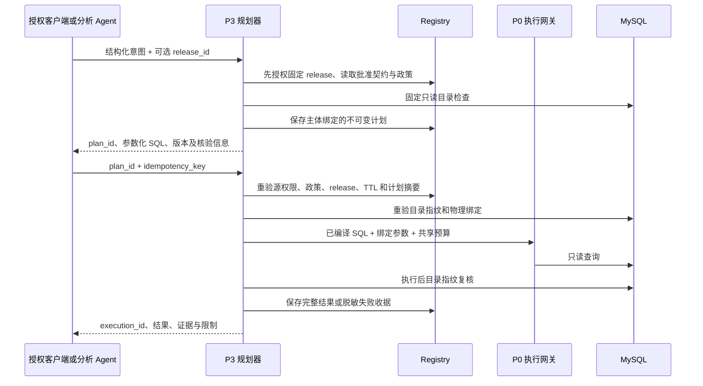

# P3 实施记录：基于已批准本体的受控查询规划与指标编译

日期：2026-11-28（Asia/Shanghai）。基线：P2 提交 `af494277f208f44f1dcf0b2693cfccb386c1eddc`。

对应[升级方案](../research/2026-11-25-auto-ontology-production-upgrade-assessment.md) P3、AO-09、AO-10。本文记录已实现范围、运行契约、验证证据和未通过实际业务验收的边界。

后续本地验收：见[本地生产工程验收记录](2026-11-28-p3-local-production-acceptance.md)。全量 Python 219 项、前端 36 项，共 255 项通过，补充签名 HTTP、真实 MySQL 并发、故障恢复、一致性备份恢复和灰度回退；E1 仅增加目录拒答负对照，真实模型质量对照和业务放量门槛仍未验收，默认灰度保持 0。

## 1. 交付与范围

P3 工程链路已实现：批准的 `Metric + MetricContract` → 授权且固定 release 的结构化计划 → 确定性 SQL → P0 只读执行网关 → 结果核验与私有证据包。保留 P0 原查询、SQL 安全、多库聚合、P1 已发布模板、P2 候选和审核流程。

首期支持一个明确 MySQL 源、一个事实数据集、最多 4 个指标、4 个维度和 2 条从事实表出发的明确多对一连接。支持 SUM/COUNT/AVG/MIN/MAX、单字段 COUNT DISTINCT，以及比率 `SUM(x)/NULLIF(SUM(y),0)`。维度、过滤、时间和关系都必须在批准契约中；不接受用户或模型传入 SQL。

**P2 机器候选仍不能执行。P2 发布的普通参考 Metric 也不会自动获得执行权：还须通过 P1 双人审核发布 MetricContract，明确编译范围。** 新实体仍为 `reference`，执行权限来自 P3 编译器对其严格解释及源/主体灰度开关。没有把任何 Metric 直接标为 executable，也没有修改 P1 仅允许 QueryTemplate executable 的规则。

默认 `ONTOLOGY_PLANNER_SOURCES=[]`、`ONTOLOGY_PLANNER_ROLLOUT_PERCENT=0`。本次没有访问真实业务库、实际 Cognito 或 Bedrock，没有加载应用 `.env` 执行验收，也没有开启线上 5% 放量。方案中的正确率、性能、业务口径和评测样本门槛必须由目标业务验收后再决定放量。

## 2. 代码位置与兼容策略

| 文件 | 变更 |
|---|---|
| `ontology/v2.py` | 新增严格 MetricContract 类型、字段/类型/依赖校验；旧 v2 文档继续有效 |
| `ontology/planner/compiler.py` | 指标闭合语法、计划范围、类型、主键粒度、连接、强制过滤与真实目录验证 |
| `ontology/planner/runtime.py` | 灰度、固定版本计划、主体绑定、执行幂等、结果核验、政策与缓存失效、存储预算 |
| `ontology/registry.py` | 增加 query_plans/query_executions 两张表；保留已有事务审批和不可变版本 |
| `server/planner_api.py`、`main.py` | 读者规划工具接口、共享请求 deadline、P3 readiness 检查 |
| `server/api.py` | 显式 plan_id 查询接入现有聊天响应；不改变普通消息及 P1 模板路由 |
| `server/exports.py` | P3 下载关联 execution_id，读取时重新校验主体、源、release、政策与有效期 |
| `pages/api/planner/[...path].ts` | 同源 Bearer 代理，严格路径/方法白名单；无管理权限升级 |
| `tests/planner_fixtures.py`、`tests/test_planner_p3.py` | 合成批准资产、语义/安全/状态/兼容契约测试 |
| `tests/test_p3_mysql.py`、`tests/web/p3.test.ts` | 真实 MySQL 黄金结果与前端代理回归 |
| `scripts/evaluate_p3.py` | E0–E3 合成验证记录，明确标注未运行的对照 |

没有新增第三方运行依赖，没有放宽 P0 SQL AST、数据库权限、只读事务或参数绑定。规划、执行、核验是确定性函数，不需要建立多个模型进程；没有借多智能体名称引入无人审核的执行权。

## 3. 批准契约

### 3.1 MetricContract

完整合成示例：[`p3-approved-contracts.json`](../examples/p3-approved-contracts.json)。它用于解释结构及测试，**不是可直接导入业务环境的授权资产**。其中 `db_a`、字段类型、源 `a` 和主体过滤必须按实际审批重新绑定。

```json
{
  "metric_id": "metric:sales",
  "dataset_id": "dataset:orders",
  "dimensions": ["field:customers:region"],
  "filter_fields": ["field:orders:tenant_id", "field:orders:owner_id", "field:orders:amount", "field:customers:region"],
  "relation_ids": ["relation:customer"],
  "time_field": "field:orders:created_at",
  "timezone": "Asia/Shanghai",
  "required_filters": ["field:orders:tenant_id"]
}
```

这些是完整 v2 实体的 attributes；实体还需要 id、owner、source_ids、availability、version、显式 dependencies 等标准字段。metric_id、dataset_id、所有维度/过滤/时间字段和 relation_ids 必须纳入依赖；v2 校验禁止批准实体引用 candidate。

契约是一个明确的执行授权边界，不是自然语言提示。一个指标匹配零个批准契约时 `UNANSWERABLE`，多个时 `AMBIGUOUS_DEFINITION`；不会按召回分数任意选一个。契约的细节会在计划验证时继续做编译语义和实时物理检查，发布一个结构合法的契约不保证它一定可以回答所有请求。

### 3.2 Metric 编译语法

Metric 必须有非空表达式、单位、时间定义和粒度。粒度必须完整且有序地等于事实 Dataset 的批准主键，且实际数据库主键也必须一致。Metric 的 field_ids 与 grain 只能来自该事实数据集；不支持把另一事实表的度量混入同一聚合。

| aggregation | 受支持 expression | 结果语义 |
|---|---|---|
| sum / avg / min / max | `SUM(amount)` 等 | 数值字段；AVG 对原始粒度计算，不平均分组均值 |
| count | `COUNT(*)`、`COUNT(id)` | 两者的 NULL 处理不同，严格保留批准表达式 |
| count_distinct | `COUNT(DISTINCT customer_id)` | 单源、单字段去重，不能跨分区相加 |
| ratio | `SUM(amount)/NULLIF(SUM(units),0)` | 原始分子/分母聚合后相除；分母为 0 返回 NULL |

表达式字段名必须绑定到 metric.field_ids 对应的实际列名，不支持子查询、窗口、任意算术、用户函数、修复 SQL 或自由格式字符串拼接。聚合字段、连接键、维度物理名采用受控标识符引用，最终再由 P0 AST 检查。

多个指标必须共享事实数据集、完整原始粒度、time_field/timezone，以及完全一致的固定过滤集合。固定过滤不同会拒绝合并，避免简单 AND 两种口径造成结果失真。不同单位在输出标签和证据中分别保留；不做未经批准的币种换算。

### 3.3 时间、过滤和政策

time_field 非空时，每次必须提供明确的 `[start,end)` 与同一 timezone；只支持 DATE/DATETIME 按批准的本地存储时间比较。支持 `UTC`、`Asia/Shanghai`，不推断“本月”、比较基准或时区转换。当前不支持 TIMESTAMP、带偏移字符串及隐式会话时区；不能靠删除过滤规避类型拒绝。time_field=null 表示人工批准的全量口径，请求不能再偷偷添加其他时间字段。

用户过滤支持 eq/ne/gt/gte/lt/lte/in/is_null/not_null；required_filters 要求显式 eq/in 范围。NULL 检查不接受 value，IN 最多 100 个非 NULL 标量。整数拒绝字符串/布尔隐式转换。数值参数有限、绝对值小于 10^35、小数最多 30 位，使用绑定参数和显式 `CAST(... AS DECIMAL(65,30))`，防止 Decimal 过滤退化成隐式字符串浮点比较。结果 Decimal 按字符串精确存入 JSON；图表浮点转换只是展示，不替代原始结果。

required_filters 是口径/范围要求，不等于租户授权。不能因请求写了 tenant_id 就信任其身份；实际隔离必须由可信源授权、批准 Policy 和数据库只读权限共同落实。本阶段没有独立的租户身份提供商或自动租户授权映射。

Metric.filters 仍沿用 v2 的字符串数组，但 P3 只解释其中的受控 JSON 条件，例如：

```json
{"field_id":"field:orders:amount","op":"gte","value":"0.00"}
```

任意旧 SQL 条件字符串会拒绝编译，不会解释成 SQL。

批准的 Policy.definition 支持两种 JSON：

```json
{"version":1,"deny":true}
```

```json
{"version":1,"filters":[{"field_id":"field:orders:owner_id","op":"eq","value":{"principal":"subject"}}]}
```

适用政策条件总是 AND 到查询，用户条件不能移除它们。主体值由服务端可信 principal 注入。政策从完整发布文档检查，不只扫描授权检索列表；适用政策不可访问、不可解释，或存在尚无执行器的相关 QualityRule，都会拒绝。候选政策不参与线上授权。

同一物理源/表/列即使换一个本体 ID，也仍参与原政策适用性检查，不能借 ID 别名绕过政策。如果政策引用的逻辑绑定无法映射到明确计划，拒绝执行并要求治理统一绑定，不猜测映射。当前能力是受控单源行范围过滤和 deny；不是通用 ABAC、动态脱敏、任意质量规则解释器。

### 3.4 关系与粒度

维度或过滤字段不在事实表时，需要显式 relation_ids，并同时获每个指标契约批准。仅支持事实表 → 维表的星型 `many-to-one`，join_type 为明确 left 或 inner；最多两条。不自动选择同名字段，不支持多跳、自关联、桥表多对多或跨源动态 JOIN。

必须在数据库实际目录找到完整目标唯一键/主键，复合键顺序和全部组成列保留，类型/排序规则一致。P2 的 sampled_pass 不能替代执行时的唯一键约束。样本无重复但没有实际唯一约束的关系会被拒绝。LEFT 保留孤儿事实并产生 NULL 维度，INNER 可能排除无匹配事实，必须由批准口径明确承担这一差异。

## 4. 规划、执行和失效机制



### 4.1 固定版本与政策权威

计划绑定 namespace、可信主体、source_id、release_id、定义版本、目录指纹、连接绑定摘要、参数引用和编译器版本。其他主体即使拥有同源权限也不能读取或执行该计划。调用方不能重写 SQL、指标列表或参数后继续使用原 plan_id。

本体语义固定到计划的 release。普通指标版本变化不悄悄改变已验证计划；但**当前活动发布中的相关源政策摘要必须仍与计划一致**。增加/修改/移除批准 Policy 或 QualityRule 后，旧计划、新执行、缓存结果和 P3 下载都会以 `STALE_POLICY` 拒绝，需要重新规划。显式指定旧 release 也不能绕过新政策。

每个请求重新验证 JWT/源权限。执行前后检查发布隔离和当前政策，读取缓存/下载也检查；物理端点/库/账号变化使旧结果失效，单纯密码轮换不改变绑定摘要。source grants 的认证快照是当前请求内的身份上下文，不声称每条 SQL 之间都重新调用身份提供商；进行中的请求受最长预算约束，后续请求和下载按新授权验证。

目录验证只涉及批准计划使用的表列，复用 P2 固定 information_schema 探测。表列类型必须与批准定义精确一致，计划验证和执行前后指纹变化均阻止产生完整答案。MySQL 与 SQLite 不共享事务，结构验证与查询之间仍有极短变化窗口；查询本身是一条只读语句，不承诺跨请求源快照或与其他库一致的水位。

目录指纹在计划验证时建立，不替代业务方冻结完整数据库 schema 的治理流程。执行器验证已声明类型、事实主键和目标唯一键等约束；未在本体中声明的历史存储细节不能凭新计划指纹追溯证明。

### 4.2 幂等与资源限制

| 约束 | 初始值 |
|---|---|
| 源 / 事实表 / 指标 / 维度 / 连接 | 1 / 1 / 4 / 4 / 2 |
| 实际物理表 / 每表显式字段 | 最多 3 / 64 |
| 请求过滤 / 每个 IN | 最多 16 / 100 |
| 适用政策 | 最多 32，每条过滤最多 16 |
| 单次规划或执行总预算 | 最长 60 秒，同时受请求剩余时间限制 |
| SQL 次数 / 单 SQL | 共享 P0 QueryBudget；默认 16 次，目录单条最多 5 秒，业务 SQL 沿用 P0 上限 |
| plan TTL / result TTL / execution 租约 | 10 分钟 / 从执行创建起 10 分钟 / 90 秒 |
| 同主体 / 全局运行执行 | 最多 1 / 4 |
| 单计划或结果 / 累计 P3 产物 / 累计行记录 | 6 MiB / 128 MiB payload / 10,000 条 |

规划和执行是两个请求，分别有各自请求预算；单次执行内部的元数据、业务查询和复核共享同一预算，没有每一步重新获得 60 秒。执行仍采用 P0 行/字节限额。任何业务结果截断都会成为 `PARTIAL_RESULT`，不输出完整指标答案；大规模查询应缩小时间/维度范围或使用经过审核的专门模板。

幂等键绑定 `namespace + actor + key`，且绑定唯一 plan_id。同键同计划返回已有收据；同键换计划返回冲突。并发同键只产生一个 SQL 执行，另一请求取得 running 状态。失败不自动重试、不调用模型修复、不切换旧 Prompt；需显式新计划/新键处理。超时或进程中断后，下一次访问将过期租约标为 failed，迟到工作不能覆盖。

查询失败记录稳定错误码而非驱动原文。计划/结果损坏、配额超限、空参数/类型不符均失败关闭。SQLite 的 P3 表仍只支持单机本地事务存储；没有分布式作业队列和自动 SQL 取消 API。

TTL 是访问有效期，**不是磁盘物理删除承诺**。当前保留原记录维护审计和幂等语义；容量达到硬上限后拒绝新计划/结果，运维需一致性备份、归档并在停写窗口按关联关系治理保留期。不能随意删掉幂等记录后重用旧键。全局 128 MiB 是 P3 payload 逻辑限额，不等于整个 SQLite 文件或 P0/P1/P2 存储总大小。

### 4.3 核验与证据

只有状态 success、未截断、游标列精确等于计划输出、指标值为有限数值或 NULL、执行后结构/政策检查通过，才保存 succeeded 结果。Decimal 原精度保留；零分母与无适用值保留 NULL。回答文本固定说明口径和限制，不让模型编造原因、趋势或因果解释。

证据包含 plan_id、execution_id、release_id、Metric/Relation ID 和版本、传递依赖版本、SQL SHA-256、不可猜测的参数引用、源 ID/数据库、目录指纹、政策上下文摘要、实际读取起止时间、行数、完整性检查、SQL 次数和事件顺序。`retrieved/selected/validated` 与 `executed/verified` 分开，未执行计划不展示为业务答案。原始参数和结果只在私有存储，公共日志不打印它们。

聊天响应保留 status/content/mdData/chartData/sql/chartType/extra/sources/ontology 字段。显示行数仍由 MAX_ROW_COUNT_RETURN 限制；完整成功结果超过展示上限时生成受控下载，P3 下载绑定执行收据，政策变化、权限撤销、源重绑、隔离和过期均能阻止后续下载。

## 5. 工具 API 与接入

Flask 全部经现有 JWT 认证。通过 Next 时前缀为 `/api/planner/`，后接下表 `/v1/` 之后的部分；不要从浏览器直接访问数据库。无管理员资格的读者可使用这些查询工具，但必须具备源授权及灰度资格。

| 方法 / Flask 路径 | 用途与请求 |
|---|---|
| POST `/v1/questions/check` | question、source_ids、可选 release_id；精确匹配批准名称/同义词，返回缺失时间/范围或歧义；不执行 |
| GET `/v1/metrics/<id>` | 当前活动版本的可见 Metric；固定版本明细继续用 P1 Knowledge API 的 release_id |
| POST `/v1/relations/plan` | source_ids、left_dataset、right_dataset、可选 release_id；返回批准候选路径及歧义，仍需计划验证 |
| POST `/v1/query-plans/validate` | intent、可选 release_id；返回 201、主体绑定 plan_id 与验证信息 |
| GET `/v1/query-plans/<id>` | 同主体读取未过期计划；不返回原始参数/政策字面量 |
| POST `/v1/queries/execute` | plan_id、idempotency_key；200 succeeded、202 running、422 失败收据；权限/版本冲突保持对应错误 |
| GET `/v1/executions/<id>` | 同主体且当前源/政策/发布有效时读取结果或失败状态 |

questions/check 是确定性澄清入口，不是通用自然语言解析器。比如“sales”可以命中指标并要求时间/租户范围，“为什么下降”不会被擅自转成比较口径。客户端或受限 Agent 可用 Knowledge API 取得明确 ID，提交结构化意图；错误或歧义需澄清，不通过 LLM 兜底扩大范围。

意图示例见 [`p3-query-intent.json`](../examples/p3-query-intent.json)。核心结构：

```json
{
  "source_ids":["a"],
  "metric_ids":["metric:sales"],
  "dimensions":["field:customers:region"],
  "relation_ids":["relation:customer"],
  "filters":[{"field_id":"field:orders:tenant_id","op":"eq","value":1}],
  "time":{"start":"2026-11-01","end":"2026-12-01","timezone":"Asia/Shanghai"}
}
```

先以 `{"intent": ...}` 验证，再提交 `{"plan_id":"<返回的32位ID>","idempotency_key":"<本次用户操作的稳定键>"}` 执行。调用聊天入口 `/api/chat` 时，可把同样对象放入 `ontology`，并保留 messages 和 sourceIds；源必须与计划完全一致。原 P1 的 ontology.template_id/parameters 协议继续保留，不能混合 template 与 plan 选项。

本期没有新增自然语言 UI 自动切换、指标图形设计器或 Agent MCP 服务；现有页面继续工作，P3 由显式 API/聊天计划信封调用。不会仅因为开关开启就把所有普通问题改路由到新规划器。

## 6. 配置、发布和回退

```dotenv
ONTOLOGY_PLANNER_SOURCES=[]
ONTOLOGY_PLANNER_ROLLOUT_PERCENT=0
```

灰度比例是对 `namespace:subject` 的 SHA-256 稳定分桶，范围 0–100；同一主体稳定进入同一桶。它约束显式规划请求，**不是生产流量实际分布保证**，不同主体请求量可能不同。单源开启时配置如 `["a"]`，测试环境可设 100；方案的 5% 只在业务/权限/质量门槛验收后设置 5，不能由这次合成测试自动决定。

部署顺序：

1. 备份 Registry 和导出库，保留当前 release、源配置与授权；先部署新代码，开关保持关闭。
2. 确认只读 MySQL 账号、实际主键/唯一键和精确类型；选择可承受目录读取与聚合扫描的只读实例。
3. 通过现有 P1 changesets → 独立 review → releases 流程发布 MetricContract。P2 Metric 没有单位/时间/粒度时必须人工补齐；不改自动候选 availability。
4. 用两个不同管理员完成审批，再用真实读者身份执行已标注黄金问题和负向权限用例。readiness 对非零灰度源检查源授权与批准契约存在，但不把 readiness 当业务正确性证明。
5. 对比实际业务口径、Decimal 结果、NULL/零分母、过滤、连接和证据；另做负载/源扫描成本测试。
6. 通过门槛后显式配置源和百分比，观察错误码、拒答/澄清、执行时间、SQL 次数、容量及源负载。ONTOLOGY_QUERY_SOURCES 仍独立管理 P1 模板路由。

业务开关回退优先将 P3 percent 设为 0；新的规划/执行以及 P3 缓存/下载均拒绝，普通 P0/P1 请求保留原路径。开关不保证立即杀死正在数据库执行的语句，后置校验与预算阻止继续发布失效结果。语义错误可用 P1 quarantine/CAS 回滚，保留证据。

**二进制降级需特别注意新增 MetricContract 类型。** 当前代码兼容旧 v2；旧 P1/P2 代码不认识新类型。不能直接用旧代码读取含新类型的全部历史并假设管理功能正常。必须先归档 P3 数据，验证恢复到降级版本可读的一致性 Registry 备份，并在测试环境演练；优先只关功能开关，避免为回退修改不可变 release。

## 7. 验证与评测记录

P3 实现阶段 **247 个不同测试通过**：Python 211 + 前端 36。P3 新增 37 个契约/HTTP/并发/安全测试、9 个真实 MySQL 测试及 8 个代理测试，共 54 个。后续本地验收另增 8 项，最终共 255 项，详见本文开头链接。真实数据库重复执行与评测脚本复用同一用例，不重复计入总数。

| 检查 | 结果 |
|---|---|
| Python 默认 discover | 211 项，188 通过，23 项真实 MySQL 默认跳过 |
| 真实 MySQL 8.0.46 | P0 8 + P2 6 + P3 9 = 23 项通过 |
| Vitest | P0/P1/P2/P3 共 36 项通过 |
| TypeScript | `npx tsc --noEmit --incremental false` 通过 |
| Next 生产构建 | 不含 `.env*`、运行数据的临时副本中通过，新增 `/api/planner/[...path]` |
| 差异/源码检查 | 无空白错误，原 `need.md` 未修改 |

关键反例包括：候选或无契约指标、契约歧义、任意 SQL/未知字段、错粒度、关系放大、未批准维度、缺少时间/范围、政策无法解释、物理 ID 别名规避、旧政策缓存/下载、源撤权/重绑、隔离、结构漂移、截断、非数值/NaN、并发重复执行、租约迟到、产物损坏、容量不足和模型修复禁用。

真实数据夹具包括复合主键、多租户同名 ID、主体行过滤、不同分组样本量、NULL 金额、零分母、孤儿客户、时间边界及恶意字符串。黄金结果：有效事实 5 行，非空金额 4 行，SUM=160、AVG=40、SUM(amount)/SUM(units)=40；华东 SUM=120、AVG=60、去重客户=1；华南零分母保留 NULL。额外验证 `99.99999999999999999999` 数值边界不会被浮点比较舍入成 100。

机器可读记录：[`2026-11-28-p3-synthetic-results.json`](../evaluation/2026-11-28-p3-synthetic-results.json)。复现脚本 `scripts/evaluate_p3.py` 记录：

| 组别 | 本次实际运行 | 不能据此宣称 |
|---|---|---|
| E0 | P0 SQL/联邦基础设施回归 8 项 | 未运行原 LLM 主链路的答案质量基线 |
| E1 | not_run | 没有可比的纯目录新查询循环，不编造对照分数 |
| E2 | 人工批准本体的合成 MySQL 结果 8 项 | 不是 200 题真实业务正确率或语义增益统计 |
| E3 | 隔离数据域：P2 candidate → 人工口径/审核 → 独立批准 Contract → 执行，1 项 | 没有上游 LLM 质量、人工成本或生产业务验收结论 |

该实现阶段记录明确 `model_calls=0`、`data=synthetic_only`、`production_gate=not_evaluated`。后续本地验收补齐并发负载和 p95；真实 Cognito/Bedrock、业务题集、E0/E1 答案对比及置信区间仍未运行，不能声称满足生产 5% 放量条件。既有 React hooks、Browserslist 和 Webpack 构建提示仍存在，未关闭检查隐藏问题。

复现命令（依赖使用现有锁定环境）：

```bash
.venv/bin/python -m unittest discover -s tests -v
npx vitest run tests/web --threads false
npx tsc --noEmit --incremental false
# 仅在不包含真实 .env 的隔离副本：
NEXT_TELEMETRY_DISABLED=1 npm run build
```

真实数据库仅使用一次性本地实例，随机前缀测试库和 SELECT-only 用户由测试创建并清理：

```bash
docker run -d --name bi-p3-test --publish 127.0.0.1::3306 \
  --env MYSQL_ROOT_PASSWORD=disposable-fixture-only mysql:8.0
docker port bi-p3-test 3306
# 等待实例就绪，替换端口；不得指向业务实例。
P0_MYSQL_TEST_PORT=<port> P0_MYSQL_TEST_ALLOW_CREATE=1 \
  P0_MYSQL_TEST_PASSWORD=disposable-fixture-only \
  .venv/bin/python -m unittest tests.test_p0_mysql tests.test_p2_mysql tests.test_p3_mysql -v
P0_MYSQL_TEST_PORT=<port> P0_MYSQL_TEST_ALLOW_CREATE=1 \
  P0_MYSQL_TEST_PASSWORD=disposable-fixture-only \
  .venv/bin/python scripts/evaluate_p3.py --output /tmp/p3-synthetic-results.json
docker rm -f bi-p3-test
```

## 8. 反思与后续边界

1. 审核通过的文字定义不能直接成为 SQL 权限。新增 Contract 让维度/关系/时间/过滤具备明确批准边界；仍需要真实业务 owner 对定义负责。
2. P2 样本关系证据适合辅助审核，但执行防放大需要实际唯一键。没有唯一约束时拒绝动态 JOIN，即使牺牲覆盖率，也不偷偷扩大事实粒度。
3. 固定语义 release 与当前权限是两件不同的事。政策变化会失效旧结果及下载；不能用“可重现”为理由继续使用已撤销范围。
4. E2/E3 工程正确性已经可复现，但缺少 E1 和真实 E0 答案质量，无法证明本体提升了多少百分点。后续应建立至少 200 题分层且人工审阅的评测集，固定模型/预算/快照后再做配对比较。
5. P3 动态指标当前只做单源。跨源 AVG/ratio/distinct 不会被临时拼接求和；已有 P0/P1 审核聚合契约继续工作。多源动态计划需另建可证明的分区和合并语义。
6. 多事实粒度、SCD 时间关系、自关联、多跳、动态策略语言、自动政策部署、后台漂移监控与图形化指标设计仍不在本次能力内。遇到不支持的定义明确拒绝，后续按证据和需求逐项扩展。
