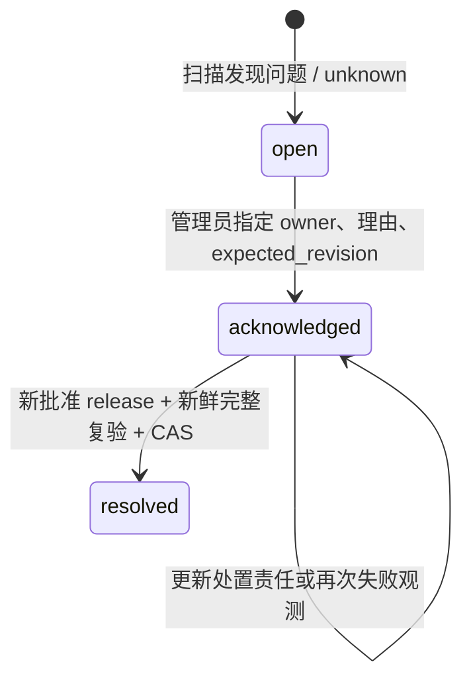

# P4 实施记录：治理闭环、受控协作与 MCP

日期：2026-11-28（Asia/Shanghai）。实现基线：P3 提交 `a6058570a827245465303883051577369006a65b`。依据[升级方案](../research/2026-11-25-auto-ontology-production-upgrade-assessment.md)的 P4、AO-11、AO-12，并承接 [P3 本地验收](2026-11-28-p3-local-production-acceptance.md)。

## 1. 本次交付与退出条件

P4 工程链路已实现：批准资产 → 有界目录/质量扫描 → 影响分析 → 有 owner 的治理问题 → 相关资产隔离 → 人工修复及双人审核的新 release → 完整复验 → CAS 解除隔离。查询侧新增共享身份、版本、预算的协调任务，以及按需独立总量核验；MCP 为现有认证 REST 的薄适配。

**P3 灰度默认仍为 0，P4 治理和协作默认关闭。** 原 P0 查询与多库聚合、P1 注册审核与模板、P2 候选生成与审核、P3 受控计划及证据接口保留。新功能没有自动发布、修改业务数据、自动扩权或因失败转回自由 SQL 的路径。

本地工程回归、真实 MySQL 治理闭环、签名 HTTP 和 MCP 适配验收通过。E4 已有合成数据的成本记录与故障注入证据；**真实 E1/E4 模型质量对照、业务黄金题与生产放量条件仍未验收**，不宣称方案中全部业务退出条件已完成。本期不执行生产部署或开启非零灰度。

## 2. 代码与兼容性

| 位置 | 作用 |
|---|---|
| `ontology/governance/runtime.py` | 治理扫描、目录差异、依赖影响、问题 owner/状态、CAS 处置、物理别名隔离 |
| `ontology/governance/rules.py` | 批准质量规则的闭合语法和只读精确计数 |
| `ontology/analysis/runtime.py` | 单任务协调、固定 release、主查询、独立核验、任务幂等与回放授权 |
| `integrations/mcp_stdio.py` | MCP stdio → 固定 REST 工具清单，私有 token 文件，不暴露管理工具 |
| `ontology/registry.py` | 增量增加 `governance_runs`、`governance_incidents`、`analysis_tasks`；旧数据保持兼容 |
| `ontology/discovery/mysql.py` | 仅治理调用使用 `tolerate_missing=True`，读取缺表/缺列证据；P2/P3 默认严格目录行为保持原样 |
| `ontology/planner/compiler.py` | `metric-compiler/2` 支持闭合 QualityRule；旧未识别规则仍失败关闭 |
| `ontology/planner/runtime.py` | 执行质量规则并共享 SQL 预算；所有计划/结果访问重验治理隔离 |
| `ontology/runtime.py`、`server/exports.py` | P1 模板和发布关联下载接入治理守卫；新导出保存依赖 ID |
| `server/governance_api.py`、`main.py` | 管理治理 API、读者任务 API、认证/请求预算及 readiness 配置检查 |
| `utils/server/ontologyProxy.ts`、`pages/api/planner/[...path].ts` | 明确管理路由和读者路由，沿用 Bearer 校验与管理员分离 |
| `scripts/evaluate_p4.py` | 全量 Python 回归、E4 观测、故障控制和源文件 SHA-256 报告 |

没有新增第三方运行依赖，也没有替换已有数据库驱动、JWT 或 SQL 安全检查。管理界面继续使用原 P2 审核台；本期治理处置通过 API，未增加治理图形工作台。

## 3. 治理扫描、差异与影响

### 3.1 授权与观测范围

`POST /v1/ontology/governance/runs` 要求管理员身份、当前 source grants、源级治理配置，以及当前可用的批准 release。只读取批准且依赖闭合的单源实体；候选不作为观测授权依据。批准的 DataSource 必须与运行数据库名称一致。

每轮最多 8 张表、每表 128 个批准字段、8 条质量规则。目录通过既有 Collector 固定 information_schema 探测获得；治理模式会观察批准表内的新增列元数据，用于发现新增/删除/改名迹象，不读取业务原始样本。完整目录读取仍受 2,048 行、2 MiB 结果与探测超时限制，超限不视作完整证据。

扫描前后各读取一次目录指纹。中间发生 schema 改变、探测不可用、证据截断等情况记为失败/unknown，并创建源范围阻断问题。数据库错误只记录稳定错误码，驱动原文不进入问题证据或响应。

### 3.2 初始扫描与后续差异

首次扫描直接检查批准定义中的字段类型、完整主键及多对一关系目标唯一键。**没有“第一次看到什么就批准什么”的自动基线。** 后续同绑定扫描比较目录快照，记录列新增、移除、变更、索引变化和 FK 变化。重命名表现为删除/新增，只作为映射修订证据，不自动搬迁原字段 ID 或指标语义。

以下形成阻断问题：批准表/列缺失、表类型变化、批准字段类型不符、主键不符、关系目标缺少唯一键、原有唯一约束丢失，以及已观测字段的 nullable/collation 变化。列新增、仅注释/位置变化和 FK 差异会记录为变更；FK 差异本身不等于已证明数据违规，不自动修改关系基数。需要引用完整性检查时，仍使用 P2 关系证据与人工审核；本期没有新增孤儿率在线质量规则。

每条问题保存种类、目标实体、逆向依赖影响集合、物理隔离键、首次 release、最近失败 run、owner、状态与 revision。影响集合覆盖显式依赖的 Metric、MetricContract、Mapping、Relation、QueryTemplate 等实体，不猜测未登记的外部报表调用方或评测题关系。

普通问题按字段/表/实体及依赖隔离，不全局关闭 release。同一物理字段或表换逻辑 ID 仍会命中隔离；关系唯一键问题按目标表隔离。Contract 已批准但本次未实际使用的依赖也可能被保守阻断，不能把它描述为每条 SQL 列级最小隔离。

扫描失败或问题规模过大时使用源范围隔离：每轮最多保存 32 个精确问题；若问题集或证据超过限额，记录 `GOVERNANCE_LIMIT` 和带 `impact_truncated` 的源级问题，不悄悄丢弃多余问题后报告成功。

### 3.3 采集频率与候选保护

本期扫描是有界同步 API，由授权管理员或现有运维调度触发。没有安装后台定时器，也没有承诺实时监听数据库 DDL。首次开启治理后应立即扫描，并由环境运维按数据变更频率配置调度；调度使用不同幂等键，同一键用于失败网络回放。

每个扫描固定一个 release。扫描结束时 active 若变化，旧扫描仍可留下安全隔离证据，但不能证明新 release 已通过。扫描租约中断会留下 `interrupted` 记录，不自动重跑或解隔离，需用新操作键完成观测。

治理扫描不更新 release 或批准实体。需要重新编译时，继续调用已存在的 P2 discovery API，在既定采集策略内生成候选，再走 prepare-review / P1 双人审批；旧 owner 的手工定义不会被新观测覆盖。Schema 或数据的实际修复操作不由本应用执行，测试中的 DDL/DML 仅由一次性夹具管理员执行。

## 4. 批准质量规则

继续使用已有 v2 `QualityRule`，没有将其放宽成可执行 SQL。`definition` 仅接受下列 JSON 结构：

```json
{"version":1,"check":"not_null","field_ids":["field:orders:amount"]}
```

```json
{"version":1,"check":"unique","field_ids":["field:orders:tenant_id","field:orders:id"]}
```

字段必须属于同一个批准源和数据集，并显式列入规则 `target_ids`、`dependencies`。`not_null` 检查任一指定字段为 NULL 的行数；`unique` 检查重复键组数，重复 NULL 元组也视为重复。两者阈值都是人工批准的零违规，不自动选阈值或以采样零违规代替全量通过。

规则由受控编译器生成 COUNT 查询，经 P0 AST、只读事务、结果上限和共享预算执行，只返回计数，不返回违规行。精确计数可能扫描大表；结果为一行不等于扫描成本小，必须在适当只读副本和窗口内运行。超时、截断、不可解释定义或不完整输出均为 unknown/拒绝。

治理扫描会将规则失败/unknown 转为有 owner 的问题。P3 对计划适用的批准规则在业务 SQL 前实时执行，质量计数也消耗原请求 SQL/时间预算。规则失败时无正式指标结果；成功证据包含规则 ID、版本、方法与状态。未经治理扫描发现的历史成功收据不会因数据后来变化而自动重查质量，仍按既有 TTL 与已知隔离状态访问。

**在线质量 SQL 必须与主查询使用相同的授权行范围**：强制主体 Policy、时间窗、固定/用户过滤及连接全部保留，不能借质量检查扫描读者无权访问的行。在线只支持事实表字段的规则，并将证据标为 `scope=authorized_plan_population`；这不证明全源质量健康。管理员治理扫描检查完整批准表，证据为 `scope=approved_source_table`。维表字段规则仍可被管理员扫描，但若作为 P3 计划适用规则，本期会明确拒绝，不把维表值在事实连接中的重复误判为维表主键重复，也不会仅凭历史扫描通过就绕过在线不支持的规则。

真实 MySQL 反例覆盖了一条当前读者不可见且 owner 为空的记录：在线质量计数为 0、合法主体结果仍为 5；管理员完整表扫描检测到 1 条违规并建立隔离。另验证复合主键唯一性为零违规，以及包含重复 NULL 元组在内的 3 个重复键组。这些用例确保质量扫描本身不扩大读者授权范围。

质量查询和指标查询不是同一个跨语句源快照，不能据此承诺源数据在两者之间不变。P1 模板接入的是已知治理隔离守卫，本期没有为旧 P1 任意模板增加 inline QualityRule 执行器。P0 未绑定本体的旧查询仍维持原 SQL/身份安全边界，不声称能自动映射到全部治理依赖。

## 5. 问题处置与解除隔离



问题不会因为下一次扫描碰巧恢复而自动关闭。`acknowledge` 必须填写 owner 与理由；owner 是处置责任标签，不产生查询或发布权限。`resolve` 同时要求：

1. 问题已经 acknowledged，revision 与调用方预期一致。
2. 复验 run 属于同 namespace / source、状态 complete，晚于该问题最近失败观测，且距当前不超过 300 秒。
3. run 对应当前可用 active release，且该 release 不同于问题首次发生的 release，说明已经过新的 P1 双人审核发布。
4. 该次完整源复验没有任何 findings，运行源绑定摘要与复验一致。

这比“只检查某个问题已消失”更保守：同源还有其他问题时，不能用部分成功证据解隔离。旧审核、旧快照、过期复验或源重绑都不能解除隔离。状态变更保留 audit 记录和理由，不删除旧观测。

隔离检查始终读取持久问题状态，**关闭采集开关不等于解除隔离**。P3 的计划、执行、缓存、下载和分析任务回放都会重新检查；P1 模板执行前后和发布关联下载也检查。旧 P1 导出没有依赖 ID 时按其已授权源保守检查全部相关发布资产；新导出记录精确的已声明依赖。

## 6. 按需协作与独立核验

`POST /v1/analysis/tasks` 接受 P3 结构化 `intent`、`idempotency_key` 和 `verification=auto|required|off`。身份与命名空间只由网关注入，不接受请求中的 actor、principal、token、namespace、SQL 或任意工具定义。

Coordinator 在任务起点固定 release。Planner 生成 P3 计划；Query Worker 执行计划；Verifier 在适用时创建同 release、同源、同过滤和同连接、去除分组维度的独立总量计划。所有角色顺序调用已有受控工具，使用**同一个 QueryBudget**；没有为每个角色创建新的 SQL/时间预算，也没有并行模型或自由 SQL 子循环。

本期独立核验仅适用于带分组维度且全部指标为 SUM/COUNT 的意图。保留 LEFT/INNER 连接和过滤，确保核验总体与主查询总体一致；采用高精度 Decimal 比较分组总和与独立总量，保留 NULL 语义。AVG、ratio、COUNT DISTINCT 等不可加指标不进行错误求和：`required` 会在业务执行前拒绝；`auto` 返回 `not_applicable`；`off` 明确返回 `not_requested`，不会伪称完成独立核验。

独立核验失败、预算用尽、任一子查询失败或结果不完整，任务的正式 result 为 null。两个查询之间源数据可能更新，差异只说明复核不一致，不能断言一定是计算 bug 或证明了原因。任务输出没有自动生成因果叙述。

任务证据记录可信主体引用、scope、release、父子 task ID、角色、plan/execution ID、共享 SQL 调用数、总耗时、核验结论与局限。相同主体/namespace/幂等键不可换意图；每次回放重验源权限、灰度、政策、release、治理隔离及子收据期限，其他主体不可读取。进程中断或租约过期不会用相同键重新执行；需新操作键发起恢复任务。

## 7. MCP 薄适配

启动方式为 `python -m integrations.mcp_stdio`，标准输入/输出只传单行 UTF-8 JSON-RPC。实现固定支持 MCP **2025-06-18** 协议版本，通过 initialize → initialized 协商进入工具调用。它不是最新协议所有特性的实现，不提供远程 MCP HTTP/OAuth 服务或自动模型采样。

工具仅有：`knowledge_search`、`question_check`、`query_plan_validate`、`query_execute`、`execution_get`、`analysis_run`、`analysis_get`、`governance_status`。其中知识检索工具要求显式 release，协作任务在服务端固定 release；审批、发布、扫描、解除隔离与任意 SQL 都不在工具清单。

服务地址只来自 `MCP_BACKEND_URL`；仅允许 HTTPS，或本机环回 HTTP。不接受工具参数指定地址，禁止自动重定向和环境代理。凭据只来自 `MCP_ACCESS_TOKEN_FILE`，文件不能对组或其他用户开放读取；每次调用重新读取，便于现有安全流程轮换 token。token 不出现在工具定义、输出或参数中。每次 REST 调用仍经过生产 JWT 校验，工具声明不是授权依据。

适配器限制输入为 128 KiB/消息、后端响应为 8 MiB，禁止非有限 JSON 数值；后端超时 65 秒，任务自身最长 60 秒。stdio 按序处理，不提供运行中取消源 SQL 的承诺；客户端断开不等于立即取消已发送 SQL。它不管理 Cognito 登录/刷新，运维需通过现有安全配置提供有效 access token，不能把 token 粘贴进模型提示词。

官方协议核对来源：[传输](https://modelcontextprotocol.io/specification/2025-06-18/basic/transports)、[生命周期](https://modelcontextprotocol.io/specification/2025-06-18/basic/lifecycle)、[工具](https://modelcontextprotocol.io/specification/2025-06-18/server/tools)。按照明确版本实现，客户端应检查协商版本是否受支持。

## 8. API 与配置

| 接口 | 身份 / 主要输入 |
|---|---|
| `POST /v1/ontology/governance/runs` | admin；`source_id,idempotency_key` |
| `GET /v1/ontology/governance/runs/{id}` | admin + source grants；完整私有证据 |
| `GET /v1/ontology/governance/incidents` | admin；只返回其源范围的问题，最多最近 1,000 条 |
| `POST /v1/ontology/governance/incidents/{id}/transition` | admin；`expected_revision,action,reason`，acknowledge 带 `owner`，resolve 带 `run_id` |
| `POST /v1/governance/status` | reader；`identity,release_id?`，返回可见资产是否被隔离，不返回管理证据 |
| `POST /v1/analysis/tasks` | reader；`intent,idempotency_key,verification?` |
| `GET /v1/analysis/tasks/{id}` | 创建任务的同主体 + 当前权限 |

Next 同源代理分别沿用 `/api/ontology/governance/...` 和 `/api/planner/analysis/...`、`/api/planner/governance/status`。管理路由仍先查管理员身份，读者代理不能跳转到管理动作。API 请求体白名单拒绝伪造身份等额外字段。

```dotenv
ONTOLOGY_PLANNER_SOURCES=[]
ONTOLOGY_PLANNER_ROLLOUT_PERCENT=0
ONTOLOGY_GOVERNANCE_SOURCES=[]
ONTOLOGY_ANALYSIS_ENABLED=false
ANALYSIS_MAX_SQL_CALLS=32
# MCP_BACKEND_URL=http://127.0.0.1:5020
# MCP_ACCESS_TOKEN_FILE=/absolute/private/access-token
```

协作开关不覆盖 P3 灰度：即使 analysis=true，P3 percent=0 时仍不能查询。治理扫描不要求打开查询灰度，可在 percent=0 时完成治理准备；必须单独配置治理源并使用管理员凭据。readiness 验证治理源位于有效授权范围。

| 资源 | 上限 |
|---|---|
| 单轮治理 / 任务时间 | 60 秒，同时受请求剩余 deadline 限制 |
| 治理 SQL | 沿用 P0 QueryBudget 默认 16 次；目录前后 8 次，余量用于批准规则 |
| 协作 SQL | 默认 32 次、硬上限 32；主查询和核验共用，可配置更低，耗尽即失败 |
| 同时运行 | 全局 1 个治理扫描、2 个分析任务，叠加既有 P3 每主体 1 / 全局 4 个执行约束 |
| 租约 | 90 秒，迟到结果不能覆盖失效运行 |
| 任务 / 子计划结果 TTL | 600 秒；回放受全部子产物期限约束 |
| 治理产物 | run 与问题合计最多 10,000 条、128 MiB payload；启动时预留最大本轮额度 |
| 单轮治理证据 / 问题 payload 合计 | 各最多 2 MiB；超限记录源范围阻断 |
| 分析任务产物 | 最多 10,000 条、64 MiB payload；单任务 6 MiB，预留在途任务容量 |

以上为逻辑 payload 限额，不等于 SQLite 文件上限。与 P3 一样，TTL 不删除持久审计、任务或幂等记录；到限拒绝新增，需受控备份归档。未增加无界后台队列。

## 9. 测试、E4 证据与复现

机器可读结果见 [P4 本地验收 JSON](../evaluation/2026-11-28-p4-local-acceptance.json)。测试覆盖新治理/协作/MCP 契约、真实 JWT HTTP + MySQL 和前端代理，并运行 P0–P3 全部回归。报告包含实际用例数、跳过/失败计数、E4 耗时/SQL 成本、故障切片和关键源文件 SHA-256；报告要求全量 Python 通过且零跳过才标为 passed。

最终 **300 个不同测试通过**：Python 258（0 跳过、0 失败）+ Vitest 42。P4 新增 32 个治理/协作/MCP 契约测试、7 个真实 MySQL/HTTP 用例、6 个代理用例，共 45 个；历史 P3 的 255 项仍保留，重复执行不重复计数。TypeScript `--noEmit --incremental false` 检查通过。

Next 生产构建在排除 `.env*`、运行数据的临时副本中通过；首次受沙箱网络限制无法获取既有 Inter 字体，允许读取现有字体依赖后构建成功。既有 hooks、Browserslist 与 Webpack 提示仍保留，没有关闭检查掩盖告警。

后端按原 `DockerfileServer` 和哈希锁定依赖构建通过。最终本地 Linux arm64 镜像为 `sha256:3d5d7c9f639fdd77790e815c9bed95a2eac8b58fc3ed7dc0320b2ce521975471`；Nginx/uWSGI/Flask 启动后 `/healthz`=200、无业务配置 `/readyz`=503、未认证的 analysis 与 governance POST 均为 401，响应保持 no-store。容器 `pip check` 通过；没有推送镜像或部署生产。

E4 的收益证据限定在可加指标的独立总量核验：漏分组、重复分组、错误金额三种人工注入的结果产物故障均被拒绝，正常对照未误拒。该控制是在确定性核验器上注入产物，不是生产事故样本或模型准确率基准。真实 MySQL 上，关闭核验与要求核验的结果一致；调用次数分别为 13 和 26。耗时只是同机单次观测，不能当 P95、统计显著增益或生产容量。

最终记录的单次耗时为关闭核验 186.933 ms、要求核验 279.905 ms；全量 Python 耗时 26.967 s。前后端构建、重复运行及四个故障控制不额外计入 300 个不同测试的总数。

业务上应只对高风险、可加、需要额外总量保证的分组查询启用该核验。对普通查询额外执行一次完整总量扫描，可能增加成本或因数据水位不同而保守拒绝。本期没有证明多个 LLM Agent 比单循环更好，也没有为展示协作而默认开启模型调用。

复现时不要加载业务 `.env`，使用已有锁定 Python / 前端依赖和一次性 MySQL：

```bash
docker run -d --name bi-p4-test --publish 127.0.0.1::3306 \
  --env MYSQL_ROOT_PASSWORD=disposable-fixture-only mysql:8.0
docker port bi-p4-test 3306
# 等待 MySQL 就绪；<port> 使用本次新容器端口，禁止指向业务库。
P0_MYSQL_TEST_PORT=<port> P0_MYSQL_TEST_ALLOW_CREATE=1 \
  P0_MYSQL_TEST_PASSWORD=disposable-fixture-only \
  .venv/bin/python scripts/evaluate_p4.py --output /tmp/p4-local-acceptance.json
npx vitest run tests/web
npx tsc --noEmit --incremental false
# 不含 .env*、var、.git 的临时副本中：
NEXT_TELEMETRY_DISABLED=1 npm run build
docker rm -f bi-p4-test
```

真实库用例创建并清理随机前缀库和 SELECT-only 用户；故障注入只由夹具管理员执行。默认未设置 MySQL opt-in 时会跳过真实库用例，不能据此认定本地验收完成。浏览器未做新界面验收，因为本期没有新增页面；接口代理、构建与旧审核台回归均保留。

## 10. 运行和回退边界

回退协作优先关闭 `ONTOLOGY_ANALYSIS_ENABLED`，P3 灰度继续保持 0。需要停止采集可清空治理源，但已经形成的问题依然阻断相关查询。不能用“关闭治理”绕过隔离，也不能通过直接删问题记录恢复服务；应修复、审批新 release、复验并按 CAS 处置。

SQLite 新表由 Registry 初始化增量创建；数据库备份必须使用一致性 backup API。仅退回旧 P3 二进制会丢失新治理守卫，且旧编译器不能执行新的 QualityRule 语法，因此二进制降级必须关闭查询灰度，并在隔离环境验证与旧版本兼容的批准配置和备份。源业务数据不会被本体回滚恢复。

后续仍需建设实际业务题集、真实模型 E1/E4 对照、业务规模的质量扫描成本控制、独立快照/水位策略、治理调度与值守、图形治理工作台，以及远程 MCP 部署需要的完整认证方案。这些都不由当前合成测试或默认关闭的开关代替。
