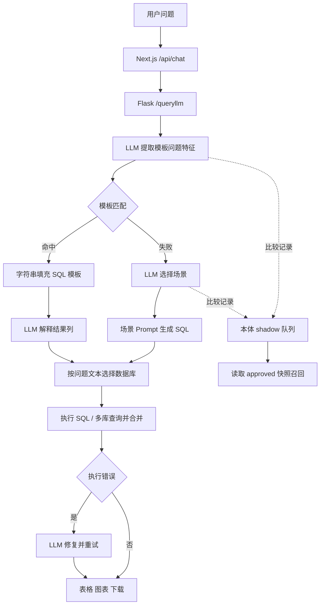
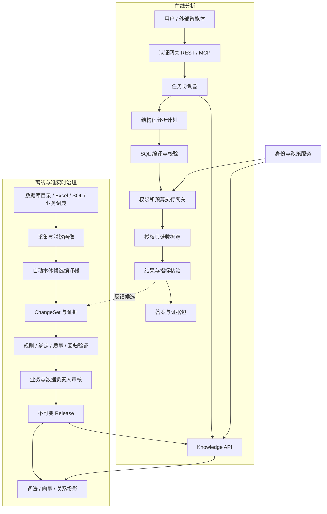
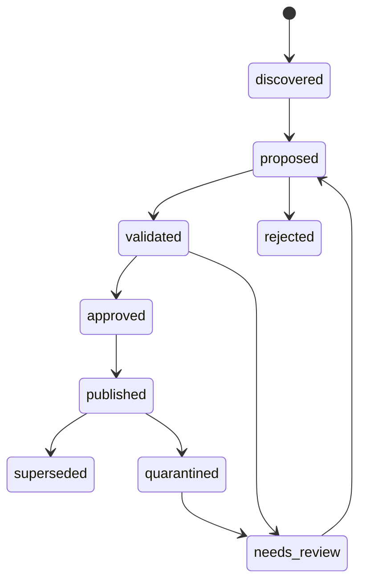

# 自动本体驱动的数据治理与多智能体分析：项目调研、升级评估与生产实施设计

> 调研日期：2026-11-25（Asia/Shanghai）。对象：NVIDIA/auto-ontology 与当前 mutli-agent-bi 工作区。本文是可用于设计评审、任务拆解和上线验收的实施依据；目标设计尚未实施，不能据此认定系统已可上线。
> 后续实施：P0 核心工程改造见 [2026-11-25 P0 实施记录](../implementation/2026-11-25-p0-security-and-federation.md)。本文以下代码缺口属于调研时快照，当前修复状态以实施记录为准；自动本体目标架构仍未全部落地。
> P1 进展：[Registry v2 与查询接入实施记录](../implementation/2026-11-25-p1-registry-and-query-integration.md)。新增批准模板路径已实现，完整自动本体编译与复杂指标规划仍属后续阶段。

>
> 建议决策：保留当前系统的查询入口、人工审核资产和本体旁路，以独立适配层引入自动语义编译；建设自己掌控的版本发布、指标契约、执行权限和证据体系。先证明一个业务域的收益，再扩大自动化范围。暂不整体替换为上游应用，也不立即建设完整图数据库或通用多智能体平台。

阅读导航：

- [1. 决策摘要](#section-1)
- [2. 调研范围、证据等级与版本边界](#section-2)
- [3. 当前项目：从实际执行链路出发](#section-3)
- [4. NVIDIA Auto Ontology：机制拆解与适配判断](#section-4)
- [5. 目标定义：把自动化放在哪些环节](#section-5)
- [6. 架构方案选择与明确取舍](#section-6)
- [7. 生产级元模型与契约](#section-7)
- [8. 数据自动治理闭环](#section-8)
- [9. 多智能体分析：共享版本、受限工具、独立核验](#section-9)
- [10. 执行安全、可靠性与运行边界](#section-10)
- [11. 对当前代码库的迁移分解](#section-11)
- [12. 评估设计、验收门槛与收益测量](#section-12)
- [13. 成本模型、资源规划与实施里程碑](#section-13)
- [14. 上线、监控与故障处置手册](#section-14)
- [15. 自我辩证、反思与可推翻条件](#section-15)
- [16. 本次验证记录与可复查索引](#section-16)

<a id="section-1"></a>

## 1. 决策摘要

当前项目可以升级成“自动本体支撑的治理与分析系统”，而且已有比从零起步更有价值的基础：Excel 业务说明、SQL 模板、六类本体实体、审核区隔离、版本回退及不干扰旧查询的旁路。主要工作不是增加一个图谱可视化页面，而是把分散在 Prompt、Excel、SQL 和程序里的业务规则，变成可以验证、发布、执行和追溯的语义资产。

NVIDIA Auto Ontology 最值得吸收的是四个工程模式：从物理元数据到业务概念的分阶段编译；结合声明约束、模型候选和数据探测的关系发现；按需检索上下文的查询工具循环；以 API/MCP 共享语义能力。它不能直接替我们解决指标口径审批、跨库可加性、租户隔离、完整数据质量闭环和本体发布一致性。

尤其需要纠正三个容易误导决策的理解：

1. **自动生成不等于自动成为事实。** 列值重叠、关联能返回一行、SQL 能执行，都不足以证明业务含义正确。
2. **语义图不等于必须使用图数据库。** 调研版本以 PostgreSQL 关系表及边表存储语义图，pgvector 支撑向量检索；当前项目可沿同一路线渐进升级。
3. **多智能体不等于每次请求串联多个模型。** 上游 1.3.0 已将原 LangGraph 查询链路替换为单个 ReAct 循环。我们的多智能体应服务于治理、规划、查询、核验的职责边界；简单问题保持短路径。[R1][R2][R3][R8]

建议先批准一个有退出条件的试点：一个业务域、一个 MySQL 数据源、10～30 张表、10～20 个经业务负责人确认的指标，以及不少于 200 条分层评测问题。数量是规划假设，需用真实资产盘点修订。第一阶段成功标准是更可靠地回答问题、减少审核成本并能追溯错误，不是生成更多节点。

<a id="section-2"></a>

## 2. 调研范围、证据等级与版本边界

### 2.1 固定研究快照

| 对象 | 本次基线 | 使用边界 |
| --- | --- | --- |
| 当前项目 Git HEAD | `62bd56b4b34cb0814c4cf04972779ff0afa5c9ba` | 工作区另有修改和未跟踪文件，不能仅凭 HEAD 重建本次观察 |
| 上游 main | `a12fec75226a54ffc91752cca9538f1f01f760eb` | 本文源码事实针对该提交 |
| 上游最新可见 release | `v1.3.0`，2026-11-24 发布 | tag 指向 `25318762ed36b717b4d87a6826e09ea42fccef3f`；与 main 不同 |
| 官方评测仓库 | `NVIDIA/auto-ontology-eval`，main `e727e4d6e1e198355099de4803590bb3681793a4` | 读取其评测方法，未执行其公开基准 |
| 本地执行验证 | Python 3.12，现有 44 项 unittest 全部通过 | AWS、MySQL、模型调用使用测试替身；不是端到端生产验证 |

调研开始时已有改动：`.env_template`、`DockerfileServer`、`prompt_gen.py`、`server/api.py`、`server/aws.py`；未跟踪的 `.gitignore`、`need.md`、`ontology/`、`tests/`。本报告将这些工作区内容纳入现状，未覆盖或提交它们。

本文采用三个证据等级：

- **源码/执行事实**：定位到已读取文件、函数，或本次执行结果。
- **上游文档/问题报告**：文档说明与公开 issue/PR。问题报告只证明存在待调查/修复的风险，不自动等于本次已经复现。
- **设计建议/推断**：根据当前需求提出的目标模型、接口、门槛和工期，均不冒充已实现能力。

### 2.2 实际阅读范围

本地重点阅读：README、`ontology/` 的 schema/store/extractor/service/shadow、生成入口、Flask 查询入口、SQL/数据库路由与多库合并、Next.js 聊天转发、Dockerfile、依赖声明及三组测试。上游重点阅读：README、架构、认证、语义编译入口与单表处理、外键推断与数值验证、DAL 表结构、ReAct 检索/SQL 校验/提交、连接器基类、MCP 工具、依赖和部署文件、release 与近期问题。不是逐行审计所有前端与所有连接器。

未读取真实 `.env`，未接入业务库，未启动上游完整服务，未执行模型基准、真实 SSO、并发压测、灾备或生产权限验证。故本文能够确定“代码做了什么、架构应如何改”，不能确定真实数据规模下的准确率、吞吐、成本或合规完成度。

<a id="section-3"></a>

## 3. 当前项目：从实际执行链路出发

### 3.1 在线链路与离线资产链路



离线资产链路是：数据库 schema/样本 → `PROMPT_F` 分批分析 → Excel/JSON → 人工修改确认 → Prompt 文件与 S3 发布 → 本体双写。`ontology.extractor` 本身不调用模型、不访问数据库/S3，它解析已有分析结果、工作簿和模板；“自动发现”的模型调用仍在 `prompt_gen.py`。[L1][L2][L3]

### 3.2 已有能力与真实限制

| 领域 | 已实现能力 | 本次确认的边界 |
| --- | --- | --- |
| 语义资产 | Scenario、Table、Column、Relation、Metric、QueryTemplate | 业务概念与物理资产尚未充分分离；缺少完整指标粒度与时间口径 |
| 校验 | 严格类型、未知字段拒绝、引用完整性、修订哈希 | 校验结构正确，不证明业务定义正确 |
| 生命周期 | pending/approved 文件区、实体审核状态、版本计数、历史回退 | 没有独立审阅者身份、审批记录和多节点发布协议 |
| 存储 | flock、fsync、原子替换、来源级合并、版本高水位 | 单机 POSIX 假设；32 MiB 快照上限；默认保留 20 次发布 |
| 召回 | 中文 2/3 字片段、英文词、同义词、slot 骨架、稳定排序 | 不是向量语义检索；slot 匹配不等于参数提取/安全绑定 |
| 审核过滤 | 仅召回 approved 实体，检查父节点/关系端点可见性 | namespace 只是分区，不是认证或租户权限 |
| 线上接入 | 有界异步 shadow、采样、丢弃计数、异常隔离 | 不改变旧答案、Prompt、LLM 次数；尚无成本节约实证 |
| 测试 | 44 项覆盖抽取、版本、并发、召回、旁路、旧行为兼容 | 未覆盖真实权限、指标正确性、全服务启动和生产数据库负载 |

这一基础应保留。尤其是“未经确认的指标和关联不直接批准”的保守规则，符合治理目标。`Metric` 由“度量”标记生成时，aggregation 仍为空且保持 pending；等式关联在不知道 join_type 时仍待审核，避免替业务方猜口径。[L3][L4][L5]

### 3.3 README 宣称与当前主路径不能混同

- README 描述向量检索流程，但当前 `Helper.get_rag_str()` 直接返回空字符串；不能据此把主链路视为已具备有效 RAG。
- README 宣称行列权限，但本次读取的 Next.js 入口从请求体接受 `userId`，身份检查被注释，Flask 从头部读取 ID；主查询路径未见基于可信身份的行列策略执行。外部网关是否另有控制尚未验证。
- README 的“联邦查询”在当前 Python 主路径表现为同一条 SQL 分发多个 MySQL 库，拼接结果后对度量求和；不是跨异构源语义查询规划器。
- “多角色 Agent 优化 Prompt”是项目设计理念；当前在线分析主要是顺序 LLM 调用与一次修复，不等于具备持久任务状态、工具权限和独立核验的多智能体运行时。[L1][L6][L7]

### 3.4 升级前必须关闭的生产缺口

| 优先级 | 证据/问题 | 对升级的影响 | 建议修复与验收 |
| --- | --- | --- | --- |
| P0 | `main.py:53` 注册未定义的 HelloWorld | 服务入口到该语句会失败，现有旁路测试未覆盖完整启动 | 修复路由；隔离依赖后执行全应用启动与健康检查 |
| P0 | `pages/api/chat.ts` 的客户端 userId 与 Flask 信任头 | 可追踪 ID 不等于可信身份 | 网关验证身份并重写内部头；直连后端被网络策略阻断 |
| P0 | `template_sql.format(*new_params)` | 模型提取的值参与 SQL 字符串构造 | 参数化绑定；列名/排序字段只能从批准集合选择 |
| P0 | `mysql.fetch()` 直接 execute/commit；`sql.format_md()` 仅清理文本 | Prompt 中只读要求无法形成执行防线 | 统一 SQL 网关、方言 AST 校验、只读账号、超时和结果限制 |
| P0 | `get_mysql_conf_by_question()` 未匹配时返回全部库 | 模糊问题扩大查询范围，也扩大错误和泄露面 | 先授权再选源；歧义澄清，禁止默认查所有源 |
| P0 | `merge_data()` 对所有度量 sum | 平均值、比率、去重人数等可能错误 | 按指标代数合并；未声明合并规则则拒绝多源执行 |
| P0 | `query_db_async()` 异常分支不把错误写入结果队列 | 某源失败可能被包装为不完整的成功汇总 | 返回逐源状态；partial 默认不得作为完整总计 |
| P0 | `DockerfileServer:13` 复制 `.env`；旧日志输出问题、SQL、结果 | 本体可引用更多数据后，暴露范围进一步扩大 | 密钥运行时注入；日志分级脱敏；下载结果实施授权与过期 |
| P1 | `answer()`/重试中 finalSQL 缺失判断使用错误的 and 逻辑 | 缺失键仍访问，部分无效响应可能继续执行 | 严格响应 schema、错误分型、有限重试；错误不能返回成功数据结构 |
| P1 | Python 依赖无版本锁，服务缺少统一任务/取消/预算机制 | 结果难复现、长查询难控制 | 固定 Python/锁文件；总 deadline、取消、幂等任务状态 |

这些是代码层发现，不是在宣称已发生生产事故。修复应单独提交、单独验收；本次任务只归档分析，不修改应用行为。

### 3.5 现有本体模型里不宜直接继承的假设

`stable_id()` 根据 namespace 和名称等业务键生成哈希；Table/Column 身份还包含场景。场景或表列改名可能产生新 ID，同一物理表出现在不同场景时也可能被重复表示。未来应以 source_id + 物理路径建立映射，实体内部使用稳定 ID，场景仅组织用途。

Relation 当前只有一对左右键，且引用必须同命名空间、同场景；要表达复合外键、跨场景关联、慢变维和多对多桥表，需升级契约。namespace 的约束不应直接取消，应由明确的跨域共享及授权策略替代。

Excel 生成路径写入的是“是否保留”列；抽取器却在同一列检查 `PRIMARY KEY`。PROMPT_F 分析路径能读取物理主键，但常规 Excel 往返未必完整保留主键信息。迁移时应重新对接目录约束，并设计独立主键字段，不能把 Excel 视为完整物理 schema。[L2][L3][L4]

<a id="section-4"></a>

## 4. NVIDIA Auto Ontology：机制拆解与适配判断

### 4.1 它解决的是共享业务上下文

核心产物可理解为“业务概念—属性—物理映射—可复用计算—关联”的语义图。目录包含数据库/schema/表/列、SQL 及引用关系；语义层包含 Term、ColumnAttribute、SqlAttribute、Semantic FK 等。DAL 用关系表表示节点与边，SQLAlchemy/Alembic 管理持久化，pgvector 用于检索。它不是将全部业务明细行都搬进知识图谱，也不是开箱即用的企业主数据管理系统。[R2][R8]

上游运行单元包括 Next.js/Better Auth/Prisma 网关与应用、FastAPI 查询后端、FastAPI 摄取编译服务、PostgreSQL/pgvector，以及单独运行的 MCP 服务。模型分 reasoning、non-reasoning、embedding、rerank 四类角色；编译与查询不必使用同一个模型。当前项目的 Bedrock 调用接口不能假设可直接替换上游模型配置，需要独立适配与结构化输出契约测试。[R1][R2][R10]

main 的连接器清单已包括 PostgreSQL、MySQL、Databricks、Snowflake、ClickHouse、Trino、BigQuery、Kyuubi、HeavyDB、DuckDB、SQLite，共 11 类；架构图仍写 10 connectors，说明文档存在同步滞后。BigQuery 提交晚于 1.3.0 tag，不能把 main 的能力无差别归给 release。我们首期仅验证 MySQL，不因清单长就宣称全连接器兼容。[R1][R3]

### 4.2 自动语义编译不是一个 Prompt

| 阶段 | 输入与机制 | 产物 | 我们应借鉴/补充什么 |
| --- | --- | --- | --- |
| 目录摄取 | 连接器读表列、主外键、视图、可用查询历史 | 物理目录、向量索引；可选 PII 标签 | 定义抓取范围、最小权限、采集水位和故障状态 |
| 单表画像 | SQL 采样、distinct、日期格式等 | 值摘要、唯一性线索 | 统计证据应带样本量、时间、方法；不得自动当硬约束 |
| 单表语义 | 模型建议 FK/PK、桥表、描述和术语 | Term、ColumnAttribute 候选 | 使用确定性 schema 校验及目录绑定，保留候选而非直接发布 |
| 跨表协调 | 术语族、向量候选、模型选择、值匹配与 join 探测 | 语义外键、默认关联路径 | 增加粒度、复合键、基数、有效期及业务审阅 |
| 计算提炼 | 查询历史表达式、桥表语义归纳 | SQL 属性 | SQL 表达式必须升级成完整指标契约 |
| 人工修订 | UI/API 修改、认证、重新 embedding | 修订后的语义层 | 接入自己的发布状态机和审计，而非只展示认证图标 |

编译代码分层清晰：`compile.py` 协调阶段，`pipeline.py` 并行访问表，`visit_enter.py` 处理单表，`semantic_fk.py` 推断关联。文档默认三个表并行，模型在编译范围内通过 `SEMANTIC_LLM_MAX_INFLIGHT=6` 限流。表级异常可能被捕获后跳过，跨阶段还有独立失败路径，因此我们不能用“作业函数返回”代替每个资产的完整性验收。[R2][R4]

### 4.3 自动关系推断：有用，但证据强度有限

读到的推断路线是：声明 FK 优先；否则检索候选 ColumnAttribute，由模型选择；结合已存低值 distinct 集合做包含比较；必要时在值匹配候选中再选择；最后对推断关系进行 join 是否有结果的检查。数值匹配有范围截断处理，包含阈值为 0.9；对小整数/短值、标签列和同表候选有额外防误判逻辑。[R5]

需要明确四个边界：

1. 单表画像最多采样 1,000 行，`is_unique` 的阈值是非空样本 distinct 比例 ≥ 0.95；它是启发式标签，不是主键证明。`distinct_ratio` 记录更细的信息，仍只是采样结果。
2. 两个自增 ID 列可能大量重叠，包含率高不表示相同业务对象；即使 join 返回一行，也不能证明方向、基数、覆盖率或业务正确性。
3. `_resolve_via_vdb()` 在没有可比较源值时可以保留模型选择；`PREVENT_SEMANTIC_FK_DB_QUERIES` 会关闭数值/关联探测。没有探测时必须把验证状态标为不足，不能沿用“已验证”措辞。
4. PII 标记列有跳过采样/清理值的防护；但 PII 检测本身是可选项，且分类有漏检可能。关闭 Distinct Value Scanning 也不等于关闭所有采样。[R4][R5][R6]

我们应让每条关系携带 `declared / inferred / confirmed` 的来源与证据，不把一个模型分数合并成唯一的“置信度”。生产关联至少需核对目标键唯一性、复合键完整性、孤儿率、join 扩张、时间有效区间及业务角色。

### 4.4 查询：确定的是工具校验，不是自然语言到 SQL 全过程

1. ReAct 推理模型选择工具；`retrieve` 做向量与名称检索，返回表列、定义、值摘要和关联路径。
2. `run_sql`/`submit` 解析 SQL、检查单语句与只读类型、遍历有副作用节点/函数、核对目录、要求表先被检索看到，并限定连接器/catalog 范围。
3. SQL 执行错误成为下一轮观察；提交成功后返回答案、SQL 和结果。信息性问题可以检索后直接文字回答。
4. 主查询循环没有独立 SQL judge 或专门修复模型；也不自行发起澄清。MCP 客户端可以先调用 `check_answerable` 决定是否澄清，Chat 并不自动调用该接口。[R2][R7]

默认上限包括 24 次工具调用、10 次探索性 `run_sql`、单次观察 8,000 字符和展示 100 行。**10 次不包括 submit 的最终执行；展示 100 行也不是所有连接器都只取回 100 行。** `execute_chat_sql()` 仅在连接器声明支持时传入只读和 statement timeout。我们需要在外层覆盖最终提交、重试、画像、探测的总预算，并实际限制内存与返回量。[R7]

还有一个容易漏掉的边界：`submit()` 在成本预算不允许执行时，可以构造空结果并“接受未执行 SQL”。它不应被我们包装成“查询成功且没有数据”。自己的协议必须区分 `not_executed`、`empty`、`success`、`partial` 和 `failed`。[R7]

因此，适合借鉴的是“模型决定探索路径，确定性系统约束执行”的结构。业务计算优先用批准的指标和计划编译器，开放探索才交给受限 ReAct。

### 4.5 治理、安全与发布：已有功能，仍需补齐契约

上游提供登录、API token、SSO、角色动作权限、用户组、标签、规则、owner/modified 信息，以及 UI 认证状态。不能把它描述为完全没有治理能力。但认证标记不改变 Agent 检索准入；编译主要跳过已有 term 的表，保留人工编辑，却不构成完整 schema drift 的依赖失效重编译；默认 semantic FK 的选择每轮可能重做。[R2][R8][R9]

公开访问应走前端网关；Python 后端信任网关转发身份，摄取服务没有自己的认证，3001/3002 必须在私网。角色动作授权也不能直接推导为业务库的行级/列级授权。多数据库共享语义存储，不等于经过验证的多租户隔离。[R2][R9]

Ossie YAML 适合做互操作边界，但必须锁定格式和转换器版本。当前依赖固定 converter 提交；公开 issue #682 报告 0.3 与当前 0.2 路径不兼容，#267 报告自然路径/外部 ID 冲突。它们是迁移测试项，不应靠“支持开放标准”四个字绕过。[R10][R12]

### 4.6 活跃演进风险：区分 main、问题报告和待合并修复

| 证据 | 调研时状态/可确认内容 | 对本项目的约束 |
| --- | --- | --- |
| PR #677 | open；提出聚合被 join 放大时的检测 | 不假设已解决 fanout；指标粒度规则必须自己验证 |
| PR #676 | open；提出文字数字与结果不符的检测 | SQL 能跑通之后仍要验证答案数字 |
| PR #675 | open；提出空结果的过滤条件探测 | 空结果不能自动等价为业务事实不存在 |
| Issue #681 | 报告已用分析溯源为空；源码 response builder 确实硬编码 `custom_analyses_used: []` | 不将该字段为空解释为“没有使用分析定义” |
| Issue #680 | 报告导入的分析 SQL 有未解析列仍被持久化，本次未复现 | 导入前后做物理绑定、dry-run 和独立回归 |
| PR #480 / Issue #444 | 待合并修复报告 reset 的 database_name 未转发 | 候选环境禁止直连生产 reset；对删除范围做集成测试 |
| Issue #669 | 报告自关联层级键推断漏召回，原因仍待复现 | 部门/组织层级必须设置专门关系测试集 |

以上问题用于定位验收重点，不能把 PR 描述当已上线保障，也不能将个别问题扩展为整个项目不可用。[R12][R13][R14]

### 4.7 对上游基准成绩的克制解读

release 报告了 BEAVER/BIRD-Interact 成绩和速度、token 改善，本次未复现，不把其中的百分比用于业务收益承诺。[R3]

官方 eval 值得复用的是同问题、同模型、同数据库执行 gold SQL、使用确定性结果比较及保留修复/破坏样本的做法。但其 schema-only 控制组是无工具单 Prompt，treatment 使用带工具的本体 Agent；差异同时包含语义上下文和运行策略变化，不能严格归因为“只有本体”的因果贡献。本文另设运行框架一致的消融实验。[R11]

<a id="section-5"></a>

## 5. 目标定义：把自动化放在哪些环节

### 5.1 四层语义资产

| 层 | 回答的问题 | 核心对象 | 权威来源 |
| --- | --- | --- | --- |
| 物理目录层 | 数据在哪里、什么结构 | DataSource、Dataset、Field、Constraint、SchemaSnapshot | 连接器观测与目录快照 |
| 业务语义层 | 数据代表什么、如何计算 | BusinessConcept、Attribute、Metric、Dimension、Relation、Mapping | 业务负责人批准的定义 |
| 治理层 | 是否可信、谁能使用、怎样变更 | Policy、QualityRule、Evidence、ChangeSet、Review、Release | 规则执行、审批、审计 |
| 分析层 | 如何回答这次问题 | Intent、QueryPlan、Execution、Answer、Feedback | 绑定版本的计划和执行证据 |

Scenario 保留为业务域/分析用例集合；不再承担物理资产身份。QueryTemplate 保留为已认证的高价值分析方案；不强行把它拆成若干指标后丢失原业务意图。

首期“自动治理”的范围是自动盘点、候选释义、关系发现、敏感性建议、质量检测、影响分析和待审核变更生成。生产明细修复、口径改变、权限放宽、删除发布版本必须走受控执行；不会由分析 Agent 自行完成。

### 5.2 自动化等级与发布准入

| 等级 | 允许自动完成 | 禁止直接做的事情 |
| --- | --- | --- |
| A0 观测 | 采集 schema、记录差异和批准的统计画像 | 修改源数据/线上定义 |
| A1 候选 | 提议概念、映射、指标、标签、关系 | 将推断内容标为业务事实 |
| A2 验证 | 结构校验、引用绑定、只读探测、回归、影响报告 | 用模型自评分代替业务认证 |
| A3 发布 | 按已批准规则自动发布低风险变更；高风险人工审批 | 隐式覆盖人工口径或解除权限限制 |
| A4 执行 | 从有效 release 与政策生成只读分析 | 使用草稿口径直接回答正式业务问题 |

第一版默认 A0～A2 自动，A3 人工，A4 只读。后续可以自动发布无语义影响的描述修正，但需记录审查策略版本。敏感级别上调可以按规则立即收紧；解除敏感标记或扩大权限不能对称自动化。

<a id="section-6"></a>

## 6. 架构方案选择与明确取舍

### 6.1 四种可选路径

| 方案 | 收益 | 主要成本/风险 | 结论 |
| --- | --- | --- | --- |
| 整体换成 Auto Ontology | 快速获得 UI、编译、查询和 MCP | 现有 Excel/S3/Bedrock 迁移；治理差异；应用与身份重构 | 适合独立演示环境，不作为当前首选 |
| 直接把上游 Python 内部函数嵌入现有 Flask | 表面开发量较小 | 依赖、全局配置、DAL、数据库迁移、内部 API 耦合 | 不建议成为长期边界 |
| 独立候选编译服务 + 自有发布/查询契约 | 可回滚、保留资产；上游可替换 | 需要适配器与数据转换；同步一致性要设计 | **推荐** |
| 完全自主重写 | 完整控制 | 重复建设画像、连接器、检索和工具循环 | 只自建治理及指标等差异化核心 |

这里的“独立服务”不意味着把原上游公开问答直接作为最终生产执行端。编译可先在隔离实例完成并导出候选；批准后转换进自己的 registry。正式查询只读取批准版本并经自己的 SQL 网关执行。若后续直接使用上游问答，应另加经验证的发布过滤、身份和执行适配，不能仅在外部回答之后补检查。

### 6.2 目标结构



建立两条清晰边界：构建面可提出变化，服务面只消费已发布资产；模型可提出计划，执行面通过确定性规则和数据库权限裁决。构建作业失败不应破坏当前 release；权限撤销则必须即时影响查询，不能为了版本固定继续放行。

### 6.3 存储、向量与图的选型

首期 PostgreSQL 作为权威 registry，JSONB 保存可演进契约，关系表保存引用、审批、版本和依赖边；pgvector 与全文/词法索引作为可重建投影。保留 `FileOntologyStore` 用于开发、导出和兼容迁移，增加 repository 接口而非让在线业务直接依赖存储细节。

只有在真实压测表明多跳遍历、路径约束或规模成为瓶颈时再考虑专用图数据库；届时图仍是 release 的投影，不能变成第二个未经定义的真相源。暂不引入 OWL 推理引擎：当前收益集中在目录绑定、指标和关联安全，而不是形式逻辑推理。

索引条目必须包含 release_id、entity_id、entity_version、source_scope、policy 标签与 embedding 配置指纹。更换 embedding 模型或维度要生成新索引并验证，不能在旧向量集合中混用。

<a id="section-7"></a>

## 7. 生产级元模型与契约

以下名称和接口均为拟议 v2 设计，不是当前仓库已有 API。

### 7.1 最小对象集合

| 对象 | 必填语义 | 关键约束 |
| --- | --- | --- |
| DataSource | 稳定 source_id、引擎、目录路径、credential_ref、owner | 凭据只引用，不写本体正文 |
| Dataset / Field | 物理定位、类型、约束、schema_fingerprint | 同名跨库不能合并；重命名保留 identity mapping |
| BusinessConcept | 名称、定义、别名、业务域、owner | 跨系统同名先建冲突组，不直接合并 |
| Mapping | concept/attribute 到物理表达式的映射、适用范围 | 一概念多映射要有明确选源条件 |
| Relation | 端点键组、方向、角色、基数、有效时间、证据 | 复合键不可拆成多条独立单键 join |
| Metric | 表达式、粒度、时间、单位、过滤、可加性、合并策略 | 缺少关键口径不能发布为可执行指标 |
| QualityRule | 检测目标、计算式、阈值、调度、阻断策略 | 结果必须绑定观测时间和数据水位 |
| Policy | 主体/对象/动作/条件、行列限制、脱敏 | 不由用户问题或模型生成可信授权上下文 |
| Evidence | 来源、方法、schema/数据水位、结果摘要、失效条件 | 证据强度与模型置信度分开 |
| ChangeSet / Review | 基线、diff、依赖、影响、提交者、审批者 | 乐观并发校验；批准结果不能被新修改复用 |
| Release | 不可变内容清单、索引版本、验证结果、签名/摘要 | 部分编译不能成为完整发布 |
| QueryExecution | 计划、SQL、参数摘要、源、政策决策、结果状态 | 可区分检索到、计划采用、实际执行的定义 |

关系证据示例字段：`declared_constraint_id`、`sample_method`、`sample_size`、`nonnull_count`、`target_uniqueness`、`containment`、`orphan_rate`、`fanout_ratio`、`observed_at`、`schema_fingerprint`、`reviewer_id`。样本验证写 `sampled`，未经验证写 `unknown`；不能给未知值填 0。

### 7.2 指标必须表达粒度与可加性

以“净销售额”为例，至少需要：订单还是订单行粒度、下单/支付/发货时间、退款发生日还是原订单日回溯、税费与运费、币种与换算日期、取消单范围、跨源去重规则、时区与自然/财务月。列名 `amount` 无法提供这些结论。

下面是契约形状示例，数值及定义仅供设计，不代表真实业务已批准。所有 ID 在发布前必须解析到对应实体：

```yaml
kind: Metric
schema_version: 2
id: metric:sales:net_revenue
version: 1
status: draft
name: 净销售额
owner: role:sales_finance_steward
base_dataset: dataset:erp:sales:order_lines
grain:
  keys: [field:erp:sales:order_lines:order_id, field:erp:sales:order_lines:line_id]
expression:
  language: typed_metric_ast_v1
  op: sum
  input:
    op: subtract
    args: [field:erp:sales:order_lines:paid_amount, field:erp:sales:order_lines:allocated_refund]
time:
  field: field:erp:sales:order_lines:paid_at
  timezone: Asia/Shanghai
  calendar: gregorian
  interval: half_open
unit: CNY
null_policy: reject_unknown_financial_amount
aggregation:
  across_disjoint_partitions: sum
  requires_disjointness_evidence: true
  across_currencies: forbidden_without_fx_mapping
  across_time: additive
quality_rules: [quality:paid_amount_complete, quality:line_key_unique]
required_reviews: [business_definition, physical_mapping, security]
evidence_ids: []
```

退款如果在独立一对多表，应先按订单行聚合并分配，再关联；不能直接把订单行金额与退款明细 join 后 sum。批准 expression 的语义之后，由编译器按目标方言生成 SQL；SQL 文本摘要用于追溯，不能取代指标 AST。

跨源合并规则必须按指标类型区分：

| 指标 | 正确的可合并中间态 | 不能做的事情 |
| --- | --- | --- |
| 可加金额 | 相同单位、互斥分区下的 sum | 混币种、重叠分区直接加总 |
| 平均值 | `(sum, count)` 合并后相除 | 对各库平均值直接求和或简单平均 |
| 比率 | `(numerator, denominator)` 合并后相除 | 对各库比率相加 |
| 去重客户数 | 全局一致客户 ID 集合，或明确误差的兼容 sketch | 把各库 distinct count 相加 |
| 余额/库存 | 指定时点的状态与允许加总的维度 | 随意跨时间加总 |
| 分位数 | 原始分布或明确算法的可合并摘要 | 平均各库 P95 |

### 7.3 审核与发布状态机



状态作用于某个 entity_version/ChangeSet，不对旧发布版本原地改内容。`approved` 只说明内容获批，`published` 才进入服务；更新同一对象会产生新候选，旧版保持可追溯。`quarantined` 通过服务层有效性策略阻断；历史内容仍存在。

发布事务流程：固定 source snapshot → 验证依赖闭包 → 记录审阅与测试摘要 → 生成不可变 release → 构建全部索引 → 确认 ready → 比较并交换 active pointer。外部索引不能与数据库同事务时采用 outbox/幂等构建，索引 ready 前不移动指针。并发审批如果基线已变化，返回冲突而非覆盖。

查询开始固定 release_id；同一任务所有 Agent 读取同一版本。权限校验使用当下有效政策，撤权可以中止在途任务。回滚是将 active pointer 切回兼容的旧 release，并保留审计；它不回滚业务数据库数据，也不能逆转已经发生的 schema 破坏。

### 7.4 漂移与人工修订保护

对表列新增、删除、改名、类型变化、约束变化分别生成 diff。通过依赖图定位受影响的 Mapping、Relation、Metric、Template 和评测题。破坏性变化立即把受影响映射标为不可执行，保留无关指标服务。

人工覆盖值应与机器建议分层存储，保留 override 的适用 schema 和原因。重编译生成新候选，不能覆盖批准口径。仅描述变化可局部重建索引；键/类型/表达式变化必须触发依赖验证。重命名匹配只产生候选映射，避免错误地把旧字段 ID 迁到新含义字段。

<a id="section-8"></a>

## 8. 数据自动治理闭环

### 8.1 工作流与产物

| 步骤 | 自动工作 | 审核/阻断点 | 可审计产物 |
| --- | --- | --- | --- |
| 盘点 | 表列、约束、owner 候选、未描述资产 | 采集范围与源授权 | CatalogSnapshot、覆盖率 |
| 画像 | 空值、唯一性、枚举、时间范围、引用覆盖 | 采样预算、敏感字段 | ProfileRun、数据水位 |
| 语义发现 | 名称/描述/同义词、概念映射 | 冲突业务定义不合并 | Proposal、证据列表 |
| 规则提炼 | 从约束、指标和历史异常提出质量规则 | 阈值由 owner 决定 | QualityRuleCandidate |
| 检测 | 运行批准规则、识别漂移 | 核心字段失败阻断对应指标 | QualityResult、Incident |
| 影响分析 | 找到受影响指标与调用方 | 不用全局停机替代精确隔离 | ImpactSet |
| 修复建议 | 生成代码/映射/数据修复计划 | 涉及数据写入另行批准、可回退 | RemediationPlan |
| 发布反馈 | 审核通过后产生新 release | 回归未过不发布 | Release、Approval、Evaluation |

不把“打了 PII 标签”称为完成数据治理。治理至少包括明确责任、可执行规则、问题状态、影响范围、处置和复验；本体是承载这些规则及关系的共享语义基础。

### 8.2 关系验证的最小策略

声明 FK 也要记录是否由数据库强制实施、是否过期，不能只因来自目录就忽略历史脏数据。推断 FK 优先验证完整键组与类型兼容，再测孤儿率和目标唯一性；对大表先采样筛选，关键关系在只读副本/数仓进行限定范围的精确检查。

join 放大率可定义为“关联后匹配行数 / 关联前匹配主实体行数”，但必须按声明粒度计算；分母为 0 时返回 unknown，不能返回 0。当 expected cardinality 为 many-to-one 而观察到目标重复，应阻断使用此关系聚合主表金额。多对多关联需桥表及分摊规则，最短路径不能代替这些约束。

源探测的 LIMIT 约束返回规模，不保证扫描成本低。需结合引擎特性设置超时、扫描/费用预算、采样策略、只读副本和调度窗口，避免把自动治理变成生产库负载放大器。

### 8.3 冲突与可信度

同一概念“客户”可能指下单账号、开票主体或签约法人；同一“收入”可能是 GMV、实收或会计确认收入。系统应返回冲突原因与候选，不直接挑 embedding 最相似的定义。

证据优先级建议：明确适用且最新的业务批准定义 > 当前有效目录约束/数据验证 > 已审阅查询资产 > 模型推断。该次序仍需按问题类型拆分：业务定义不能让不存在的物理列重新存在，数据分布也不能自动修改会计口径。将“业务正确性”和“物理可执行性”作为两个门槛共同通过。

<a id="section-9"></a>

## 9. 多智能体分析：共享版本、受限工具、独立核验

### 9.1 最小职责划分

| 角色 | 责任 | 工具范围 | 不能做什么 |
| --- | --- | --- | --- |
| Coordinator | 明确问题、预算、澄清、任务状态 | Knowledge API、任务调度 | 直接绕过执行器连接业务库 |
| Planner | 选择指标、粒度、时间和分解方案 | 已发布语义、计划验证 | 自行创造未批准指标并作为正式答案 |
| Query Worker | 按结构化计划编译/探索只读 SQL | 授权目录、受限查询网关 | 写数据、提权、无限探测 |
| Verifier | 检查口径、结果完整性、数值一致性 | 计划/SQL/结果证据；有限复核查询 | 以“另一个模型也同意”作为充分证明 |
| Narrator | 解释结果与限制 | 已核验结果与定义 | 无证据编造原因或因果关系 |
| Governance Worker | 从反馈生成待审核变更 | 候选写入和影响分析 | 修改 active release |

不必每个角色都成为独立模型进程。首期 Coordinator/Planner 可以共用一个受限循环，Verifier 的大部分规则应确定性执行；复杂多指标拆解、独立数据源调查才按需分发多个 worker。整个 DAG 共享总 token、SQL、时间预算，不给每个 Agent 各自无限预算。

### 9.2 任务信封与证据包

任务上下文至少包括：`task_id`、`parent_task_id`、可信 `principal_ref`、`tenant_id`、`release_id`、`policy_context_ref`、`scope`、`deadline_at`、`remaining_budget`、`input_artifact_ids`。身份由网关注入，不能接受模型填写的主体 ID。

每次回答返回：采用的 Metric/Relation/Template ID 与版本、QueryPlan ID、SQL hash、受控参数引用、源数据库与 schema 指纹、源读取时间/快照能力、逐源状态、结果行数、截断信息、校验结果、可访问的 lineage、实际执行状态。原始敏感参数及完整结果留在受控存储，不混入一般日志。

溯源应区分三个事件：`retrieved` 表示定义被工具展示；`selected` 表示计划采用；`executed` 表示最终编译 SQL 确实落实。只记录被检索过的定义，不能证明回答遵循了它。

### 9.3 Knowledge API 与工具设计

建议先 REST，内部 Python client 共用契约；MCP 作为同一授权服务的薄适配。上游已有只读 MCP 工具可借鉴，但我们新增的发布、审阅等管理动作不要默认暴露给分析 Agent。[R15]

| 拟议接口 | 主要输入 | 必须返回/执行 |
| --- | --- | --- |
| `POST /v1/knowledge/search` | question、kinds、scope、release_id | 授权且有效的候选、版本、证据、冲突；返回固定 release |
| `GET /v1/metrics/{id}` | id、version/release | 完整粒度/口径/依赖，不只返回一段说明 |
| `POST /v1/relations/plan` | 起止对象、期望粒度、scope | 批准路径、基数约束、不可用原因 |
| `POST /v1/questions/check` | 问题、结构化意图 | 缺失指标/维度/时间/权限、需澄清项；不是单一 coverage 分数 |
| `POST /v1/query-plans/validate` | 指标/维度/过滤/时间/源 | 类型、粒度、单位、政策、预算检查报告 |
| `POST /v1/queries/execute` | 已验证 plan_id、idempotency_key | 执行前再次授权，返回 execution_id 和明确状态 |
| `GET /v1/executions/{id}` | execution_id | 同主体/授权校验后的结果、证据、partial/truncated |
| `POST /v1/changesets` | proposal、base_revision、evidence | 待审核变更；不直接改变服务视图 |
| `POST /v1/releases` | approved changeset、expected_active | 受限发布者权限、CAS、完整验证清单 |

错误建议稳定分型：`AUTH_REQUIRED`、`FORBIDDEN_SCOPE`、`AMBIGUOUS_DEFINITION`、`UNANSWERABLE`、`STALE_BINDING`、`RELEASE_NOT_READY`、`SEMANTIC_VALIDATION_FAILED`、`BUDGET_EXCEEDED`、`SOURCE_UNAVAILABLE`、`PARTIAL_RESULT`。权限不足时不返回不可访问对象的名称/存在性来帮助“澄清”。

### 9.4 一个端到端例子

用户问：“华东本月净销售额为什么下降？”

1. 身份校验确定有权访问的业务域和区域；“本月”按请求时刻、Asia/Shanghai 和指标日历转换为明确半开区间。
2. 查找净销售额批准定义，确认比较基准是上月同期、上月整月还是预算；缺失则澄清。
3. 固定 release，验证订单行粒度、退款归属期、币种和华东区域版本。
4. Planner 产生总量、渠道、产品、退款影响等可比较的子计划。只有任务可独立且同口径时并行。
5. 执行器对每个计划进行授权、关联基数与资源限制；如果某分区失败，不能继续输出全国/区域完整总额。
6. Verifier 验证分解项与总量一致、时间窗口可比、金额精度及解释文字与结果一致。
7. 答案呈现“哪些因素与下降同步变化/贡献了算术差异”；没有实验或因果模型时，不把分解结果说成已经证明原因。
8. 发现“退货金额”的历史口径冲突，只生成 ChangeSet，不能在回答过程中悄悄重定义净销售额。

<a id="section-10"></a>

## 10. 执行安全、可靠性与运行边界

### 10.1 权限必须覆盖完整数据路径

必须同时约束目录/检索、计划、SQL 执行、结果缓存和下载。仅给 SQL 加过滤，而检索返回了未授权字段样本，仍然存在泄露。仅给检索加过滤，而执行器拥有全库凭据，也不能保证安全。

先按可信身份得到 scope，再搜索批准资产；缓存 key 至少包含 tenant、授权范围指纹、release 和参数摘要。向量查询后的 top-k 过滤不能作为唯一隔离方式：应先约束候选域并在读取和执行处复核，防止越权及被过滤内容影响结果。

数据库侧优先最小权限只读账号、受限视图和引擎支持的行级策略；应用层做行列策略编译和最终 AST 检查。重试修复后的 SQL 必须重新检查，不得沿用首次授权。SQL AST 白名单需要覆盖 CTE、子查询、多语句、锁、导出/外部访问函数；数据库权限是独立防线。

### 10.2 把元数据和工具结果当作数据

表注释、业务文档、SQL 历史、字段样本可能包含恶意指令。它们进入 Prompt 时应标识来源并限制为参考数据，不能改变系统权限。模型返回的 ID 要属于实际候选集合；SQL 对象要可绑定目录；不能因注释里写了“执行更新修复数据”就调用写工具。

采样先分级再执行。默认不收集已知敏感字段原值；允许的摘要也有访问范围、保留期和清除策略。评测数据优先使用合成/脱敏副本。embedding、LLM 请求、日志、导出都属于数据出口，要分别配置，而不是只检查数据库连接。

### 10.3 失败、降级与一致性

| 故障 | 预期行为 | 不允许的降级 |
| --- | --- | --- |
| 候选编译中断 | 记录部分成功资产，当前 release 不变 | 将半成品作为最新权威本体 |
| 向量服务不可用 | 在同 release、同权限下词法/模板检索，或明确拒绝 | 读取草稿、全量裸 schema 绕过范围 |
| 本体源损坏 | 使用校验过且仍有效的最后良好 release；告警 | 将缺失资产解释为业务上不存在 |
| schema 破坏性漂移 | 隔离受影响计划，提示绑定失效 | 静默转旧 Prompt 继续猜 SQL |
| 单一数据源失败 | 返回 failed/partial；严格指标默认拒绝完整回答 | 把剩余源相加当全局总计 |
| 权限撤销 | 失效缓存并停止后续执行 | 固定旧政策继续完成任务 |
| 超时/取消 | 终止模型循环并尽力取消源查询，记录是否取消成功 | 只断开浏览器，后台任务无限运行 |

源数据库一致性独立于本体版本。多库即使同一个 release，也可能读到不同水位；需返回每源读取时间，强一致业务改走已对齐的数仓/物化层。不能声称固定本体版本就保证了结果可完全重现。

<a id="section-11"></a>

## 11. 对当前代码库的迁移分解

### 11.1 文件级演进方案

| 现有位置 | 建议保留 | 下一步变更 | 兼容验证 |
| --- | --- | --- | --- |
| `ontology/schema.py` | v1 严格校验、版本和引用思想 | 新增独立 v2 契约与迁移器，避免 v1 直接放宽未知字段 | v1 fixture 可读，v2 拒绝无效关联/指标 |
| `ontology/store.py` | FileOntologyStore 作为单机实现 | 增加 registry repository、不可变 release、事务审批 | 并发 CAS、幂等、回滚、崩溃恢复 |
| `ontology/extractor.py` | Excel/模板导入 | 统一为 proposal adapter；保留来源与审批证明 | 行数/类型/单位/键/模板 slot 往返不丢失 |
| `ontology/service.py` | 确定性词法召回作为基线 | 发布过滤、权限过滤、混合召回、关系计划 | recall、拒答、租户隔离、版本一致性 |
| `ontology/shadow.py` | 有界非阻塞旁路 | 增加受控评测关联；保留丢弃/失败统计 | 关开不改变旧调用与答案，评估采样偏差 |
| `prompt_gen.py` | 业务方熟悉的生成和审阅入口 | 双写改为可重试 outbox；记录旧 Prompt 与 release 对应关系 | S3 部分成功不误判整体发布 |
| `server/api.py` | 对前端的兼容响应适配 | 抽出 router/planner/executor；保留可控旧路径 | 契约回归、失败状态、重复执行防护 |
| `server/api_helpler.py` | 可复用表格展示逻辑 | 移除通用 sum 合并，改指标计划合并 | AVG/ratio/distinct/partial 专项 |
| `server/db/mysql.py` | 基础连接能力 | 只读事务/账号、超时、绑定参数、取消、流式限量 | SQL 副作用/注入/大结果/长查询 |
| `server/conf.py` | 配置兼容读取 | 显式 source_id 与授权路由；禁默认全源 | 无源/多源/歧义行为 |
| `pages/api/chat.ts`、`main.py` | 现有产品入口 | 可信身份、统一 trace、健康检查、结构化错误 | 全入口集成与直连绕过测试 |

建议新模块分为 `catalog/`、`semantic_registry/`、`governance/`、`query_runtime/`、`integrations/auto_ontology/`；这是设计分区，具体目录可在实现时按规模调整。不为了形式先拆成大量微服务。

### 11.2 从 v1 到 v2 的可回退迁移

1. 备份 v1 pending/approved、历史、Excel/SQL/Prompt 版本；记录文件摘要与来源清单。
2. 按 source_id + 物理路径建立 v1→v2 ID 映射。场景拆为域/用例；不要仅以同名跨来源合并。
3. v1 approved 的业务描述可以保留审阅来源，但不自动推定已有新标准的审阅身份/证据。涉及可执行指标、关系和权限按 v2 规则补验。
4. aggregation 为空、join_type unknown、复合键缺失、单位/时间不明的资产进入待审核列表；禁止为通过迁移默认填 SUM/inner。
5. 生成迁移报告：各类对象数、未映射数、丢失字段、冲突、阻断指标和人工待办。
6. 文件存储和新 registry 双读比对；比对实体语义与召回，不要求新旧 hash 相同。
7. 从同一 approved release 派生新版语义索引与兼容旧 Prompt；避免两个独立发布者逐渐产生口径差异。
8. 灰度上线后保留回退路由。回退到旧查询也必须经过新身份和 SQL 安全网关，不能为可用性恢复已知漏洞。

### 11.3 旧 Prompt 与本体的权威关系

过渡期允许旧 Prompt 为主、本体 shadow；进入生产灰度后，批准指标/政策/关系以 release 为权威，Prompt 只是编译输出。发生冲突时阻断相关计划并产生变更，不让模型自由选择相信哪一份。

最终停止手工同时维护 Excel、Prompt JSON 和线上本体三份真相。Excel 可以继续作为导入/审阅界面，但要绑定导出 release 和基线 revision，导入使用 diff/CAS，而不是覆盖整库。

<a id="section-12"></a>

## 12. 评估设计、验收门槛与收益测量

### 12.1 分层评测集

先建设至少 200 条人工审阅问题，正式放量前建议扩至 500～1,000 条，并确保关键切片有足够样本。覆盖：单表、跨表、同名概念、复合键、自关联、桥表 fanout、指标口径、时间/币种、多源合并、不可回答、歧义澄清、权限、漂移、异常与恶意输入。每题记录 gold 指标/关系/范围、gold SQL 或预期拒绝、源数据快照、预期结果与误差规则。

按业务域/SQL 模板族划分训练与评测，避免同模板改一个城市名就算独立泛化测试。至少两个审阅者处理高风险指标，分歧由业务 owner 解决。结果比较处理 NULL、排序、重复行、Decimal 与时区；金额不能默认用宽泛浮点容差。

### 12.2 对照与消融

| 实验组 | 用途 |
| --- | --- |
| E0：现有主链路，固定模型与输入 | 测当前业务基线 |
| E1：同一新查询循环 + 纯目录，无本体 | 隔离运行框架改变的贡献 |
| E2：同一新查询循环 + 人工批准本体 | 测受控语义上下文增益 |
| E3：同一新查询循环 + 自动候选经验证审核形成的本体 | 测自动化建设是否降低人工成本并保持质量 |
| E4：E3 + 按需多智能体核验 | 测多 Agent 的边际收益与额外延迟 |

每组固定模型版本、温度、预算、数据快照和权限；随机性重复至少 3 次，记录置信区间、配对题目差异和失败切片。基础设施失败计入可用性并单独报告，不能悄悄从分母删除。

### 12.3 建议验收门槛

以下是试点的初始目标，不是实测结果或上游保证；由业务风险、负载和基线共同确认后固化。

| 维度 | 试点门槛 | 计算/边界 |
| --- | --- | --- |
| 指标口径 | 核心批准指标黄金题 100% 通过 | 任何金额重复累计/错粒度都是阻断项 |
| 执行正确率 | 整体 ≥90%，关键切片不退化 | 对可回答题按结果等价；不能只比较 SQL 文本 |
| 本体增益 | 相比同运行框架 E1，正确率提升 ≥5 个百分点，或保持质量并显著降低成本 | 配对分析；样本不足则结论暂缓，不伪称显著 |
| 拒答/澄清 | 不可回答题正确拒答/澄清率 ≥95% | 另报可回答题误拒率，防止“全拒答”得高分 |
| 召回 | 批准概念/模板 recall@5 ≥95% | 用人工 gold；shadow 与旧 LLM 一致率不是准确率 |
| 关系发布 | 高风险关系逐条审阅；已批准关系测试零已知严重错误 | 候选 precision 单独统计，不把候选误报藏掉 |
| 权限 | 隔离、元数据、结果、导出、缓存的负向测试全通过 | 有限测试不能证明永无漏洞，仍需持续监测 |
| 溯源 | 100% 正式答案带 release/plan/execution 与采用定义 | 未执行 SQL 不作为业务结果 |
| 延迟 | 目标负载下知识检索 p95 ≤300 ms；明确区分冷热 | 规划负载从 10 并发只读分析起；根据基线修订 |
| 查询预算 | 简单查询 p95 目标 ≤15 s，复杂查询 ≤60 s，总 deadline 强制执行 | 包括模型、检索、执行；不同仓库单独设限 |
| 成本 | 每个正确答案成本、编译成本、每批准实体人工分钟都可计量 | 不能只看单次模型 token |
| 恢复 | release 切换/回滚演练目标 ≤5 分钟，已发布配置恢复 RPO=0 目标 | 依赖备份与事务验证；不包含源业务数据恢复 |

若基线已经很高，不强求 5 个百分点而造成不可能任务；应在试点开始前选择“准确率增益”或“同质降本”的成功标准，避免结果出来后改口径。

### 12.4 必须具备的回归案例

- 同一商品有 3 条退款记录，销售额不能被乘 3；两个订单金额相同也不能靠 `SUM(DISTINCT amount)` 错误去重。
- A 库 1 人均值 100，B 库 9 人均值 0，整体均值应为 10，不是 50 或 100。
- 同一个客户在两库出现，客户数不可直接相加。
- `tenant_a.orders` 与 `tenant_b.orders` 同名，检索、SQL、缓存、下载均不可串租户。
- 列被删除但语义描述未改，执行应报 stale binding；不能让 LLM 换相似列偷偷继续。
- 组织层级同表 parent_id、复合 `(tenant_id, order_id)` 键、跨时间有效期关联均有独立样本。
- 返回零行时区分真实空集、过滤值错误、未执行、源失败。
- 一个数据源超时，完整总额被拒绝或明确 partial，不能默默减少。
- 预算用尽后未执行的 SQL，响应状态必须为 not_executed。
- 文本说“下降 20%”但行数据对应 5%，核验失败并禁止发布该解释。
- 模型重试、并行任务和 submit 的总 SQL 次数/费用不突破全局预算。
- 审批后内容被改、并发发布、索引未就绪、恢复旧版本、任务期间撤权都不能绕过门槛。

<a id="section-13"></a>

## 13. 成本模型、资源规划与实施里程碑

### 13.1 成本模型

不要在未知模型、数据规模与私有部署条件下给出采购金额。可用下面的公式做试点测量：

```text
总月成本 = 候选编译与增量重编译 + embedding/索引
         + 在线模型调用 + 源查询计算 + 元数据存储与服务
         + 人工审核与运维

每个正确答案成本 = 全部在线尝试成本 / 经 gold 或抽样复核确认的正确答案数
每批准实体成本 = (候选生成成本 + 验证成本 + 人工审核成本) / 批准实体数
```

采集输入/输出/缓存 token、重试次数、数据库耗时/扫描量、索引大小、候选接受率、审阅分钟与错误返工时间。上游 3 表并行、6 个模型请求并发只是默认调度参数，不是容量保证。若候选误报增加人工时间，总成本可能上升。

首个容量实验分三档：30 表/1,000 列、100 表/5,000 列、500 表/25,000 列；这些是测试规模建议，非产品容量声明。分别测初次编译、1%/10% schema 变化、检索冷热、10/30 并发查询与故障恢复；资源规格按观测结果调整。

### 13.2 分阶段计划

以 1 名后端/语义工程师、1 名数据工程师、1 名应用/平台工程师、兼职 QA/安全，以及持续可参与的业务 owner 为规划前提。下表是约 12～16 周的初始估算，不是交付承诺；高质量业务口径和评测集往往比编码更影响周期。

| 阶段 | 预计时间 | 可验收交付物 | 退出条件 |
| --- | --- | --- | --- |
| P0 基线与执行防线 | 第 1～2 周 | 修复入口/身份/SQL/多库失败语义；资产盘点；gold 集；基线报告 | P0 缺口关闭，现有回归与入口集成通过 |
| P1 Registry v2 | 第 3～4 周 | 元模型、迁移报告、ChangeSet/Review/Release、兼容文件适配 | v1 可迁移、无静默丢字段，发布/回滚演练通过 |
| P2 自动候选编译 | 第 5～7 周 | 单 MySQL 适配、隔离上游试验、画像/关系证据、人工审核台最小流程 | 已批准核心概念和指标；无隐式自动发布 |
| P3 受控查询灰度 | 第 8～10 周 | Knowledge API、指标计划、SQL 网关、证据包、E0～E3 评测 | 正确率/权限/口径门槛达标后 5% 灰度 |
| P4 治理与协作 | 第 11～13 周 | 漂移/质量/影响闭环、按需核验 Agent、MCP | E4 证明边际收益；治理问题有 owner 和处置状态 |
| P5 放量与恢复 | 第 14～16 周 | 25%→50%→100% 灰度、负载测试、备份恢复、运行手册 | 质量不退化，成本和延迟达标，值守可执行 |

可以并行建设评测、registry 和适配器，但生产查询上线依赖执行安全与批准资产。禁止为了演示进度跳过 P0。每阶段都允许停止扩大范围，保留已验证的资产和现有系统。

### 13.3 第一轮可直接进入任务系统的工作包

| ID | 工作包 | 依赖 | 完成定义 |
| --- | --- | --- | --- |
| AO-01 | 当前入口、身份、配置与日志加固 | 无 | 全入口测试；不可伪造用户；镜像无环境密钥 |
| AO-02 | 统一 SQL 执行网关 | AO-01 | 绑定参数、只读、AST、超时/取消/资源限制；重试同样受控 |
| AO-03 | 多源结果与聚合契约 | AO-02 | partial 明示；AVG/ratio/distinct/fanout 案例全过 |
| AO-04 | Gold 数据与评测 runner | 无 | 题目/快照/口径可追溯，支持配对结果与成本报告 |
| AO-05 | v2 schema 与 v1 migration | 资产盘点 | 所有类型映射和阻断清单，Excel 主键/复合键不丢失 |
| AO-06 | Registry/Release 与 outbox | AO-05 | CAS、ready 切换、审阅记录、重建索引和回滚演练 |
| AO-07 | 上游隔离编译适配 | AO-05 | 固定 SHA、受限源、输出仅候选、字段映射覆盖测试 |
| AO-08 | 画像/关系与质量证据 | AO-02、AO-07 | 采样可解释、敏感字段不外发、验证失效可检测 |
| AO-09 | Knowledge API 与灰度路由 | AO-06 | 固定版本、先授权召回、候选冲突/缺失明确 |
| AO-10 | 指标编译与答案核验 | AO-03、AO-09 | 口径/结果/文字一致，来源和定义使用可追溯 |
| AO-11 | 漂移、影响与治理闭环 | AO-06、AO-08 | 从 schema 变更到指标隔离、复验、重新发布完整演练 |
| AO-12 | 按需多智能体与 MCP | AO-10、AO-04 | 相比单循环有量化收益，共享预算与权限测试通过 |

<a id="section-14"></a>

## 14. 上线、监控与故障处置手册

### 14.1 上线清单

- 固定源/模型/上游 SHA、依赖锁、数据库迁移和 converter 版本；内部维护兼容矩阵。
- 当前服务启动通过；密钥引用与网络边界完成；数据库角色权限实测为只读且范围最小。
- active release 有业务 owner、审阅记录、完整依赖、验证报告和 ready 索引。
- 关键质量规则通过；已知漂移/隔离状态可见；待审核资产不会出现在正式回答中。
- 权限与注入、fanout、跨库合并、未执行/空结果/partial、重试预算用例通过。
- 旧路由回退也经过新的授权和执行网关；验证失败不能自动走无约束旧链路。
- 备份、恢复和 release 回滚演练完成；值守人员有查询取消和资产隔离权限。

### 14.2 必监控指标

构建面：采集覆盖率/延迟、候选数量及接受率、失败资产数、编译 token/耗时、审核积压与年龄、未处理冲突、schema drift、索引 ready 延迟。

服务面：正确率抽检、口径违规、拒答与误拒、请求 p50/p95/p99、SQL 次数/超时/取消、每正确答案成本、partial 比例、旧版本读取、授权拒绝、结果截断和下载行为。

证据面：缺失 release/metric/plan 的回答数、检索/采用/执行记录不一致、影子队列丢样、审计写入失败。现有 shadow 不能承担完整合规审计：它是可丢弃的评测旁路。[L8]

### 14.3 常见故障动作

| 事件 | 第一动作 | 恢复条件 |
| --- | --- | --- |
| 净销售额异常放大 | 隔离指标/关系，保留 execution 证据，停止相关自动回答 | 修正粒度/关联，黄金题和回放通过，新 release 发布 |
| 新版索引遗漏资产 | 停止放量，切回 ready 的上一 release | 资产数量/指纹及召回对账通过 |
| PII 样本进入模型请求 | 停止相关采样/模型出口，限制证据访问并按内部流程处置 | 完成分类/出站策略修复、清理与专项验证 |
| 元数据更新未同步 | 标记 stale，阻断受影响指标 | 依赖重新绑定并验证完成 |
| 模型端限流 | 退避、减少并发，使用仍有效的批准模板或明确失败 | 限流恢复且预算可用；不无限重试 |
| PostgreSQL/registry 不可用 | 暂停发布；有政策允许且仍有效的完整只读缓存才继续服务 | 存储恢复、审计与 active pointer 对账 |

<a id="section-15"></a>

## 15. 自我辩证、反思与可推翻条件

### 15.1 “既然上游功能完整，为什么不直接整体采用？”

支持理由：上游已经提供较完整 UI、目录、自动语义编译和工具循环，完全自研会重复大量工作。

反对理由：现有项目有 Excel 审核与 SQL 模板资产；上游认证不等于准入控制，指标代数、数据权限和跨源合并仍需要我们承担。把完整产品部署起来的速度不等于业务切换速度。

修正决策：允许独立部署上游做可对比 PoC，生产以适配边界接入。如果实测证明其身份、发布、查询语义均可满足约束，且迁移成本低于维持双系统，可以重新评估整体采用；本建议不是永久排除。

### 15.2 “自动审核能否消灭人工维护？”

支持理由：元数据、查询历史和统计画像足以自动生成大量高质量候选，减少人工从空白写定义。

反对理由：同一个字段可能服务不同口径；业务所有权、时间规则和重大指标变更不是统计模型能独立裁定的事实。低质量候选甚至增加审阅负担。

修正决策：以“每批准实体人工分钟”和返工率衡量价值。只自动通过已证明低风险的变更类别；若试点审核时间不降，缩小生成范围，优先使用已有人工词典和模板。

### 15.3 “知识图谱会不会让架构过重？”

支持理由：跨域依赖、路径和影响分析确实适合图表达。

反对理由：一个单库、少量固定问题可能只需要可靠指标层与模板；新数据库、同步和运维未必有收益。上游 README 也明确承认简单单源场景可能直接 SQL 即可。[R1]

修正决策：先关系型语义图和批准指标，再按真实瓶颈引入专用图引擎。若业务问题规模和多源冲突不足以支撑成本，停在轻量语义层就是合理终态。

### 15.4 “更多 Agent 是否天然更可靠？”

支持理由：规划、执行、核验分工能减少单一步骤负担，并提供不同证据视角。

反对理由：多个同模型共享同一错误定义可能形成一致幻觉；交接增加上下文丢失、成本和延迟。上游新版本收敛到单循环就是值得重视的反证，但其发布成绩也不是普适因果证明。[R3]

修正决策：E4 对 E3 无稳定收益就不启用额外 Agent；保留角色契约、确定性验证和工具权限。独立核验优先使用 gold、约束、恒等式和查询结果，不是模型投票。

### 15.5 “SQL 结果正确，答案就一定对吗？”

反例：查询算的是 GMV，却回答为净收入；没有拿到某个区域数据，却给出全区总额；SQL 正确但叙述数字错误；查询某时刻结果后，来源数据已经变更。

修正决策：验收链拆成意图正确、定义正确、映射正确、查询正确、执行完整、叙述一致六道门。公开基准执行等价只覆盖其中一部分，不能取代业务审阅。

### 15.6 本报告仍有哪些不确定性？

尚不清楚真实表/列数量、数据源分区方式、已有数据目录、可复用 dbt/指标资产、授权模型、中文术语混用、典型查询并发、LLM 可出域范围和业务 owner 可投入时间。文中规模、门槛和工期是试点假设，应在 P0 资产盘点中确认。

我们也尚未在真实源上验证上游 MySQL 连接器、采样负载、复合键提取、Ossie 往返、Bedrock 适配和多节点故障恢复。若发现上游内部耦合使候选导出难以可靠使用，应改为复用算法设计与测试样本，而不是继续扩大 fork。

### 15.7 明确停止或调整方向的条件

- E2/E3 相对同框架 E1 无质量改善，也没有审核/推理成本收益：暂停扩大本体范围。
- 核心指标仍有重复累计、错口径或越权：停止生产灰度，即使整体准确率好看。
- 候选误报导致审核工时持续增加：关闭低价值自动推断阶段。
- 数据域不能提供稳定口径负责人：只开放目录探索和候选治理，不提供权威财务类答案。
- 团队无法维护发布、恢复和权限基础：收缩到单域模板/指标服务，不先上线自由探索 Agent。

<a id="section-16"></a>

## 16. 本次验证记录与可复查索引

### 16.1 实际执行

首次使用系统 `python3`（3.14）执行测试时，因缺少 openpyxl 导致测试导入失败，未进入用例。随后在临时隔离环境使用已安装 Python 3.12，安装 openpyxl 和 `pandas<3` 后执行现有测试：

```sh
UV_CACHE_DIR=/private/tmp/auto-ontology-uv-cache uv run \
  --python /opt/homebrew/opt/python@3.12/bin/python3.12 \
  --with openpyxl --with 'pandas<3' \
  python -m unittest discover -s tests -v
```

结果：`Ran 44 tests in 10.232s — OK`。其中有既有 `prompt/tool.py` 转义字符 SyntaxWarning，以及故意制造的旁路配置/双写失败测试日志；不影响测试通过。该临时依赖选择是本次验证环境，不应直接视为生产锁定版本。

未运行真实 AWS/MySQL/LLM、上游测试全套、上游公开基准、Docker 构建或前端生产构建。44 项通过证明现有局部契约和旁路兼容性，不证明主服务启动、安全或业务答案正确。本次交付仅新增本文及其中的设计，无应用代码变更。

### 16.2 本地证据索引

以下链接相对于本报告文件；函数名/类名便于后续代码变化后重新定位。

| 编号 | 文件与定位 | 支持结论 |
| --- | --- | --- |
| L1 | [README](../../README.md)、[server/api.py](../../server/api.py)：get_result / answer / answer_template_sql | 设计意图、实际查询与回退路径 |
| L2 | [prompt_gen.py](../../prompt_gen.py)：template_command / prompt_command / _ontology_write | 分批分析、Excel、人审确认、S3 与本体双写 |
| L3 | [extractor.py](../../ontology/extractor.py)：_assemble / _relations / extract_workbook | 审核保守性、关系与指标候选、Excel 主键问题 |
| L4 | [schema.py](../../ontology/schema.py)：stable_id / Relation / Metric / Snapshot | 身份、v1 契约与引用边界 |
| L5 | [store.py](../../ontology/store.py)、[service.py](../../ontology/service.py) | 原子快照、回滚、审核过滤、确定性召回 |
| L6 | [api_helpler.py](../../server/api_helpler.py)：get_rag_str / query_db_async / merge_data；[conf.py](../../server/conf.py)：get_mysql_conf_by_question | RAG 空实现、失败结果遗漏、直接 sum、默认全库 |
| L7 | [chat.ts](../../pages/api/chat.ts)、[main.py](../../main.py)、[mysql.py](../../server/db/mysql.py)、[sql.py](../../server/sql.py)、[DockerfileServer](../../DockerfileServer) | 身份/入口/SQL 执行/配置生产缺口 |
| L8 | [shadow.py](../../ontology/shadow.py)、[ontology README](../../ontology/README.md) | 有界可丢弃旁路、非审计定位与当前部署边界 |
| L9 | [test_ontology.py](../../tests/test_ontology.py)、[test_shadow.py](../../tests/test_shadow.py)、[test_regression.py](../../tests/test_regression.py) | 本次 44 项离线验证范围 |

### 16.3 上游一手来源索引

除 release、issue/PR 外，源码链接固定到本次 main SHA；后续采用新版本必须重新核对。文中以 [R编号] 关联事实，多个来源对应同一结论时应结合阅读。

- **R1**：[Auto Ontology README](https://github.com/NVIDIA/auto-ontology/blob/a12fec75226a54ffc91752cca9538f1f01f760eb/README.md)：产品边界、连接器、模型、入口。
- **R2**：[Architecture](https://github.com/NVIDIA/auto-ontology/blob/a12fec75226a54ffc91752cca9538f1f01f760eb/docs/architecture.md)：编译、认证、ReAct、MCP、预算与服务信任边界。
- **R3**：[v1.3.0 release](https://github.com/NVIDIA/auto-ontology/releases/tag/v1.3.0)、[main 提交](https://github.com/NVIDIA/auto-ontology/commit/a12fec75226a54ffc91752cca9538f1f01f760eb)：查询架构演进与版本差异。
- **R4**：[compile.py](https://github.com/NVIDIA/auto-ontology/blob/a12fec75226a54ffc91752cca9538f1f01f760eb/auto_ontology/semantic/compile.py)、[pipeline.py](https://github.com/NVIDIA/auto-ontology/blob/a12fec75226a54ffc91752cca9538f1f01f760eb/auto_ontology/semantic/pipeline.py)、[visit_enter.py](https://github.com/NVIDIA/auto-ontology/blob/a12fec75226a54ffc91752cca9538f1f01f760eb/auto_ontology/semantic/visit_enter.py)：编译入口、并行、画像与采样。
- **R5**：[semantic_fk.py](https://github.com/NVIDIA/auto-ontology/blob/a12fec75226a54ffc91752cca9538f1f01f760eb/auto_ontology/semantic/semantic_fk.py)、[fk_values.py](https://github.com/NVIDIA/auto-ontology/blob/a12fec75226a54ffc91752cca9538f1f01f760eb/auto_ontology/semantic/fk_values.py)：关联候选、包含阈值、无证据退化和 join 探测。
- **R6**：[pii_values.py](https://github.com/NVIDIA/auto-ontology/blob/a12fec75226a54ffc91752cca9538f1f01f760eb/auto_ontology/semantic/pii_values.py)、[visit_enter.py](https://github.com/NVIDIA/auto-ontology/blob/a12fec75226a54ffc91752cca9538f1f01f760eb/auto_ontology/semantic/visit_enter.py)：PII 相关值处理与画像边界。
- **R7**：[run_sql.py](https://github.com/NVIDIA/auto-ontology/blob/a12fec75226a54ffc91752cca9538f1f01f760eb/auto_ontology/retrieval/text_to_sql/react/run_sql.py)、[loop.py](https://github.com/NVIDIA/auto-ontology/blob/a12fec75226a54ffc91752cca9538f1f01f760eb/auto_ontology/retrieval/text_to_sql/react/loop.py)、[config.py](https://github.com/NVIDIA/auto-ontology/blob/a12fec75226a54ffc91752cca9538f1f01f760eb/auto_ontology/retrieval/text_to_sql/react/config.py)、[chat_sql.py](https://github.com/NVIDIA/auto-ontology/blob/a12fec75226a54ffc91752cca9538f1f01f760eb/auto_ontology/retrieval/text_to_sql/chat_sql.py)：SQL 防线、路由、预算、未执行提交与连接器能力。
- **R8**：[DAL schema](https://github.com/NVIDIA/auto-ontology/blob/a12fec75226a54ffc91752cca9538f1f01f760eb/auto_ontology/dal/schema.py)：关系型语义图、认证和对象结构。
- **R9**：[Authentication](https://github.com/NVIDIA/auto-ontology/blob/a12fec75226a54ffc91752cca9538f1f01f760eb/docs/authentication.md)、[access.json](https://github.com/NVIDIA/auto-ontology/blob/a12fec75226a54ffc91752cca9538f1f01f760eb/frontend/auth/access.json)：认证及动作权限范围。
- **R10**：[pyproject.toml](https://github.com/NVIDIA/auto-ontology/blob/a12fec75226a54ffc91752cca9538f1f01f760eb/pyproject.toml)、[docker-compose.yml](https://github.com/NVIDIA/auto-ontology/blob/a12fec75226a54ffc91752cca9538f1f01f760eb/docker-compose.yml)、[LICENSE](https://github.com/NVIDIA/auto-ontology/blob/a12fec75226a54ffc91752cca9538f1f01f760eb/LICENSE)：运行依赖、converter 固定版本、部署及 Apache-2.0 标识。采用时保留适用版权/NOTICE，并盘点第三方与模型条款；本文不作法律适用结论。
- **R11**：[官方 eval README](https://github.com/NVIDIA/auto-ontology-eval/blob/e727e4d6e1e198355099de4803590bb3681793a4/README.md)：两组对照、确定性 verifier、基础设施健康与额外上下文边界。
- **R12**：[Issue #682](https://github.com/NVIDIA/auto-ontology/issues/682)、[Issue #267](https://github.com/NVIDIA/auto-ontology/issues/267)、[Issue #680](https://github.com/NVIDIA/auto-ontology/issues/680)：互操作版本、身份冲突及导入绑定风险报告。
- **R13**：[PR #677](https://github.com/NVIDIA/auto-ontology/pull/677)、[PR #676](https://github.com/NVIDIA/auto-ontology/pull/676)、[PR #675](https://github.com/NVIDIA/auto-ontology/pull/675)：fanout、文字数字和空结果的待合并改进。
- **R14**：[Issue #681](https://github.com/NVIDIA/auto-ontology/issues/681)、[response.py](https://github.com/NVIDIA/auto-ontology/blob/a12fec75226a54ffc91752cca9538f1f01f760eb/auto_ontology/retrieval/text_to_sql/agents/response.py)、[PR #480](https://github.com/NVIDIA/auto-ontology/pull/480)、[Issue #669](https://github.com/NVIDIA/auto-ontology/issues/669)：溯源字段、reset 范围及自关联风险。
- **R15**：[MCP tools.py](https://github.com/NVIDIA/auto-ontology/blob/a12fec75226a54ffc91752cca9538f1f01f760eb/mcp/auto_ontology_mcp/tools.py)：精简只读工具面及与公开 API 的映射。

本文的可执行决策是：先建立可信执行和评测基线，以现有本体资产迁移出受控 registry；用上游自动编译降低候选建设成本；用批准的指标、关系和版本驱动分析。能否扩大自动化及多智能体范围，由业务正确性、人工工时、成本和恢复能力共同决定。

### 16.4 本地研究基线指纹

以下 SHA-256 对应本次读取的工作区内容，用于判断后续评审是否仍针对同一版本；不替代 Git 提交或内容备份。未记录凭据文件。

```text
97af53d2cc36b80ab3d5cdc90d986ed4d32965748e9b631e2265e609e0878c23  ontology/schema.py
6c65d8dafee3ddc51a57c129758c92dc87ec854391a265777478a433d8f406a2  ontology/store.py
3602dbe5a834252e94b74e9cde2a38f232c3cd0af424791e0070e05fc3cf6cc6  ontology/extractor.py
f48fb2e01f64f7c9ffd8f5e16047d60114ce342ca63cf6f4f5398aeb3e95d295  ontology/service.py
1905397ccdc6a2ea71f6a85a530f8966e3179f76c254d8e6ddf47eea387443f2  ontology/shadow.py
97da33f1d95f2ff01c1250ac8fc40f103e693deca30f48657cf9ea453dede04f  prompt_gen.py
19d340c11511737fe37622338ce727035346490a24b8354fed2eb406b3abfcaf  server/api.py
146376aa11a241a6054942b31028971fee80100c1a385e2e4997c270f55acb5b  server/api_helpler.py
757263dbee556045c24e2eccbe8f71c5c6999661345c6333c6c4d6bc1bbaf220  server/conf.py
19747cdadbec0b9a023423a9fd97997718db6e3a696393de85564ddd32ebcc36  server/db/mysql.py
022aefbd303b4ce74bb21672c89a48575b614b1275ee864db977bc594721cb84  main.py
548d84dd85488f7e4b21337f6af4a061fbb7831b8cef69559639d841e62ae292  pages/api/chat.ts
07358eb4411c455d489c561a6436658ba4658c35e71ae9c8d178d702b72dac25  DockerfileServer
```

[R1]: https://github.com/NVIDIA/auto-ontology/blob/a12fec75226a54ffc91752cca9538f1f01f760eb/README.md
[R2]: https://github.com/NVIDIA/auto-ontology/blob/a12fec75226a54ffc91752cca9538f1f01f760eb/docs/architecture.md
[R3]: https://github.com/NVIDIA/auto-ontology/releases/tag/v1.3.0
[R4]: https://github.com/NVIDIA/auto-ontology/blob/a12fec75226a54ffc91752cca9538f1f01f760eb/auto_ontology/semantic/compile.py
[R5]: https://github.com/NVIDIA/auto-ontology/blob/a12fec75226a54ffc91752cca9538f1f01f760eb/auto_ontology/semantic/semantic_fk.py
[R6]: https://github.com/NVIDIA/auto-ontology/blob/a12fec75226a54ffc91752cca9538f1f01f760eb/auto_ontology/semantic/pii_values.py
[R7]: https://github.com/NVIDIA/auto-ontology/blob/a12fec75226a54ffc91752cca9538f1f01f760eb/auto_ontology/retrieval/text_to_sql/react/run_sql.py
[R8]: https://github.com/NVIDIA/auto-ontology/blob/a12fec75226a54ffc91752cca9538f1f01f760eb/auto_ontology/dal/schema.py
[R9]: https://github.com/NVIDIA/auto-ontology/blob/a12fec75226a54ffc91752cca9538f1f01f760eb/docs/authentication.md
[R10]: https://github.com/NVIDIA/auto-ontology/blob/a12fec75226a54ffc91752cca9538f1f01f760eb/pyproject.toml
[R11]: https://github.com/NVIDIA/auto-ontology-eval/blob/e727e4d6e1e198355099de4803590bb3681793a4/README.md
[R12]: https://github.com/NVIDIA/auto-ontology/issues/682
[R13]: https://github.com/NVIDIA/auto-ontology/pull/677
[R14]: https://github.com/NVIDIA/auto-ontology/issues/681
[R15]: https://github.com/NVIDIA/auto-ontology/blob/a12fec75226a54ffc91752cca9538f1f01f760eb/mcp/auto_ontology_mcp/tools.py
[L1]: ../../README.md
[L2]: ../../prompt_gen.py
[L3]: ../../ontology/extractor.py
[L4]: ../../ontology/schema.py
[L5]: ../../ontology/store.py
[L6]: ../../server/api_helpler.py
[L7]: ../../pages/api/chat.ts
[L8]: ../../ontology/shadow.py
[L9]: ../../tests/test_ontology.py
